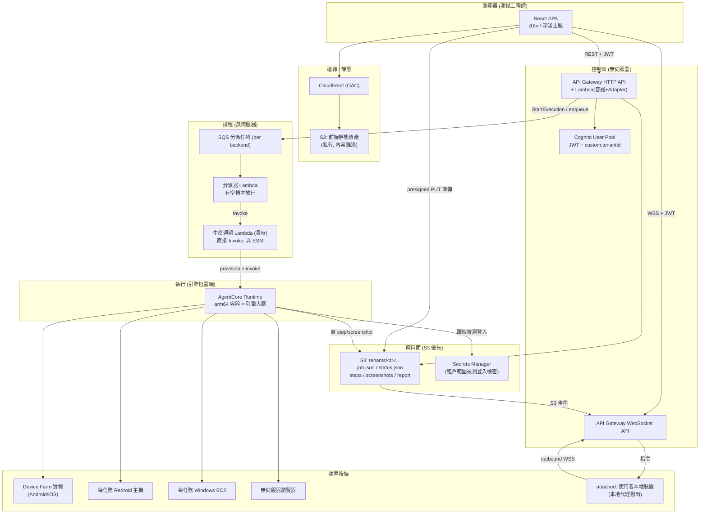
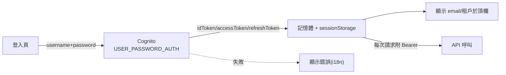
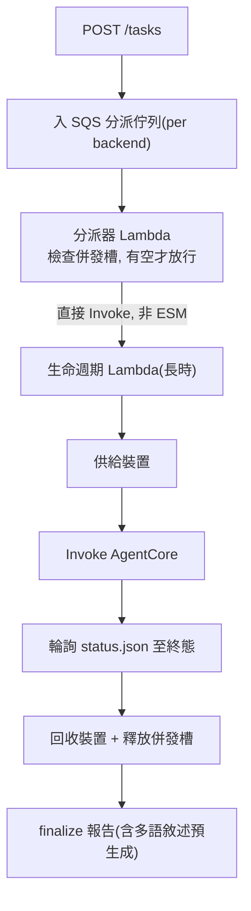
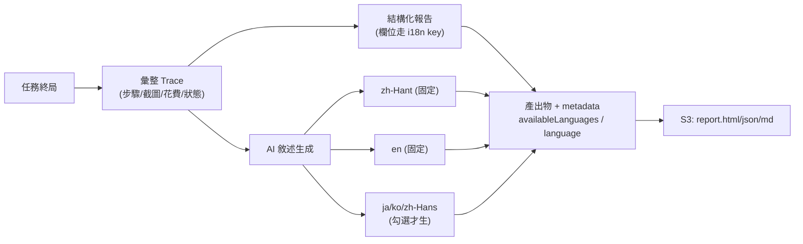

# Design — Serverless AI QA Platform

## 概觀

本平台是一個 AI 驅動的遊戲/App 自動化測試系統:使用者以自然語言描述待測流程,雲端 AI Agent 觀察被測裝置畫面、決策、驅動裝置、判斷結果並產出可切換語言的多語報告。本設計文件把 requirements 的 15 條需求落成一套可實作的架構,並貫徹兩條主軸:

1. **Serverless-first 與 CDK 最佳實踐** — 平台大腦(控制面、排程、決策呼叫、儲存、Web)全無伺服器;所有 AWS 資源以 AWS CDK(TypeScript)定義,遵循分層 construct、least-privilege、有狀態資源 RETAIN、基礎設施單元測試等實踐。
2. **前端優先、每階段可透過 web 驗證** — 交付切成縱向階段,每階段結束都有一個「瀏覽器打得開、看得到、點得動」的可驗成果,並真部署到單一 AWS 帳號的 dev 環境驗證後才推進。

### 技術選型總覽

| 層 | 選擇 | 理由 |
|---|---|---|
| 前端框架 | Vite + React + TypeScript | 快速 dev server、原生 code-splitting、對應 Req 15 效能目標 |
| 路由 | 檔案無關的 SPA 路由,路由級 lazy load | Req 15.2 首包只載當前頁 |
| 狀態/資料 | 伺服器狀態用查詢快取層(stale-while-revalidate),本地 UI 狀態用輕量 store | Req 15.4 樂觀更新與即時回饋 |
| i18n | 訊息目錄 + 語系偵測 + 缺漏檢查 | Req 10.6-10.8 |
| 前端託管 | S3(私有)+ CloudFront(OAC) | Req 1.5 無伺服器靜態託管,避免公開函式端點 |
| 控制面 API | API Gateway HTTP API + Lambda(容器映像 + Web Adapter) | Req 1.5 / 3.8 無伺服器 API |
| 認證 | Amazon Cognito User Pool(JWT authorizer) | Req 1 多租戶身分 |
| 租戶隔離 | STS AssumeRole + session tag `tenantId` + IAM 條件鍵 | Req 1.2-1.3 |
| 即時串流 | API Gateway WebSocket API + S3 事件 → Lambda → PostToConnection | Req 5.4-5.5 |
| 任務排程 | SQS(分派)+ Lambda 長時執行(直接 Invoke,非 ESM 觸發) | Req 3.8 |
| 引擎執行 | AgentCore Runtime(arm64 容器,Instances 模式) | Req 4.1 引擎恆雲端 |
| 儲存 | S3(租戶前綴,status 快照為單一真相源) | Req 2.1 / 3.6 |
| 機密 | AWS Secrets Manager(租戶範圍) | Req 14 |
| 基礎設施 | AWS CDK v2(TypeScript) | 使用者要求 CDK 最佳實踐 |

### 為何這樣繞開已知的無伺服器死路

requirements「設計約束的歷史根據」指出兩個限制,本設計的對應:

- **前端與 API 分離、上傳走 presigned PUT**:前端是 S3+CloudFront 純靜態(OAC 私有 origin,不是公開函式端點,不觸發 world-accessible 掃描);API 是獨立的 API Gateway HTTP API;大體積上傳(APK / Windows 包)由瀏覽器經 presigned S3 PUT 直傳,位元組永不經過任何運算層或邊緣函式。這同時滿足 Req 1.5、Req 2.1、Req 2.4。
- **長時執行不被 ESM 壓縮**:任務的長時協調用 Lambda 長時執行(durable),但**由分派器直接 Invoke 觸發**,不掛在 SQS 事件來源映射之後——因為由佇列事件來源映射觸發的長時執行總時長會被壓到 15 分鐘,不足一個測試任務所需(Req 3.8)。SQS 只做「有空槽才放行」的背壓,不當長時執行的觸發器。

---

## 系統架構

### 高層資料流



### CloudFront 與 API 的分工(關鍵)

- **CloudFront 只服務前端靜態資產**(來自私有 S3,OAC 授權)。它不反代 API、不處理上傳位元組。SPA 內殼由此秒開(邊緣快取)。
- **API 是獨立端點**:SPA 用 `fetch` 帶 `Authorization: Bearer <idToken>` 打 API Gateway HTTP API。
- **上傳直達 S3**:SPA 向 API 要一個租戶前綴限定的 presigned PUT URL,再由瀏覽器直接 PUT 到 S3。
- 這三條路徑彼此獨立,沒有任何一條要求上傳位元組經過 Lambda 或邊緣函式。

---

## CDK 基礎設施設計

### Stack 與 Construct 分層

單帳號部署,但 stack 依「生命週期與變更頻率」切分,而非全塞一個 stack。每個 stack 內部由可重用 **construct** 組成(L2/L3 優先,必要時才降到 L1)。

```
infra/
  bin/app.ts                      # CDK App 入口, 讀 context 決定 env
  lib/
    foundation-stack.ts           # 有狀態、極少變更: 資料 S3 桶、Cognito User Pool
    control-plane-stack.ts        # API Gateway HTTP+WS、控制面 Lambda、租戶角色
    scheduling-stack.ts           # SQS、分派器、生命週期 Lambda、併發槽
    execution-stack.ts            # AgentCore Runtime、裝置後端供給角色
    frontend-stack.ts             # 前端 S3 桶 + CloudFront(OAC) + 部署
    constructs/
      tenant-data-bucket.ts       # L3: 租戶前綴 S3 + 事件通知 + RETAIN
      cognito-tenant-pool.ts      # L3: User Pool + custom:tenantId + app client
      http-api-lambda.ts          # L3: HTTP API + 容器 Lambda + JWT authorizer
      ws-api.ts                   # L3: WebSocket API + 連線/推送 Lambda
      static-site.ts              # L3: 私有 S3 + CloudFront OAC + BucketDeployment
      per-job-host.ts             # L3: 每任務 EC2 主機供給(emulator/windows 共用)
```

**切分理由**:`foundation`(資料桶、User Pool)是有狀態且幾乎不動的,和頻繁迭代的 `control-plane` / `frontend` 分開,可獨立部署、降低誤動有狀態資源的風險。跨 stack 依賴用**直接物件參照**(同一 App 內以 props 傳遞 construct 產出的 `IBucket`/`IUserPool`),不用 context 參數手動串接。

### CDK 最佳實踐落實清單

| 實踐 | 落實方式 |
|---|---|
| L2/L3 優先於 L1 | 全程用 L2 construct;重用單元封裝成 L3 construct(見上表) |
| Least-privilege IAM | 一律用 `bucket.grantReadWrite(fn)` / `queue.grantSendMessages(fn)` 等 grant 方法,不手寫寬鬆 policy |
| 有狀態資源保護 | 資料 S3 桶、Cognito User Pool 設 `RemovalPolicy.RETAIN`;`cdk destroy` 不連帶刪任務資料 |
| 環境設定注入 | region/帳號/domain/回呼 URL 經 CDK context(`cdk.json` + `-c`)注入,不硬編碼 |
| 無 secrets 進碼 | 被測登入機密進 Secrets Manager;Cognito client id 等公開設定於建置時經環境變數注入前端 |
| 基礎設施測試 | 每個 stack 用 `aws-cdk-lib/assertions` 寫快照 + 細粒度斷言(如「資料桶必為 RETAIN 且封鎖公開存取」) |
| 可重複部署 | 資產以 CDK asset 雜湊命名;前端經 `BucketDeployment` 佈署並在部署時做 CloudFront invalidation(只失效變更檔) |
| 最小對外暴露 | 前端 S3 桶封鎖所有公開存取,只允許 CloudFront OAC;API 靠 Cognito JWT authorizer,不開匿名 |

### 租戶隔離機制(Req 1)

```mermaid
sequenceDiagram
    participant B as 瀏覽器
    participant API as HTTP API Lambda
    participant STS as STS
    participant S3 as S3 (tenants/&lt;t&gt;/)

    B->>API: 請求 + JWT(含 custom:tenantId)
    API->>API: JWT authorizer 驗簽, 取出 tenantId(不信任 body 自述)
    API->>STS: AssumeRole + SessionTag tenantId=t-001
    STS-->>API: 臨時憑證(綁 ${aws:PrincipalTag/tenantId})
    API->>S3: 以臨時憑證存取 tenants/t-001/*
    Note over S3: IAM 條件鍵把前綴釘死在 t-001<br/>即使 body 偽造 tenantId 也跨不了租戶
```

租戶身分只從 JWT claim `custom:tenantId` 推導(Req 1.3);身分推不出即拒絕,不退回預設租戶(Req 1.4)。

---

## 前端設計(優先交付)

> 介面資訊架構為本平台原生設計,從測試工程師的工作流推導。

### 資訊架構與主導覽

主導覽以**測試工程師的工作對象**組織,不以雲端資源類型組織(Req 10.1)。頂層區塊:

```
┌─ 應用程式列 ────────────────────────────────────────────┐
│ [Logo]   Apps  Cases  Tasks  Reports   Devices    [🌐語系][👤租戶/登出] │
└──────────────────────────────────────────────────────────┘
```

- **Apps(應用)** — 被測目標清單與詳情(識別、Runtime、Knowledge)。
- **Cases(測試案例)** — 案例的建立(自然語言 → AI 草擬 YAML → 審閱 → 存檔)與編輯。
- **Tasks(任務)** — 一張統一任務表,category 與 Locality 為欄位/篩選(Req 10.3);進行中任務進入 Live View + Trace 雙欄檢視。
- **Reports(報告)** — 歷史報告清單與多語報告檢視器(Req 6)。
- **Devices(裝置)** — 雲端裝置(常駐主機)與 attached 本地裝置的註冊/管理。

「登入被測目標的帳號機密」放在 App 或 Case 的設定內(Req 14),以「機密引用」呈現,不暴露值。

### 版面骨架與載入策略(Req 15)

- **App shell** 極輕:頂欄 + 內容區 + 路由出口。shell 與各頁**分包**,首屏只載 shell + 當前頁。
- **路由級 lazy load**:每個頂層區塊是一個 lazy chunk。重量級模組(YAML 編輯器、圖表、Live View 檢視器)再各自切成獨立 chunk,按需載入(Req 15.2)。
- **骨架屏 / 樂觀更新**:切頁與操作在 100ms 內給可見回饋(Req 15.4);資料查詢層用 stale-while-revalidate,回訪先顯示快取再背景刷新。
- **清單虛擬化**:Tasks / Reports 清單分頁 + 虛擬捲動(Req 15.5)。
- **串流不阻塞**:Live View 與 Trace 更新走獨立通道與批次渲染,不阻塞其他區操作(Req 15.6)。

### 佈景主題:深色 / 淺色(Req 10.9-10.11)

- **雙主題可切換**:提供深色與淺色兩套主題,頂欄放主題切換器。
- **預設跟隨系統**:初次以 `prefers-color-scheme` 決定;使用者手動選擇後存 localStorage 並優先於系統偏好(Req 10.9)。
- **語意化設計權杖**:顏色一律以 design token 定義(如 `--surface`、`--text-primary`、`--border`、`--status-pass`),主題只換 token 值,不改元件;新元件用 token 即自動適用兩主題,不出現單一主題才對的硬編碼色(Req 10.11)。
- **兩主題各自達 AA 對比**:狀態呈現以「文字 + 形狀 + 顏色」三重編碼,兩主題下都達 WCAG AA(對齊 Req 11.4);切換不重整、不跳版(Req 10.10)。
- **無閃爍**:於首次繪製前(inline script)套用已記憶的主題,避免亮/暗閃爍。

### i18n 架構(Req 10.6-10.8)

```
web/src/i18n/
  index.ts                 # 初始化: 偵測 → 選定 → 記憶(localStorage)
  locales/
    zh-Hant/*.json          # 一級, 預設
    en/*.json               # 一級
    zh-Hans/*.json ja/*.json ko/*.json   # 二級
  missingKeyCheck.ts        # 建置期腳本: 掃描缺漏 key
```

- **無硬編碼可見字串**:所有面向使用者的文字經 `t(key)`(Req 10.7)。
- **缺漏可被自動化偵測**:建置期腳本以 zh-Hant + en 為基準集,任一語系缺 key 即報錯(Req 10.7);二級語系缺漏降級為警告(對齊優先序 Req 10.8)。
- **語系偵測與回退**:預設 zh-Hant;瀏覽器語言無對應翻譯回退 en(Req 10.8)。選擇存 localStorage,按瀏覽器記憶(Req 10.6)。
- **使用者內容不翻譯**:測試案例文字以「使用者內容」標記,永不進 `t()`,逐字呈現(Req 10.10)。

### 認證流(Req 1)



- Token 存 **sessionStorage**(不用 localStorage,把泄露窗口限制在分頁生命週期)。
- 租戶顯示名由 idToken 的 `custom:tenantId` **僅供顯示**地解碼(不做本地授權判斷;真正授權在 API 端 JWT authorizer)。
- 未登入時路由守衛導向登入頁。

### 無障礙(Req 11)

- 全互動元件鍵盤可達、有可見焦點樣式;無滑鼠專屬關鍵操作(11.1)。
- 狀態徽章、圖示按鈕、截圖縮圖均有無障礙名稱/替代文字(11.2)。
- 任務進入終局、串流關鍵變化以 ARIA live region 通報,不只靠顏色(11.3)。
- 文字對比達 WCAG AA;狀態以「文字 + 形狀 + 顏色」三重編碼,不單靠顏色(11.4)。

### 多語報告檢視器(Req 6)

報告檢視器讀報告產出物的 metadata `availableLanguages`,渲染語言切換器:

- **結構化內容**(欄位、狀態、標籤、圖表說明)走前端 i18n,即時切換(6.6)。
- **AI 敘述**(缺陷摘要、流程分析、markdown 正文)讀**預生成的對應語言版本**,切換即讀取不等待(6.7)。
- 讀者選的語言未預生成 → 回退 en 並明確標示「此段為回退語言」(6.9)。
- 測試案例文字區塊逐字呈現、不翻譯(6.10)。

---

## 控制面設計

### API 形狀

以「純 `Request → Response` 函式」為核心(`api.fetch(req, deps)`)。JWT claims 由 Cognito JWT authorizer 驗證後,經 API Gateway event 帶入 handler。主要路由:

> **實作註記(與早期構想的差異)**:本專案的執行環境選用 **Node.js**,而 Node 是 AWS Lambda 的受管 runtime。因此 API 直接以 **Node zip Lambda** 承載,handler 把 API Gateway v2 event 轉成純函式核心的輸入,不需要「容器映像 + Lambda Web Adapter」那一層(Web Adapter 的存在理由是讓非受管 runtime 如 Bun 能跑,對 Node 是多餘的複雜度)。純 `Request→Response` 核心與依賴注入的設計不變,測試性一致;若日後改用 Bun,只需替換承載層,核心邏輯不動。

| 方法 路徑 | 用途 | 對應需求 |
|---|---|---|
| `POST /uploads` | 換取租戶前綴 presigned PUT URL | Req 2.1 |
| `POST /apps` `GET /apps` | App CRUD | Req 10.1 |
| `POST /cases` `GET /cases` | 案例 CRUD;含 AI 草擬端點 | Req 10.2 |
| `POST /cases/draft` | 自然語言 → AI 草擬 YAML | Req 10.2 |
| `POST /tasks` | 提交任務(校驗 artifact + 機密引用早於花費) | Req 2.2 / 14.5 |
| `GET /tasks` `GET /tasks/:id` | 任務清單/詳情(讀 S3 status 快照) | Req 3.6 |
| `POST /tasks/:id/cancel` | 取消(落 cancelled) | Req 3.3 |
| `GET /reports/:id` | 報告 metadata + 產出物 URL | Req 6 |
| `POST /devices/register` | 註冊 attached 本地裝置、發代理連線憑證 | Req 13 |
| `GET /secrets` `POST /secrets` | 租戶範圍被測登入機密引用管理(不回傳值) | Req 14 |

- **提交前校驗**:任務建立時校驗 artifact 已上傳且大小/類型合法(Req 2.2)、引用的機密存在且屬本租戶(Req 14.4-14.5)、案例無字面量密鑰(Req 2.3)——全部在任何模型花費之前。
- **body 自述 tenantId 一律忽略**(Req 1.3)。

### 任務狀態:單一真相源與終態吸收(Req 3)

- 客戶端可見真相源 = S3 上的 `status.json`(Req 3.6);清單/詳情/跟隨只讀它。
- 六個終局狀態互斥,不混同(Req 3.2)。取消落 `cancelled` 不落 `error`(Req 3.3);引擎已自然跑出結果則保留不覆蓋(Req 3.4);心跳逾時由排程層回寫 `dead`(Req 3.5)。
- 多寫入者遵守**終態吸收**:一旦終態永不被非終態覆蓋,`cancelled` 優先於其他終態(Req 3.7)。以 S3 條件寫(If-Match)+ 優先級實作。

---

## 即時串流設計(Req 5)

```mermaid
sequenceDiagram
    participant SPA
    participant WS as WebSocket API
    participant S3
    participant PUSH as 推送 Lambda
    participant AC as 引擎容器

    SPA->>WS: connect ?token=idToken (JWT 驗)
    SPA->>WS: subscribe {taskId}
    WS->>S3: 記錄訂閱 (runs/&lt;id&gt;/connections/)
    AC->>S3: 寫 steps/&lt;n&gt;.json + screenshots/&lt;n&gt;.png
    S3-->>PUSH: S3 事件通知
    PUSH->>WS: PostToConnection(步驟)
    WS-->>SPA: {type:step,...}
    Note over SPA: 連線中斷(2h/10min) → 重連 + 自 steps/ 前綴補回遺漏
```

- **引擎保持無憑證**:引擎只寫 S3,不直接對 WebSocket 端點通訊;推送由 S3 事件 → Lambda → PostToConnection 完成(Req 5.5)。
- **Live View 與 Trace 兩條獨立通道並列**:Trace 步驟走上述串流;Live View(裝置畫面)走各後端自己的畫面通道,兩者不互相多工(Req 5.1-5.2)。
- **無畫面後端**:裝置租約無 view URL 時只呈現 Trace,不顯示壞掉的 Live View 面板(Req 5.3)。
- **重連補讀**:WebSocket 2h/10min 限制下,前端自動重連並自 S3 `steps/` 前綴補回遺漏步驟(Req 5.4)。

---

## 排程與執行設計

### 兩層排程(Req 3.8, 4.4)



- **分派器直接 Invoke 生命週期 Lambda**,不讓生命週期掛在 SQS 事件來源映射後(否則長時執行被壓到 15 分鐘,不足一任務所需)(Req 3.8)。
- **併發按後端分桶**,各後端獨立上限;attached 不佔雲端併發槽(Req 4.7)。
- **回收保證**:任務任一終局都回收主機與併發槽;釋放併發槽以「容器已確認終結」為前提,避免容器還在跑就釋放、新任務搶到同一裝置(Req 4.4)。

### 統一裝置抽象(Req 4.1)

引擎恆在雲端,透過單一 `DeviceProvider` 介面接入所有後端,不為每種裝置分叉引擎:

```typescript
interface DeviceProvider {
  acquire(spec): Promise<Lease>;   // 取得租約 + 可達端點
  endpoint(lease): Endpoint;       // 引擎控制目標(ADB/Appium/CDP/attached 通道)
  viewUrl(lease): string | null;   // Live View URL, 無畫面則 null
  release(lease): Promise<void>;
}
```

實作:`DeviceFarmProvider`(Android/iOS 實機)、`EmulatorProvider`(每任務 Redroid 主機)、`WindowsProvider`(每任務 EC2 + Appium)、`WebProvider`(無伺服器瀏覽器)、`AttachedProvider`(見下)。

> **實作註記(引擎承載層,階段 5 的務實選擇)**:設計上引擎的長時承載目標是 AgentCore Runtime(arm64 容器,支援長工作)。但為了讓任務生命週期能**盡早端到端跑通並可 web 驗證**,階段 5 先以 **Lambda 承載引擎迴圈** 落地 `WebProvider`。**兩層排程、status.json 單一真相源、終態吸收、`DeviceProvider` 抽象、報告產出物契約全部不變**——AgentCore 只是引擎的另一個承載層,日後替換,核心契約零改動。
>
> **關於無伺服器瀏覽器的分階段落地**:完整的 `WebProvider` 需要真實無頭 Chromium(`@sparticuz/chromium` + Playwright)。Chromium 體積超過 Lambda zip 250MB 上限,標準解法是**容器映像 Lambda**;但那需要可用的 Docker daemon 來建置映像。在目前的建置環境中 Docker daemon 不可用(CLI 在但 daemon 連不上),因此**階段 5 的 Web 引擎先以純 Node 的 HTTP 擷取**(fetch 目標網址、記錄回應為一個 step)落地,以完整驗證「提交→分派→引擎→step/status→報告」全鏈路。**真實 Chromium 渲染與 VLM 逐步點擊迴圈**留待 Docker/Chromium layer 可用時,以同一 `runWebTask` 介面替換內部實作——引擎進入點、排程、狀態契約皆不變。此為明知的暫代,已在 tasks 標註。

### attached 本地裝置(Req 13)

```mermaid
sequenceDiagram
    participant LA as 本地代理(使用者機器)
    participant WS as WebSocket API
    participant AC as 引擎容器(雲端)
    participant S3

    LA->>WS: outbound connect + JWT(租戶身分驗證)
    Note over LA,WS: 本地代理主動撥出, 不需本地開入站埠
    AC->>WS: 指令: 擷取畫面
    WS->>LA: 擷取畫面
    LA->>S3: 上送截圖(租戶前綴)
    AC->>AC: VLM 依上一動影像判斷下一步座標
    AC->>WS: 指令: 於(x,y)點擊
    WS->>LA: 點擊(x,y)
    LA->>LA: 於本地裝置執行
    LA->>S3: 上送新截圖
    Note over AC: 迴圈直至終局; 決策恆在雲端
```

- 連線**由本地代理主動撥出**(WebSocket),不要求本地開入站埠、相容 NAT(Req 13.2)。
- 決策(Agent/VLM)恆在雲端,本地代理只擷取畫面、執行動作、轉發(Req 13.4)。
- 延遲不敏感,定位慢節奏/逐步分析(Req 13.5)。
- 代理連線以登入使用者租戶身分驗證,產物落該租戶前綴(Req 13.8)。
- 代理斷線/裝置失聯 → 落 `error`;使用者主動停 → `cancelled`;不無限等待(Req 13.6)。
- attached 任務與雲端任務共用同一 Trace 與報告呈現(Req 13.7)。

### 被測身分注入(Req 14)

- 案例引用一份**租戶範圍的機密**(Secrets Manager),不寫字面量(Req 14.1)。
- 裝置 session 內以引用機密完成登入注入,憑證僅在 session 存活期可用,結束不留於裝置(Req 14.2)。
- 平台身分(Cognito 租戶)與被測身分(遊戲/網頁帳號)概念與儲存分離(Req 14.3)。
- 只能引用本租戶機密;機密不存在/無權 → 花費前失敗並明確回報,不以空憑證盲試(Req 14.4-14.5)。

---

## 成本與模型設計

### Budget 與 Fail Closed(Req 7)

- Budget 為單一案例/單次探索的美元閾值,達到即停;閘口在引擎主迴圈每次迭代頂部判定,接受略微超出(約一次迭代開銷),報告同時給閾值與實際兩個數(Req 7.1-7.2)。
- **Fail Closed**:查不到某 modelId 單價 → 拒絕執行或按保守上限計費,絕不當 $0(否則 Budget 靜默失效)(Req 7.3)。
- Billable Spend 只計 token 計價、可歸因單次執行、隨步數單調增長的模型呼叫;不含按小時計費的常駐端點(Req 7.4)。
- 執行配置快照記各 Seat「生效後」模型(覆蓋鏈 CLI > 案例 YAML > 設定檔 > 內建預設解析後),報告與 Budget 按實跑模型計價(Req 7.5)。

### Seat / Channel / Catalog(Req 8)

- 三個 Seat(Agent/VLM/Sub-Agent)各自獨立選型,介面以職責呈現(Req 8.1)。
- Channel 由 modelId 推導,使用者不選 Channel(Req 8.2)。
- Model Catalog 為唯一權威:下拉、客戶端建構、區域校驗共用;下拉可選模型必在單價表查得到價(Req 8.3)。
- Catalog 記每個模型座標系(千分制 vs 像素),以實測值寫入,避免座標判錯致點擊全錯卻不報錯(Req 8.4)。

### Memory 與 Knowledge(Req 9)

- Memory 按 `(App, Locality)` 隔離、互不合併(Req 9.1)。
- Knowledge 按 App 單一實例,權威源恆為使用者可編輯檔案(Req 9.2)。
- 衝突時 Knowledge 優先於 Memory(Req 9.3)。
- 清空 Memory / 刪 App 不連帶刪 Knowledge(Req 9.4)。

---

## 報告產生與多語預生成(Req 6)



- 報告是**讀者可切換語言**的多語產出物,語言由讀者選,不綁操作者(Req 6.5)。
- AI 敘述在**產生報告時預生成多語版本**並隨產出物儲存;讀者切換直接讀取,不即時翻譯(Req 6.7)。
- 固定生 zh-Hant + en;ja/ko/zh-Hans 勾選才生(Req 6.8)。
- 產出物 metadata 記 `availableLanguages`,回看時列出可切換語言、不需重呼叫模型(Req 6.11)。

---

## 分階段交付與 web 驗證

**核心原則**:每階段結束都有一個瀏覽器可驗的成果,真部署到單帳號 dev 環境驗證後才推進。以下各階段的「web 驗證」即該階段的驗收關卡。

### 階段 0 — 骨架:能部署、瀏覽器看到空殼

- **內容**:CDK App 骨架 + `frontend-stack`(S3+CloudFront OAC)+ 最小 SPA 殼(頂欄 + 空內容 + i18n 初始化 + 語系切換器)。
- **web 驗證**:`cdk deploy` 後開 CloudFront URL,看到 app shell,能切換 zh-Hant/en 且頁面文字跟著變;無主控台錯誤。量測 FCP < 1.5s(Req 15.1)。
- **CDK 驗證**:assertions 測前端桶封鎖公開存取、僅 OAC 可讀。

### 階段 1 — 登入(Cognito)

- **內容**:`foundation-stack` 的 Cognito User Pool(含 `custom:tenantId`)+ 前端登入頁 + token 存取 + 路由守衛 + 頂欄顯示租戶/登出。
- **web 驗證**:在 web 用測試使用者登入 → 進入受保護區、頂欄顯示 email/租戶;登出 → 退回登入頁;錯誤密碼顯示 i18n 錯誤訊息。
- **CDK 驗證**:User Pool 設 RETAIN、`custom:tenantId` 屬性存在、app client 啟用所需 auth flow。

### 階段 2 — 主導覽 + 空清單(接通 API + 租戶隔離)

- **內容**:`control-plane-stack` 的 HTTP API + JWT authorizer + STS 租戶角色 + `GET /apps`/`GET /tasks`(先回空清單)+ 前端主導覽與各頁骨架。
- **web 驗證**:登入後在 web 看到 Apps/Cases/Tasks/Reports/Devices 導覽,各頁顯示「尚無資料」空狀態;切頁在 100ms 內有骨架回饋(Req 15.4);用兩個不同租戶帳號登入,彼此看不到對方資料(Req 1.2)。
- **CDK 驗證**:authorizer 綁 User Pool;Lambda 角色以 grant 取得最小 S3 權限;body 偽造 tenantId 的請求測試跨不了租戶。

### 階段 3 — 建 App + 產物上傳(presigned PUT)

- **內容**:`POST /apps`、`POST /uploads`(presigned PUT)、前端 App 建立表單 + 檔案上傳元件(直傳 S3)。
- **web 驗證**:在 web 建一個 App、上傳一個 APK/檔案,看到上傳進度與成功;重整後 App 仍在清單(資料落 S3 租戶前綴)。驗證大檔(數十 MB)上傳成功且位元組不經 Lambda(Req 2.1/2.4)。
- **CDK 驗證**:presigned URL 僅限租戶前綴 key;資料桶 RETAIN。

### 階段 4 — 建測試案例(自然語言 → AI 草擬 YAML)

- **內容**:`POST /cases/draft`(AI 草擬)、`POST /cases`(存檔)、前端案例編輯器(自然語言輸入 + YAML 審閱/手寫雙模式,YAML 編輯器為 lazy chunk)。
- **web 驗證**:在 web 用自然語言描述一個流程 → 看到 AI 草擬的 YAML → 修改 → 存檔;切原始 YAML 手寫也可存。YAML 編輯器按需載入不計入首包(Req 15.2)。

### 階段 5 — 提交任務 + 統一任務表 + 狀態

- **內容**:`scheduling-stack`(SQS + 分派器 + 生命週期 Lambda)、`execution-stack`(AgentCore Runtime)、`POST /tasks`、`GET /tasks`、`POST /tasks/:id/cancel`;前端統一任務表(category/Locality 欄位與篩選、六終局狀態單一選項)。先接一個最簡單後端(如無伺服器瀏覽器)跑通端到端。
- **web 驗證**:在 web 提交一個 Web 目標任務 → 任務表看到它從進行中走到 pass/fail;取消一個任務落 `cancelled` 不落 `error`(Req 3.3);狀態篩選每個終局狀態只有一個選項(Req 10.4)。
- **CDK 驗證**:生命週期 Lambda 由分派器直接 Invoke(非 SQS ESM);併發槽存在。

### 階段 6 — Live View + Trace 即時串流

- **內容**:WebSocket API + S3 事件推送 Lambda + 前端雙欄檢視(Live View 左、Trace 右)+ 重連補讀。
- **web 驗證**:在 web 開一個進行中任務 → 同時看到裝置畫面與逐步 Trace;手動中斷網路再恢復 → 前端重連並補回遺漏步驟(Req 5.4);無畫面後端只顯示 Trace 不顯示壞面板(Req 5.3)。

### 階段 7 — 報告 + 多語切換

- **內容**:報告產生器(結構化 + AI 敘述多語預生成)、`GET /reports/:id`、前端多語報告檢視器。
- **web 驗證**:任務結束後在 web 開報告 → 看到步驟/截圖/花費(閾值 + 實際兩個數,Req 6.4)→ 切換報告語言(zh-Hant/en),AI 敘述即時切換無等待(Req 6.7);未預生成語言回退 en 並標示(Req 6.9)。

### 階段 8 — 其餘裝置後端(Device Farm / 模擬器 / Windows / attached)

- **內容**:逐一補齊 `DeviceFarmProvider`、`EmulatorProvider`(每任務 Redroid)、`WindowsProvider`(每任務 EC2)、`AttachedProvider`(本地代理);被測身分注入(Secrets Manager)。
- **web 驗證**:每補一個後端,在 web 提交對應後端任務跑通並回收(Req 4.4);attached:在本地跑代理註冊裝置 → web 提交 attached 任務 → 看到本地畫面往返分析(Req 13);引用被測登入機密完成登入(Req 14)。
- **CDK 驗證**:每任務主機終局回收、常駐機不被誤銷(Req 4.5-4.6)。

### 階段 9 — 分診輔助(flaky / 趨勢)+ 收尾

- **內容**:案例通過趨勢、flaky 標記、fail/error 成因引導;無障礙全面複查;效能複查。
- **web 驗證**:在 web 看到案例最近 N 次趨勢與 flaky 標記(Req 12);鍵盤全程可操作、螢幕報讀器通報狀態變化(Req 11);清單分頁/虛擬捲動、INP < 200ms(Req 15)。

---

## 錯誤處理策略

- **提交前失敗優先**:artifact 缺失、機密缺失/無權、案例含字面量密鑰 → 在任何模型花費前拒絕並明確回報(Req 2.2/2.3/14.5)。
- **終局狀態不含糊**:六種終局狀態嚴格分離,錯誤成因引導使用者查對的方向(Req 3.2/12.3)。
- **裝置失聯不無限等**:attached 斷線或雲端裝置失聯 → 明確落終局(Req 13.6)。
- **回收保證**:任一終局都回收主機與併發槽,fail-safe 傾向漏銷寧可誤銷(Req 4.4)。
- **前端韌性**:串流中斷自動重連補讀(Req 5.4);API 錯誤以 i18n 訊息呈現,不裸露堆疊。

## 測試策略

- **CDK 基礎設施測試**:每 stack 用 `aws-cdk-lib/assertions` 驗關鍵不變式(RETAIN、封鎖公開、authorizer 綁定、grant 最小權限、生命週期 Lambda 非 ESM 觸發)。
- **前端單元/元件測試**:i18n 缺漏檢查、路由守衛、報告檢視器語言切換、清單虛擬化。
- **控制面單元測試**:`api.fetch` 路由邏輯以依賴注入 + fake 測(JWT claims 解析、body tenantId 忽略、提交前校驗、presigned key 限租戶前綴)。
- **端到端(每階段)**:每階段的「web 驗證」即該階段的 e2e 驗收,真部署 dev 環境操作瀏覽器確認。
- **效能驗證**:階段 0 起持續量測 FCP/TTI/INP 對照 Req 15 門檻。
