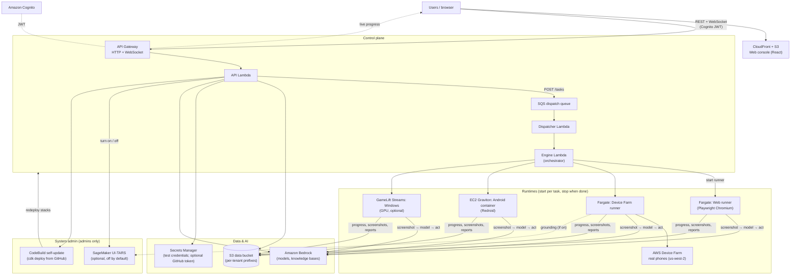

# PlayAgent Checker

**AI-driven automated QA for games and apps.** Describe a test flow in plain language; an AI agent watches the screen, taps and swipes for you, judges pass/fail, and produces a multilingual report with screenshots, a step-by-step trace, and a navigation map.

> Languages: **English** · [繁體中文](README_ZH.md) · [简体中文](README_CN.md) · [日本語](README_JP.md) · [한국어](README_KR.md)

---

## What it is

PlayAgent Checker is AI-driven automated QA for games and apps that runs entirely in your own AWS account.

- Write test cases in plain language; an AI agent runs them by watching the screen and acting like a real user (tap, swipe, type).
- Works on canvas-rendered games (Unity, Cocos2d-x) that expose no inspectable UI tree.
- Serverless and pay-per-use in your AWS account: resources start per task and stop when it ends, so idle cost is almost nothing.
- Multilingual reports with screenshots, a step-by-step trace, a navigation map, and the spend per run.
- Runtimes for web, Android/iOS real devices, an Android container, and Windows PC games.

## Quick start

The fastest path needs only a web browser; nothing is installed on your computer.

**Before you start:** sign in to the AWS Console as an admin, enable the Bedrock models first in the target region (see [Turn on the AI models](#step-3--turn-on-the-ai-models-amazon-bedrock) — every run fails without them), then open **CloudShell** with the `>_` icon in the Console top bar.

Paste one command:

```bash
curl -fsSL https://raw.githubusercontent.com/hoycdanny/playagent-checker/main/scripts/cloudshell-install.sh | bash
```

- It opens with a **language menu** (default English, no flag needed; `--lang en|zh-Hant|zh-Hans|ja|ko` still works), shows **step-by-step progress** instead of raw logs, and prints the error log if something fails.
- The default region is `us-west-2`. Use `--region <region>` for another; the chosen region must have the Bedrock models enabled, and the default models use `us.` cross-region inference profiles, so non-US regions may need different model IDs. Device Farm real devices always run in `us-west-2`.
- The admin account is created by a **Cognito email invite**: the temporary password is shown on screen at the end and also emailed to you. At first sign-in the web page asks you to set a new password.
- **Run the same command again to update to the latest version.**

What `scripts/cloudshell-install.sh` does:

- Bootstraps CDK if this account/region was never bootstrapped. This is the only step that needs admin rights.
- Creates the IAM role `playagent-installer`, trusted only by CodeBuild, with the least-privilege policy [`infra/iam/playagent-deployer-policy.json`](infra/iam/playagent-deployer-policy.json). The build gets no AdministratorAccess.
- Creates the CodeBuild project `playagent-installer`, which clones the public GitHub repo and runs the same deploy core (`scripts/deploy-latest.mjs`). No EC2 instance is needed.
- Streams progress and prints the site URL when done.

The policy only lets the build assume this account's CDK bootstrap roles, read the PlayAgent stacks, push the runner images, create the Cognito admin, and write `/playagent/*` SSM parameters. CloudFormation changes run through CDK's `cdk-hnb659fds-cfn-exec-role`, which by default has admin rights, so anyone who can deploy can still create resources through CloudFormation.

## Quick delete

To remove PlayAgent, run one command in CloudShell:

```bash
curl -fsSL https://raw.githubusercontent.com/hoycdanny/playagent-checker/main/scripts/cloudshell-uninstall.sh | bash
```

- It shows the same **language menu**, scans the environment, and lists what will be deleted versus kept. Nothing is deleted until you confirm: you must **type the 12-digit account id** to proceed. `--yes` skips the prompt (not recommended by hand); `--region` defaults to `us-west-2`.
- It removes PlayAgent's own resources: the six `PlayAgentDev-*` stacks, the retained data bucket / Cognito user pool / runner ECR repos, the installer CodeBuild project and IAM role, and PlayAgent SSM parameters and log groups.
- It keeps the CDK bootstrap (`CDKToolkit`) and the shared `cdk-hnb659fds-*` assets (other apps may share them), so a later reinstall skips bootstrap.

Full teardown by hand (and troubleshooting) is in [Cleanup and troubleshooting](#cleanup-and-troubleshooting).

## Technical details

### Runtimes

| Runtime | What runs it | Available after install | Limits |
| --- | --- | --- | --- |
| **Web browser** | Headless Chromium (Playwright) on ECS Fargate | ✅ | — |
| **Android real device** (Device Farm) | AWS Device Farm + Appium, controller on Fargate | ✅ | 150 min per session (AWS limit); the "long" option reconnects every 140 min and the game restarts |
| **iOS real device** (Device Farm) | AWS Device Farm + Appium | ✅ | Needs an installable `.ipa`; 150 min per session |
| **Android container** (Redroid) | One Graviton EC2 per task (`m7g.xlarge`) running Redroid | ✅ | Games with anti-emulator checks close themselves (use a real device); no video/audio checks; no pinch; 1–72 h per run |
| **Windows PC game** | Amazon GameLift Streams (NVIDIA GPU, `gen6n_medium_win2022`) | ⚙️ one-time setup (see [Optional: Windows](#optional-windows-pc-games-gamelift-streams)) | ≤ 60 min per run; ≤ 1920×1080 total pixels |
| iOS simulator / Linux | — | ❌ not built | — |

Which one to pick for which game: [docs/design/multi-platform-workers.md](docs/design/multi-platform-workers.md).

### What you get by default

After following the install below, this is what is on, what is off, and what needs one extra step.

| Feature | Default | Notes |
| --- | --- | --- |
| Web console, login (Cognito), 5 languages | ✅ On | Sign-up is disabled; admins create users. |
| Apps / test cases / tasks / reports / memory map | ✅ On | AI drafts test cases from plain language (Claude Sonnet 4.5). |
| Runtimes: Web, Device Farm Android/iOS, Android container | ✅ On | Each run starts its own resources and stops them at the end. |
| Default models | ✅ On | Decision **Amazon Nova Lite**, screen analysis **Moonshot Kimi K3**, helper **Amazon Nova Micro**. You can change any seat per task. |
| Knowledge bases (Markdown + PDF retrieval) | ✅ On | PDF retrieval uses Bedrock Knowledge Bases + S3 Vectors + Titan Embeddings V2. |
| Test credentials (Secrets Manager) | ✅ On | Per app; masked values never reach the model. |
| Cost guardrails (budget + fail-closed pricing) | ✅ On | — |
| Cost Analysis page — task estimates | ✅ On | Token × price per task. |
| Cost Analysis page — real AWS bill | ⚙️ Needs account setup | Enable Cost Explorer + activate tags ([below](#enable-the-cost-analysis-page)). |
| Members page (admins) | ✅ On | Add users, reset passwords, move tenants, grant admin. |
| System admin page → **System update** | ✅ On | One-click update from GitHub. No token needed (the repo is public); a token is optional only to raise GitHub's rate limit ([below](#optional-one-click-system-update)). |
| System admin page → **Centralized logs** | ✅ On | Search CloudWatch logs across all services from one place to debug failures ([below](#centralized-logs)). |
| System admin page → **UI-TARS** | ⛔ **Off** | A GPU grounding model. Admins turn it on/off on the page; it is billed only while on ([below](#optional-ui-tars-grounding-model)). |
| Windows runtime | ⚙️ Optional | One-time GameLift Streams setup from a Windows machine. |

### Architecture



CDK stacks (all in `us-west-2`):

| Stack | Contents |
| --- | --- |
| **Foundation** | S3 data bucket, Cognito user pool, tenant IAM role, Bedrock KB service role. |
| **ControlPlane** | HTTP API + JWT authorizer, API Lambda, WebSocket API. |
| **Scheduling** | SQS dispatch queue + Dispatcher Lambda. |
| **Execution** | Engine Lambda, ECS cluster + Fargate task definitions, ECR repos, VPC (no NAT gateway), per-task EC2 launch settings. |
| **Frontend** | CloudFront + S3 static site. |
| **Updater** | CodeBuild project that redeploys the five stacks above from a GitHub version; deployed automatically by the installer. |

Details: [docs/architecture.md](docs/architecture.md).

### What it costs

Measured on this project's own account (October 2026). AWS prices change, so treat these as estimates.

**When nothing is running (idle):** roughly **US$2–5 / month**. There is no NAT gateway, no always-on server, and no reserved stream capacity. What remains:

- S3 storage (screenshots, reports, uploaded apps; plus ~31 GB of UI-TARS weights if you stage them, about US$0.7/month)
- ECR images (runner images, plus the ~10 GB UI-TARS serving image if built)
- Secrets Manager (US$0.40 per secret per month), CloudWatch Logs, CloudFront
- Lambda, API Gateway, SQS, and Cognito are pay-per-request and stay within pennies at low use

**Per test run (only while it runs):**

| Item | Price | Example |
| --- | --- | --- |
| AI models (Bedrock tokens) | Per token, locked at submit; shown in each report | A 26-step, 10-spin slot test on the default models used ~141k input / 14k output tokens, **under US$0.80** |
| Device Farm real device | **US$0.17 per device minute** | 30 min ≈ US$5.10 |
| Android container (EC2 `m7g.xlarge`) | **US$0.1632 / hour** + disk | 1 h ≈ US$0.17 |
| Fargate runner (1 vCPU / 2 GB) | ~US$0.05 / hour | Web runs and the Device Farm controller |
| Windows (GameLift Streams) | Per second while a session runs | See [GameLift Streams pricing](https://aws.amazon.com/gamelift/streams/pricing/) |
| Self-update | CodeBuild minutes | ~5–15 min per update, a few cents |
| Cost Explorer query (Cost Analysis page) | ~US$0.01 per query | — |

**The one large optional cost: UI-TARS.** `ml.g6e.xlarge` GPU, measured at **US$62.53 / day (~US$2.6 / hour)**, billed the whole time it is on, even with no tasks. It is **off by default**; keep it off unless you need it.

In practice, most of the spend on our account was Bedrock tokens and Device Farm minutes. Neither costs anything when you are not testing.

### Features (what each page does)

| Page | What it's for |
| --- | --- |
| **Guide** | In-app walkthrough (your landing page after login), in 5 languages. |
| **Apps** | One workspace per game/app: name, platform, genre, the artifact (APK/IPA/XAPK/ZIP/EXE) or a URL. Inside: test cases, tasks, reports, memory map, test credentials. |
| **Test cases** (in the app workspace) | One flow for the AI. Draft it in plain language (AI → YAML), hand-write YAML, or import from a spreadsheet. Literal passwords are rejected — use test credentials. |
| **Test tasks** (in the app workspace) | Run a case. Pick the **runtime**, the three **models**, step/budget limits, and **knowledge bases**. Watch the live screen, device logs (real device and Android container), and the agents' reasoning; give the AI instructions mid-run; cancel anytime. |
| **Test reports** | AI narrative, step trace, screenshots, recording playback (real devices), navigation graph, spend and tokens. |
| **Memory map** | Screens visited across all runs become nodes, transitions become edges; later runs navigate faster. |
| **Devices** | Device Farm phones available now, plus the containers, EC2 hosts, and GameLift capacity currently running. |
| **Knowledge** | Shared knowledge bases (game genre / scenario): Markdown injected in full and/or PDF retrieval. |
| **Cost Analysis** | Task estimates by app and model, and the real AWS bill by service / component (once enabled). |
| **Members** (admins) | Add users, reset passwords, disable/enable, move tenants, grant or remove admin. |
| **System admin** (admins) | **System update** from GitHub (one-click, no token needed; version compare, progress, history), the **UI-TARS** on/off switch, and **Centralized logs** (search CloudWatch logs across all services). |

### The AI: three model "seats"

Models are organized by **role (seat)**, not by vendor. Each seat is chosen per task:

- **Agent (decision)** — decides the next action from the screen and goal. Default **Amazon Nova Lite**.
- **VLM (screen analysis / coordinates)** — turns "the thing to tap" into pixels. Default **Moonshot Kimi K3**. UI-TARS-1.5-7B appears here only while an admin has it turned on.
- **Subagent (helper)** — checks whether an action worked, tracks numbers, verifies completion. Default **Amazon Nova Micro**.

You never pick an SDK or endpoint; the system derives it from the model id.

### Cost guardrails

Every task can have a step limit and a budget. Before running, the engine **locks a price snapshot** for each seat's model (fail-closed: if a price is unknown, the run is refused). Execution stops once spend reaches the budget, and the report shows actual spend and tokens.

### System admin

The **System admin** page (admins only) has three tools.

**One-click self-update.** The Updater stack is deployed automatically by the installer, so this is ready right after install. Open **System admin → System update**, pick a version, and confirm; it runs tests first, then `cdk deploy` in CodeBuild. No GitHub token is required: the repository is public and the update clones it directly. A token is optional and only raises the GitHub API rate limit; if you set one in **System admin**, it is stored in Secrets Manager (`playagent/github`) and never shown again. Using a fork? Deploy with `-c githubRepo=owner/name`. The button redeploys IAM and resources with high privileges, so only admins see it and every run is recorded. Design notes: [docs/design/self-update.md](docs/design/self-update.md).

**Centralized logs.** A cross-service log viewer for debugging. It searches CloudWatch Logs across every service at once (control-plane API, engine, dispatcher, WebSocket, both Fargate runners, self-update and image-build CodeBuild) using CloudWatch Logs Insights, with a service filter, time range (last 15 min / 1 h / 3 h / 24 h), and a keyword. Results are newest-first and downloadable. Admin only. Design notes: [docs/design/centralized-logs.md](docs/design/centralized-logs.md).

**UI-TARS on/off.** Admins turn the optional GPU grounding model on or off here; it is billed only while on. Setup and details are in [Manual installation](#manual-installation) under Optional: UI-TARS grounding model.

### Glossary

- **Seat** — a model role (Agent / VLM / Subagent), not a vendor.
- **VLM** — Vision-Language Model; reads the screenshot and locates coordinates.
- **UI-TARS** — a ByteDance vision model fine-tuned for GUI grounding, served on SageMaker via vLLM. Optional, off by default.
- **Redroid** — Android running in a container on an ARM EC2 host (the "Android container" runtime).
- **Locality** — where the device is: `cloud` (provided) or `attached` (your local device, still driven by the cloud).
- **Terminal state** — `pass` / `fail` / `error` / `cancelled` / `budget_exceeded` / `dead`.
- **Fail-closed** — refuse to run rather than spend at an unknown price.

---

## Manual installation

Prefer to deploy from your own machine, or need one of the one-time optional setups? Use the paths below. The CloudShell one-liner in [Quick start](#quick-start) is the easiest route; this section covers everything else.

### Recommended on Windows and macOS: one-click installer

After installing **Node.js 22**, **AWS CLI v2**, **Git**, and **Docker Desktop**, configure your AWS credentials and enable the Bedrock models in Step 3. Then clone the repository and launch:

```text
Windows: double-click Install-Latest.cmd
macOS:   double-click Install-Latest.command
Linux:   run scripts/deploy-latest.sh
```

These three launchers use the same deployment core and default to **`us-west-2` (Oregon)** (change it with `--region`).

Optional account safety check on any OS:

```bash
npm run deploy:latest -- --expected-account-id 123456789012
```

The legacy Windows PowerShell entry `scripts/deploy-latest.ps1` remains as a compatibility wrapper; Windows, macOS, and Linux all execute the same Node.js deployment core.

The installer deploys **this folder as-is**; it never fetches a newer version, so run `git pull` first if you want the latest `main`. The version tag is the Git commit SHA (or `local-<UTC time>` for an extracted ZIP without `.git`); uncommitted changes are included with a warning and a `<sha12>-dirty-<UTC time>` tag. It installs from `package-lock.json`, runs tests, bootstraps CDK, deploys the stacks and the Updater, builds the runner images locally, pushes both `:<version>` and `:latest`, pins ECS task definitions to the version tag, builds the frontend from live stack outputs, and verifies CloudFormation, ECR digests, ECS image references, and CloudFront. Local files are never reset, stashed, or cleaned.

For the first admin account, the interactive installer asks only for the administrator **Email (username)** and a password entered with hidden input. The tenant defaults to `default`; only advanced setups need `--admin-tenant <tenant>`.

For non-interactive automation, never put the password in command-line arguments. Pipe it from your secret manager to stdin:

```bash
# bash / zsh (macOS or Linux)
aws secretsmanager get-secret-value --region us-west-2 --secret-id playagent/admin-password --query SecretString --output text | npm run deploy:latest -- --non-interactive --admin-email admin@example.com --admin-password-stdin
```

```powershell
# PowerShell
(aws secretsmanager get-secret-value --region us-west-2 --secret-id playagent/admin-password --query SecretString --output text) | npm run deploy:latest -- --non-interactive --admin-email admin@example.com --admin-password-stdin
```

```bat
rem Command Prompt (cmd.exe)
aws secretsmanager get-secret-value --region us-west-2 --secret-id playagent/admin-password --query SecretString --output text | npm run deploy:latest -- --non-interactive --admin-email admin@example.com --admin-password-stdin
```

These examples contain no literal password. Add `--admin-tenant <tenant>` only when overriding the default tenant.

> The one-click path requires Docker Desktop because it builds the exact checked-out source locally. The manual CodeBuild path below still does not require Docker.
>
> **About reinstalling after `cdk destroy`:** the data bucket, Cognito User Pool, and runner ECR repositories have `Retain` protection. The installer detects orphaned retained ECR repositories and safely reuses them, so fixed repository names do not block reinstall. It intentionally does not delete or silently adopt an old data bucket/User Pool; a true empty reset requires explicitly deleting those retained resources after backing up anything needed.

### Manual installation (step by step)

This section assumes **no prior AWS experience**. Follow it top to bottom. Total time: about **60–90 minutes**, most of it waiting for AWS.

> Everything deploys to **`us-west-2` (Oregon)**. Use that region everywhere unless you know what you are changing.
>
> Commands are written for **bash** (macOS, Linux, Git Bash, WSL). On Windows PowerShell, set variables with `$env:NAME="value"` instead of `NAME=value command`.

#### Step 0 — Install the tools on your computer

| Tool | Why | Install |
| --- | --- | --- |
| **Node.js 22+** | Runs the build and deploy scripts | https://nodejs.org (the "LTS" installer) |
| **AWS CLI v2** | Talks to your AWS account | https://docs.aws.amazon.com/cli/latest/userguide/getting-started-install.html |
| **Git** | Gets this code | https://git-scm.com/downloads |

```bash
node --version    # v22.x or higher
aws --version     # aws-cli/2.x
git --version
```

You do **not** need Docker; container images are built in the cloud (AWS CodeBuild).

#### Step 1 — Get the code

```bash
git clone https://github.com/hoycdanny/playagent-checker.git
cd playagent-checker
npm install
```

#### Step 2 — Connect the AWS CLI to the account

Ask the account owner for an **Access Key ID** and **Secret Access Key** (AWS Console → IAM → Users → Security credentials → Create access key). Then:

```bash
aws configure
# AWS Access Key ID     : <paste>
# AWS Secret Access Key : <paste>
# Default region name   : us-west-2
# Default output format : json

aws sts get-caller-identity   # should print your account number
```

> The credentials must be able to create Lambda, S3, Cognito, API Gateway, IAM, ECS, EC2, ECR, CodeBuild, SageMaker, Bedrock, and CloudFront resources. For a first setup, an admin user (`AdministratorAccess`) is simplest.

#### Step 3 — Turn on the AI models (Amazon Bedrock)

A new account has Bedrock models **off**. Enable them once, or every run fails.

1. AWS Console → **Bedrock** → region (top-right) **US West (Oregon) us-west-2**.
2. Left menu → **Model access** → **Enable specific models**.
3. Enable at least:
   - **Amazon – Nova Lite** (default decision model)
   - **Amazon – Nova Micro** (default helper model)
   - **Moonshot AI – Kimi K3** (default screen-analysis model)
   - **Anthropic – Claude Sonnet 4.5** (drafts test cases, reads imported spreadsheets)
   - **Amazon – Titan Text Embeddings V2** (knowledge-base search)
4. Wait for **Access granted**. Enabling every model in the region is fine for evaluation; the app lists whatever is available for each seat.

#### Step 4 — Prepare CDK (one-time per account)

```bash
cd infra
npx cdk bootstrap aws://ACCOUNT_ID/us-west-2
```

Replace `ACCOUNT_ID` with the number from Step 2.

#### Step 5 — Deploy the backend

From `infra/`:

```bash
AWS_REGION=us-west-2 npx cdk deploy \
  PlayAgentDev-Foundation PlayAgentDev-ControlPlane \
  PlayAgentDev-Scheduling PlayAgentDev-Execution \
  --require-approval never
```

> **Optional cost allocation tags.** Every resource is tagged `project`, `stage`, `component`. Add your own with `-c` (they also flow to the EC2/Fargate started at run time):
> `-c costCenter=QA-1234 -c owner=alice -c team=game-qa` (keys: `costCenter`, `owner`, `team`, `env`, `costAllocation`). Use the same flags on every deploy.

This takes ~10–15 minutes. Then print the values you need in the next steps:

```bash
aws cloudformation describe-stacks --region us-west-2 --stack-name PlayAgentDev-Foundation \
  --query "Stacks[0].Outputs[].[OutputKey,OutputValue]" --output table
aws cloudformation describe-stacks --region us-west-2 --stack-name PlayAgentDev-ControlPlane \
  --query "Stacks[0].Outputs[?OutputKey=='ApiUrl'||OutputKey=='WsUrl'].[OutputKey,OutputValue]" --output table
```

Write down:

- **Data bucket** — output name contains `DataBucket` (Ref), looks like `playagentdev-foundation-databucket…`
- **User Pool ID** — contains `UserPoolId`, like `us-west-2_XXXXXXXXX`
- **User Pool Client ID** — contains `UserPoolClientId`
- **ApiUrl** — `https://xxxx.execute-api.us-west-2.amazonaws.com`
- **WsUrl** — `wss://xxxx.execute-api.us-west-2.amazonaws.com/prod`

#### Step 6 — Build the runner images (required)

The Web and Device Farm runners, plus the keep-alive task that lets Windows runs last beyond one hour, run from container images in your ECR. They are built in the cloud with CodeBuild, so nothing large downloads to your computer.

```bash
cd ../agent/sagemaker && npm install
export PA_SM_BUCKET=PASTE_DataBucket     # from Step 5 — the scripts upload build sources here
export AWS_REGION=us-west-2

# a) Creates the shared CodeBuild role and stages the UI-TARS weights + serving image
#    (needed later only if you turn UI-TARS on). ~20–40 min, runs in AWS.
#    It does NOT start a GPU; storage costs about US$2/month.
node cloudBuild.mjs

# b) Build and push the runner images (a few minutes each).
node cloudBuildRunner.mjs
node cloudBuildWebRunner.mjs
node cloudBuildKeepAlive.mjs
```

> `PA_SM_BUCKET` is required. Set it to the DataBucket output from your own Foundation stack; the scripts no longer contain any account-specific bucket fallback.

#### Step 7 — Build the web console

```bash
cd ../../web
cat > .env.production <<'EOF'
VITE_COGNITO_REGION=us-west-2
VITE_COGNITO_USER_POOL_ID=PASTE_UserPoolId
VITE_COGNITO_CLIENT_ID=PASTE_UserPoolClientId
VITE_API_URL=PASTE_ApiUrl
VITE_WS_URL=PASTE_WsUrl
EOF
npm run build
```

Replace each `PASTE_...` with the value from Step 5 before building.

#### Step 8 — Deploy the web console

```bash
cd ../infra
AWS_REGION=us-west-2 npx cdk deploy PlayAgentDev-Frontend --require-approval never
aws cloudformation describe-stacks --region us-west-2 --stack-name PlayAgentDev-Frontend \
  --query "Stacks[0].Outputs[?contains(OutputKey,'SiteUrl')].OutputValue" --output text
```

Open the printed `https://xxxx.cloudfront.net` address; you should see the login page.

#### Step 9 — Create your first (admin) login

Sign-up is disabled on purpose. The simplest path is the one-click installer above. For a manual setup, run the helper below; it prompts for the password with hidden input, so the password never appears in the command or shell history. Use tenant `default` unless you intentionally need a separate tenant.

```bash
cd ../agent/sagemaker
AWS_REGION=us-west-2 node createUser.mjs --email admin@example.com --tenant default --admin
```

For automation, pipe the password from a secret manager to stdin instead of putting it in argv:

```bash
aws secretsmanager get-secret-value --region us-west-2 --secret-id playagent/admin-password --query SecretString --output text | AWS_REGION=us-west-2 node createUser.mjs --email admin@example.com --tenant default --admin --password-stdin
```

The password must be at least 8 characters and include upper-case, lower-case, and numeric characters.

After that, create everyone else from the **Members** page.

#### Step 10 — Log in and run a first test

Open the CloudFront URL and log in. You land on the **Guide**. Then:

1. **Apps** → create an app (upload an APK/IPA/XAPK, or enter a URL for Web).
2. In the app workspace → **Test cases** → describe a flow; the AI turns it into a case.
3. **Test tasks** → pick the case and a runtime (**Web**, **Android/iOS real device**, or **Android container**) → submit. Models default to Nova Lite / Kimi K3 / Nova Micro.
4. Watch it live, then read the **report**.

> **No Members / System admin items?** They show only for admins, and your login token picks up group changes only at sign-in. Log out and back in after being made an admin.

✅ **You now have a working environment.** Everything below is optional.

---

### Optional: UI-TARS grounding model

UI-TARS-1.5-7B is a GUI-grounding model that can be more precise on small buttons. It is **off by default** because its GPU costs about **US$62.5 / day while on**. Today only the Device Farm real-device runtime uses it; other runtimes fall back to a Bedrock vision model.

Before the switch works, the account needs:

1. The staged weights and serving image from **Step 6a** (`cloudBuild.mjs`).
2. A SageMaker execution role named **`ArtSmokerSageMakerRole`** (the name the stacks expect by default; it lets SageMaker pull the image and read the weights):
   ```bash
   ACCOUNT=$(aws sts get-caller-identity --query Account --output text)
   BUCKET=PASTE_DataBucket
   aws iam create-role --role-name ArtSmokerSageMakerRole --assume-role-policy-document \
     '{"Version":"2012-10-17","Statement":[{"Effect":"Allow","Principal":{"Service":"sagemaker.amazonaws.com"},"Action":"sts:AssumeRole"}]}'
   aws iam put-role-policy --role-name ArtSmokerSageMakerRole --policy-name uitars --policy-document "{
     \"Version\":\"2012-10-17\",\"Statement\":[
     {\"Effect\":\"Allow\",\"Action\":\"ecr:GetAuthorizationToken\",\"Resource\":\"*\"},
     {\"Effect\":\"Allow\",\"Action\":[\"ecr:BatchGetImage\",\"ecr:GetDownloadUrlForLayer\",\"ecr:BatchCheckLayerAvailability\"],
      \"Resource\":\"arn:aws:ecr:us-west-2:${ACCOUNT}:repository/playagent-vllm-byoc\"},
     {\"Effect\":\"Allow\",\"Action\":\"s3:ListBucket\",\"Resource\":\"arn:aws:s3:::${BUCKET}\"},
     {\"Effect\":\"Allow\",\"Action\":\"s3:GetObject\",\"Resource\":\"arn:aws:s3:::${BUCKET}/sagemaker-models/ui-tars/*\"},
     {\"Effect\":\"Allow\",\"Action\":[\"logs:CreateLogGroup\",\"logs:CreateLogStream\",\"logs:PutLogEvents\",\"logs:DescribeLogStreams\",\"cloudwatch:PutMetricData\"],\"Resource\":\"*\"}]}"
   ```
   To use a different role, deploy ControlPlane with `-c uitarsRoleArn=arn:aws:iam::…:role/…`.

Then use **System admin → UI-TARS → Turn on**. It takes about 8–15 minutes to reach **On**; while starting, it is already billed. UI-TARS then appears in the task VLM menu. Turn it **off** on the same page when you are done; that deletes the GPU endpoint and keeps the model settings, so turning it on again needs no setup. While it is off, the model menu hides UI-TARS and tasks that ask for it are rejected.

More: [docs/design/uitars-sagemaker-grounding.md](docs/design/uitars-sagemaker-grounding.md).

### Optional: Windows PC games (GameLift Streams)

Run this once **from a Windows machine** (it packages Windows tools for the GPU host):

```powershell
cd worker\windows-host\gamelift
npm install
$env:AWS_REGION="us-west-2"; node setup.mjs --capacity 2
```

It creates the GameLift Streams application and a stream group with **no always-on capacity** (nothing is billed while no test runs) and up to 2 concurrent runs. Then the **Windows** runtime appears when submitting a task. A first start takes 10–15 minutes; each run is capped at 60 minutes. Re-run `setup.mjs` after changing the Windows host scripts; self-update does not cover it.

### Enable the Cost Analysis page

The **Cost Analysis** page shows the real AWS bill (from Cost Explorer) next to task estimates (tokens × price). Estimates work immediately. For the real bill, once per account:

1. **Billing and Cost Management → Cost Explorer** → enable. Data appears ~24 h later.
2. **Billing and Cost Management → Cost allocation tags** → activate `project`, `stage`, `component` (and any custom tags).
3. Wait a day. Tags only apply to cost after activation; earlier cost is never backfilled.

Cost Explorer is only in `us-east-1` (the app queries it there), costs about US$0.01 per query, and lags ~24 h. Activating tags needs billing access.

Note: Bedrock tokens and Device Farm minutes do not carry resource tags, so the real-bill view by `component` shows them separately. Device Farm minutes are also matched to each run by session name.

## Device Farm (real phones) note

No extra setup. Device Farm lives in **us-west-2**; the runner creates its project automatically. When you pick a real-device runtime, a dropdown lists the phones available now (model, OS, resolution, memory, CPU); "Auto" takes the first available one. If the screen stops changing past a hard limit (stuck install, frozen app, reCAPTCHA wall), the run ends as `error` instead of billing in a loop.

## Test credentials (registration/login flows)

Keep accounts and passwords per app under **App → Test credentials**, one key–value row per field (e.g. `帳號`, `密碼`, `伺服器名稱`). Each row is **masked** (default; the AI only sees `${key}` and the runner fills in the value at input time) or **visible** (for non-sensitive values the AI must pick from a list). Write cases normally, without referencing credentials.

Values live only in **AWS Secrets Manager** (`playagent/tenant/<tenant>/app/<appId>/credentials`). Masked values are never shown in the UI, returned by the API, sent to a model, or written to S3, task definitions, reports, or traces. Details: [docs/design/test-credentials.md](docs/design/test-credentials.md).

---

## Cleanup and troubleshooting

**Stop the biggest costs first:** turn UI-TARS **off** on the System admin page, and make sure no long Android-container or Device Farm runs are still going (Devices page).

**Tear everything down** (the data bucket and Cognito user pool are retained by design; delete them by hand if you really want them gone):

```bash
cd infra
AWS_REGION=us-west-2 npx cdk destroy --all
```

Also left behind: the runner ECR repos `playagent-exploration-runner` / `playagent-web-runner` / `playagent-keepalive-runner` (CDK retains them by default), the ECR repo `playagent-vllm-byoc`, the CodeBuild projects `playagent-uitars-build` / `playagent-runner-build` / `playagent-web-runner-build` / `playagent-keepalive-runner-build`, the role `PlayAgentCodeBuildUitarsRole`, the SageMaker model/config `ui-tars-playagent-*`, and (if set up) the GameLift Streams application and stream group.

| Symptom | Fix |
| --- | --- |
| Deploy fails: *"not bootstrapped"* | Run Step 4 for `us-west-2`. |
| Runs error with *AccessDenied* / model not available | Enable model access in **us-west-2** (Step 3). |
| Web / Device Farm runs fail to start (image not found) | Build the runner images (Step 6). |
| Login page loads but sign-in fails, or the page is blank | Wrong values in `web/.env.production`, or the web was not rebuilt + redeployed after editing (Steps 7–8). |
| A game closes itself right away on the Android container | It has an anti-emulator check; use an Android real device. |
| UI-TARS shows **Failed** | Turn it off (stops billing), check the reason on the card, verify Step 6a and the SageMaker role, then turn it on again. |
| System update says the token lacks permission | The token needs **Contents: Read-only** on this repository. |
| Can't sign up | By design; admins create users (Step 9 / Members page). |

---

## Repository layout

```
agent/            Execution runners
  explorationRunner.mjs    Device Farm / Android container / Windows runner (one loop, different drivers)
  webExplorationRunner.mjs Web runner (Playwright headless Chromium)
  uitarsClient.mjs         UI-TARS (SageMaker) grounding client
  sagemaker/               Cloud build scripts (runner images, UI-TARS), createUser.mjs
infra/            AWS CDK app (Foundation, ControlPlane, Scheduling, Execution, Frontend, Updater)
web/              React + Vite web console (5-locale i18n)
worker/           Platform workers, incl. windows-host/gamelift (Windows GameLift Streams setup)
docs/             Architecture, design notes, research
```

## For developers

```bash
npm run test:web       # web unit tests
npm run test:worker    # worker unit tests
cd infra && npm test   # CDK + Lambda unit tests
npm run build:web      # i18n check + type-check + build
```

See [CONTRIBUTING.md](CONTRIBUTING.md) and [docs/architecture.md](docs/architecture.md).

## License

See repository settings. Provided as-is for internal evaluation.
