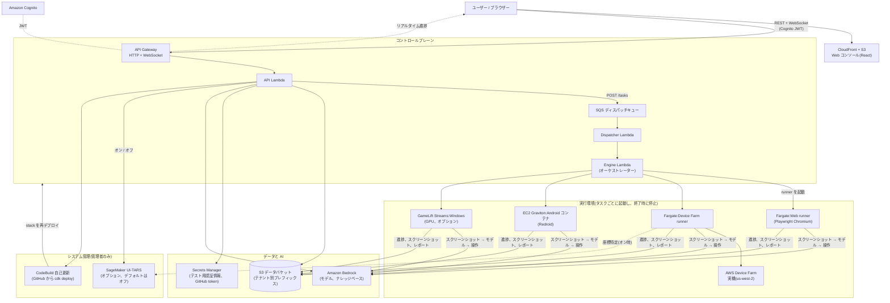

# PlayAgent Checker

**ゲームとアプリのための AI 駆動自動 QA。** テストフローを自然言語で記述すると、AI エージェントが画面を見ながらタップやスワイプを代行し、合否を判定して、スクリーンショット、ステップごとのトレース、ナビゲーションマップ付きの多言語レポートを作成します。

> 言語:[English](README.md) · [繁體中文](README_ZH.md) · [简体中文](README_CN.md) · **日本語** · [한국어](README_KR.md)

---

## できること

PlayAgent Checker はすべて **AWS(リージョン `us-east-2`)** 上で動作します。サーバーレスのコントロールプレーンと、タスクごとに起動しタスク終了時に停止する実行ランナーで構成されます。アプリをアップロード(または Web URL を指定)すると、エージェントが自律的に探索し、再現性があり検証可能なテスト実行結果が得られます。

- **エージェントループ:** スクリーンショット → VLM がターゲットを特定 → Agent が判断 → デバイスを操作 → 再度スクリーンショット。目標達成または停止条件の発動まで繰り返します。
- **UI ツリーではなく画面を見る**ため、検査可能な要素がない Canvas 描画のゲーム(Cocos2d-x、Unity)でも動作します。
- **ナレッジベース、コストガードレール、5 言語 UI**(zh-Hant、en、zh-Hans、ja、ko)、GitHub からのワンクリック自己更新を備えています。

## ランタイム

| ランタイム | 実行基盤 | インストール後に利用可能 | 制限 |
| --- | --- | --- | --- |
| **Web ブラウザ** | ECS Fargate 上のヘッドレス Chromium(Playwright) | ✅ | — |
| **Android 実機**(Device Farm) | AWS Device Farm + Appium、コントローラーは Fargate | ✅ | 1 セッション 150 分(AWS の制限)。「長時間」オプションは 140 分ごとに再接続し、ゲームは再起動されます |
| **iOS 実機**(Device Farm) | AWS Device Farm + Appium | ✅ | インストール可能な `.ipa` が必要。1 セッション 150 分 |
| **Android コンテナ**(Redroid) | タスクごとに Graviton EC2 を 1 台(`m7g.xlarge`)起動し Redroid を実行 | ✅ | エミュレーター検出のあるゲームは自ら終了します(実機を使用してください)。動画/音声チェック不可、ピンチ不可、1 回の実行は 1–72 時間 |
| **Windows PC ゲーム** | Amazon GameLift Streams(NVIDIA GPU、`gen6n_medium_win2022`) | ⚙️ 初回のみセットアップが必要(下記「任意:Windows PC ゲーム(GameLift Streams)」を参照) | 1 回の実行 ≤ 60 分、総ピクセル数 ≤ 1920×1080 |
| iOS シミュレーター / Linux | — | ❌ 未実装 | — |

どのゲームにどのランタイムを選ぶか:[docs/design/multi-platform-workers.md](docs/design/multi-platform-workers.md)。

## デフォルトで利用できる機能

以下のインストール手順を完了した時点で、有効なもの、無効なもの、追加手順が必要なものは次のとおりです。

| 機能 | デフォルト | 備考 |
| --- | --- | --- |
| Web コンソール、ログイン(Cognito)、5 言語 | ✅ 有効 | セルフサインアップは無効です。ユーザーは管理者が作成します。 |
| アプリ / テストケース / タスク / レポート / メモリマップ | ✅ 有効 | AI が自然言語からテストケースを下書きします(Claude Sonnet 4.5)。 |
| ランタイム:Web、Device Farm Android/iOS、Android コンテナ | ✅ 有効 | 各実行は自身のリソースを起動し、終了時に停止します。 |
| デフォルトモデル | ✅ 有効 | 判断は **Amazon Nova Lite**、画面解析は **Moonshot Kimi K3**、補助は **Amazon Nova Micro**。各シートはタスクごとに変更できます。 |
| ナレッジベース(Markdown + PDF 検索) | ✅ 有効 | PDF 検索は Bedrock Knowledge Bases + S3 Vectors + Titan Embeddings V2 を使用します。 |
| テスト認証情報(Secrets Manager) | ✅ 有効 | アプリごと。マスクされた値がモデルに渡ることはありません。 |
| コストガードレール(予算 + フェイルクローズ価格) | ✅ 有効 | — |
| コスト分析ページ — タスク見積もり | ✅ 有効 | タスクごとのトークン × 単価。 |
| コスト分析ページ — 実際の AWS 請求 | ⚙️ アカウント設定が必要 | Cost Explorer を有効化し、タグをアクティブ化します(下記「コスト分析ページを有効にする」を参照)。 |
| メンバー管理ページ(管理者) | ✅ 有効 | ユーザー追加、パスワードリセット、テナント移動、管理者権限付与。 |
| システム管理ページ → **システム更新** | ⚙️ 任意 | Updater スタックをデプロイし、GitHub トークンを保存します(下記「任意:ワンクリックシステム更新」を参照)。 |
| システム管理ページ → **UI-TARS** | ⛔ **無効** | GPU グラウンディングモデル。管理者がページ上でオン/オフし、オンの間のみ課金されます(下記「任意:UI-TARS グラウンディングモデル」を参照)。 |
| Windows ランタイム | ⚙️ 任意 | Windows マシンから GameLift Streams を初回のみセットアップします。 |

## アーキテクチャ



CDK スタック(すべて `us-east-2`):

| スタック | 内容 |
| --- | --- |
| **Foundation** | S3 データバケット、Cognito ユーザープール、テナント IAM ロール、Bedrock KB サービスロール。 |
| **ControlPlane** | HTTP API + JWT オーソライザー、API Lambda、WebSocket API。 |
| **Scheduling** | SQS ディスパッチキュー + Dispatcher Lambda。 |
| **Execution** | Engine Lambda、ECS クラスター + Fargate タスク定義、ECR リポジトリ、VPC(NAT ゲートウェイなし)、タスクごとの EC2 起動設定。 |
| **Frontend** | CloudFront + S3 静的サイト。 |
| **Updater**(任意) | 上記 5 つのスタックを GitHub のバージョンから再デプロイする CodeBuild プロジェクト。 |

詳細:[docs/architecture.md](docs/architecture.md)。

## コスト

本プロジェクト自身のアカウント(`us-east-2`、2026 年 10 月)での実測値です。AWS の価格は変動するため、見積もりとして扱ってください。

**何も実行していないとき(アイドル時):** 約 **US$2–5 / 月**。NAT ゲートウェイ、常時稼働サーバー、予約ストリーム容量はありません。残るのは次のとおりです。

- S3 ストレージ(スクリーンショット、レポート、アップロードしたアプリ。UI-TARS の重みを配置した場合は約 31 GB が加わり、約 US$0.7/月)
- ECR イメージ(ランナーイメージ。ビルドした場合は約 10 GB の UI-TARS サービングイメージも)
- Secrets Manager(シークレット 1 つにつき月 US$0.40)、CloudWatch Logs、CloudFront
- Lambda、API Gateway、SQS、Cognito はリクエスト課金で、利用が少なければごく僅かです

**テスト実行ごと(実行中のみ):**

| 項目 | 価格 | 例 |
| --- | --- | --- |
| AI モデル(Bedrock トークン) | トークン単位、送信時に固定。各レポートに表示 | デフォルトモデルでの 26 ステップ・10 スピンのスロットテストで、入力約 141k / 出力約 14k トークンを使用し、**US$0.80 未満** |
| Device Farm 実機 | **デバイス 1 分あたり US$0.17** | 30 分 ≈ US$5.10 |
| Android コンテナ(EC2 `m7g.xlarge`) | **US$0.1632 / 時間** + ディスク | 1 時間 ≈ US$0.17 |
| Fargate ランナー(1 vCPU / 2 GB) | 約 US$0.05 / 時間 | Web 実行と Device Farm コントローラー |
| Windows(GameLift Streams) | セッション実行中の秒単位課金 | [GameLift Streams の料金](https://aws.amazon.com/gamelift/streams/pricing/)を参照 |
| 自己更新 | CodeBuild の分数 | 更新 1 回あたり約 5–15 分、数セント |
| Cost Explorer クエリ(コスト分析ページ) | 1 クエリあたり約 US$0.01 | — |

**唯一の大きな任意コスト:UI-TARS。** `ml.g6e.xlarge` GPU で、実測 **US$62.53 / 日(約 US$2.6 / 時間)**。タスクがなくてもオンの間はずっと課金されます。**デフォルトはオフ**です。必要な場合以外はオフのままにしてください。

実際、当アカウントの支出の大半は Bedrock トークンと Device Farm の分数でした。どちらもテストしていないときは費用がかかりません。

## 機能(各ページの役割)

| ページ | 用途 |
| --- | --- |
| **ガイド** | アプリ内ウォークスルー(ログイン後のランディングページ)、5 言語対応。 |
| **アプリ管理** | ゲーム/アプリごとに 1 つのワークスペース:名前、プラットフォーム、ジャンル、成果物(APK/IPA/XAPK/ZIP/EXE)または URL。中にテストケース、タスク、レポート、メモリマップ、テスト認証情報があります。 |
| **テストケース**(アプリワークスペース内) | AI に実行させる 1 つのフロー。自然言語で下書き(AI → YAML)、YAML を手書き、またはスプレッドシートからインポートできます。パスワードの直接記述は拒否されます。テスト認証情報を使用してください。 |
| **テストタスク**(アプリワークスペース内) | ケースを実行します。**ランタイム**、3 つの**モデル**、ステップ/予算の上限、**ナレッジベース**を選択します。ライブ画面、デバイスログ(実機と Android コンテナ)、エージェントの推論を確認でき、実行中に AI へ指示を出したり、いつでもキャンセルしたりできます。 |
| **テストレポート** | AI による説明、ステップトレース、スクリーンショット、録画再生(実機)、ナビゲーショングラフ、支出とトークン。 |
| **メモリマップ** | 全実行で訪れた画面がノード、遷移がエッジになります。以降の実行はより速くナビゲートできます。 |
| **デバイス管理** | 現在利用可能な Device Farm の端末に加え、稼働中のコンテナ、EC2 ホスト、GameLift 容量。 |
| **ナレッジ** | 共有ナレッジベース(ゲームジャンル / シナリオ):Markdown の全文注入と/または PDF 検索。 |
| **コスト分析** | アプリ別・モデル別のタスク見積もりと、サービス / コンポーネント別の実際の AWS 請求(有効化後)。 |
| **メンバー管理**(管理者) | ユーザー追加、パスワードリセット、無効化/有効化、テナント移動、管理者権限の付与・剥奪。 |
| **システム管理**(管理者) | GitHub からの**システム更新**(バージョン比較、ワンクリック更新、進捗、履歴)と **UI-TARS** のオン/オフスイッチ。 |

## AI:3 つのモデル「シート」

モデルはベンダーではなく**役割(シート)**で整理されています。各シートはタスクごとに選択します。

- **Agent(判断)** — 画面と目標から次のアクションを決定します。デフォルトは **Amazon Nova Lite**。
- **VLM(画面解析 / 座標)** — 「タップすべきもの」をピクセル座標に変換します。デフォルトは **Moonshot Kimi K3**。UI-TARS-1.5-7B は管理者がオンにしている間のみここに表示されます。
- **Subagent(補助)** — アクションが成功したかの確認、数値の追跡、完了の検証を行います。デフォルトは **Amazon Nova Micro**。

SDK やエンドポイントを選ぶ必要はありません。システムがモデル ID から導出します。

## コストガードレール

各タスクにステップ上限と予算を設定できます。実行前に、エンジンが各シートのモデルの**価格スナップショットを固定**します(フェイルクローズ:価格が不明な場合は実行を拒否)。支出が予算に達すると実行は停止し、レポートに実際の支出とトークンが表示されます。

## 用語集

- **シート(Seat)** — モデルの役割(Agent / VLM / Subagent)。ベンダーではありません。
- **VLM** — Vision-Language Model。スクリーンショットを読み取り、座標を特定します。
- **UI-TARS** — ByteDance の GUI グラウンディング向けにファインチューニングされた視覚モデル。vLLM により SageMaker 上で提供されます。任意で、デフォルトはオフです。
- **Redroid** — ARM EC2 ホスト上のコンテナで動作する Android(「Android コンテナ」ランタイム)。
- **Locality** — デバイスの所在:`cloud`(提供される)または `attached`(ローカルデバイス。操作は引き続きクラウドから)。
- **終了状態(Terminal state)** — `pass` / `fail` / `error` / `cancelled` / `budget_exceeded` / `dead`。
- **フェイルクローズ(Fail-closed)** — 不明な価格で支出するのではなく、実行を拒否すること。

---

# 🚀 クリーンな AWS アカウントへのインストール(ステップバイステップ)

このセクションは **AWS の経験がないこと**を前提としています。上から順に進めてください。所要時間は合計約 **60–90 分**で、その大半は AWS の待ち時間です。

> すべて **`us-east-2`(オハイオ)** にデプロイします。変更内容を理解していない限り、すべての箇所でこのリージョンを使用してください。
>
> コマンドは **bash**(macOS、Linux、Git Bash、WSL)向けに書かれています。Windows PowerShell では、`NAME=value command` の代わりに `$env:NAME="value"` で変数を設定してください。

## ステップ 0 — コンピューターにツールをインストールする

| ツール | 用途 | インストール |
| --- | --- | --- |
| **Node.js 22+** | ビルドとデプロイのスクリプトを実行 | https://nodejs.org(「LTS」インストーラー) |
| **AWS CLI v2** | AWS アカウントと通信 | https://docs.aws.amazon.com/cli/latest/userguide/getting-started-install.html |
| **Git** | このコードを取得 | https://git-scm.com/downloads |

```bash
node --version    # v22.x 以上
aws --version     # aws-cli/2.x
git --version
```

Docker は**不要**です。コンテナイメージはクラウド(AWS CodeBuild)でビルドされます。

## ステップ 1 — コードを取得する

```bash
git clone https://github.com/hoycdanny/playagent-checker.git
cd playagent-checker
npm install
```

## ステップ 2 — AWS CLI をアカウントに接続する

アカウント所有者に **Access Key ID** と **Secret Access Key** を依頼してください(AWS コンソール → IAM → ユーザー → セキュリティ認証情報 → アクセスキーを作成)。その後:

```bash
aws configure
# AWS Access Key ID     : <貼り付け>
# AWS Secret Access Key : <貼り付け>
# Default region name   : us-east-2
# Default output format : json

aws sts get-caller-identity   # アカウント番号が表示されるはずです
```

> 認証情報には、Lambda、S3、Cognito、API Gateway、IAM、ECS、EC2、ECR、CodeBuild、SageMaker、Bedrock、CloudFront のリソースを作成できる権限が必要です。初回セットアップでは、管理者ユーザー(`AdministratorAccess`)が最も簡単です。

## ステップ 3 — AI モデルを有効にする(Amazon Bedrock)

新しいアカウントでは Bedrock モデルが**無効**です。一度有効にしないと、すべての実行が失敗します。

1. AWS コンソール → **Bedrock** → リージョン(右上)で **US East (Ohio) us-east-2** を選択。
2. 左メニュー → **Model access** → **Enable specific models**。
3. 少なくとも以下を有効にします:
   - **Amazon – Nova Lite**(デフォルトの判断モデル)
   - **Amazon – Nova Micro**(デフォルトの補助モデル)
   - **Moonshot AI – Kimi K3**(デフォルトの画面解析モデル)
   - **Anthropic – Claude Sonnet 4.5**(テストケースの下書き、インポートしたスプレッドシートの読み取り)
   - **Amazon – Titan Text Embeddings V2**(ナレッジベース検索)
4. **Access granted** になるまで待ちます。評価目的であれば、リージョン内のすべてのモデルを有効にしても構いません。アプリは各シートで利用可能なモデルを一覧表示します。

## ステップ 4 — CDK を準備する(アカウントごとに 1 回)

```bash
cd infra
npx cdk bootstrap aws://ACCOUNT_ID/us-east-2
```

`ACCOUNT_ID` をステップ 2 で表示された番号に置き換えてください。

## ステップ 5 — バックエンドをデプロイする

`infra/` から:

```bash
AWS_REGION=us-east-2 npx cdk deploy \
  PlayAgentDev-Foundation PlayAgentDev-ControlPlane \
  PlayAgentDev-Scheduling PlayAgentDev-Execution \
  --require-approval never
```

> **任意のコスト配分タグ。** すべてのリソースに `project`、`stage`、`component` のタグが付きます。`-c` で独自のタグを追加できます(実行時に起動される EC2/Fargate にも引き継がれます):
> `-c costCenter=QA-1234 -c owner=alice -c team=game-qa`(キー:`costCenter`、`owner`、`team`、`env`、`costAllocation`)。すべてのデプロイで同じフラグを使用してください。

約 10–15 分かかります。その後、次のステップで必要な値を表示します:

```bash
aws cloudformation describe-stacks --region us-east-2 --stack-name PlayAgentDev-Foundation \
  --query "Stacks[0].Outputs[].[OutputKey,OutputValue]" --output table
aws cloudformation describe-stacks --region us-east-2 --stack-name PlayAgentDev-ControlPlane \
  --query "Stacks[0].Outputs[?OutputKey=='ApiUrl'||OutputKey=='WsUrl'].[OutputKey,OutputValue]" --output table
```

以下を控えておいてください:

- **データバケット** — 出力名に `DataBucket`(Ref)を含み、`playagentdev-foundation-databucket…` のような値
- **User Pool ID** — `UserPoolId` を含み、`us-east-2_XXXXXXXXX` のような値
- **User Pool Client ID** — `UserPoolClientId` を含む
- **ApiUrl** — `https://xxxx.execute-api.us-east-2.amazonaws.com`
- **WsUrl** — `wss://xxxx.execute-api.us-east-2.amazonaws.com/prod`

## ステップ 6 — ランナーイメージをビルドする(必須)

Web と Device Farm のランナーは、自分の ECR にあるコンテナイメージから実行されます。イメージは CodeBuild でクラウド上でビルドされるため、大きなファイルがコンピューターにダウンロードされることはありません。

```bash
cd ../agent/sagemaker && npm install
export PA_SM_BUCKET=PASTE_DataBucket     # ステップ 5 の値 — スクリプトはビルドソースをここにアップロードします
export AWS_REGION=us-east-2

# a) 共有 CodeBuild ロールを作成し、UI-TARS の重みとサービングイメージを配置します
#    (後で UI-TARS をオンにする場合のみ必要)。約 20–40 分、AWS 上で実行されます。
#    GPU は起動しません。ストレージ費用は約 US$2/月です。
node cloudBuild.mjs

# b) 2 つのランナーイメージをビルドしてプッシュします(それぞれ数分)。
node cloudBuildRunner.mjs
node cloudBuildWebRunner.mjs
```

> スクリプトに組み込まれたバケット名は元の開発者のアカウントのものなので、必ず `PA_SM_BUCKET` を**自分の**データバケットに設定してください。

## ステップ 7 — Web コンソールをビルドする

```bash
cd ../../web
cat > .env.production <<'EOF'
VITE_COGNITO_REGION=us-east-2
VITE_COGNITO_USER_POOL_ID=PASTE_UserPoolId
VITE_COGNITO_CLIENT_ID=PASTE_UserPoolClientId
VITE_API_URL=PASTE_ApiUrl
VITE_WS_URL=PASTE_WsUrl
EOF
npm run build
```

ビルド前に、各 `PASTE_...` をステップ 5 の値に置き換えてください。

## ステップ 8 — Web コンソールをデプロイする

```bash
cd ../infra
AWS_REGION=us-east-2 npx cdk deploy PlayAgentDev-Frontend --require-approval never
aws cloudformation describe-stacks --region us-east-2 --stack-name PlayAgentDev-Frontend \
  --query "Stacks[0].Outputs[?contains(OutputKey,'SiteUrl')].OutputValue" --output text
```

表示された `https://xxxx.cloudfront.net` のアドレスを開くと、ログインページが表示されます。

## ステップ 9 — 最初の(管理者)ログインを作成する

セルフサインアップは意図的に無効にしています。メールアドレスとパスワード(8 文字以上、大文字 + 小文字 + 数字)を決めてください。`tenant` は顧客ごとのデータを分離します。会社名など短いものを使用してください。

**オプション A — スクリプト(推奨):**

```bash
cd ../agent/sagemaker
AWS_REGION=us-east-2 node createUser.mjs \
  --email you@example.com --tenant acme --password 'ChangeMe123!' --admin
```

**オプション B — デプロイ時:** Foundation のデプロイに `-c adminEmail=you@example.com -c adminPassword='ChangeMe123!' -c adminTenant=acme` を追加します。

<details>
<summary>オプション C — AWS CLI を直接使用</summary>

```bash
POOL_ID=PASTE_UserPoolId
aws cognito-idp admin-create-user --region us-east-2 --user-pool-id "$POOL_ID" \
  --username you@example.com \
  --user-attributes Name=email,Value=you@example.com Name=email_verified,Value=true "Name=custom:tenantId,Value=acme" \
  --message-action SUPPRESS
aws cognito-idp admin-set-user-password --region us-east-2 --user-pool-id "$POOL_ID" \
  --username you@example.com --password 'ChangeMe123!' --permanent
aws cognito-idp admin-add-user-to-group --region us-east-2 --user-pool-id "$POOL_ID" \
  --username you@example.com --group-name admins
```
</details>

以降のユーザーは**メンバー管理**ページから作成します。

## ステップ 10 — ログインして最初のテストを実行する

CloudFront の URL を開いてログインすると、**ガイド**が表示されます。その後:

1. **アプリ管理** → アプリを作成します(APK/IPA/XAPK をアップロード、または Web の場合は URL を入力)。
2. アプリワークスペース内 → **テストケース** → フローを記述すると、AI がケースに変換します。
3. **テストタスク** → ケースとランタイム(**Web**、**Android/iOS 実機**、または **Android コンテナ**)を選択 → 送信します。モデルのデフォルトは Nova Lite / Kimi K3 / Nova Micro です。
4. ライブで確認し、その後**レポート**を読みます。

> **メンバー管理 / システム管理の項目が表示されない場合** これらは管理者にのみ表示され、ログイントークンはサインイン時にのみグループの変更を反映します。管理者に設定された後は、一度ログアウトして再ログインしてください。

✅ **これで動作する環境が整いました。** 以下はすべて任意です。

---

## 任意:ワンクリックシステム更新

管理者が**システム管理 → システム更新**から、プラットフォーム全体を GitHub のバージョンに更新できるようにします(まずテストを実行し、その後 CodeBuild で `cdk deploy` を実行)。

1. Updater スタックを一度だけデプロイします(このスタック自体は更新されません):
   ```bash
   cd infra
   AWS_REGION=us-east-2 npx cdk deploy PlayAgentDev-Updater --require-approval never --exclusively
   ```
   フォークを使用する場合は、このデプロイとすべてのデプロイに `-c githubRepo=owner/name` を追加してください。
2. このリポジトリ用に、**Contents: Read-only** と **Metadata: Read-only** を持つ GitHub の **fine-grained** トークンを作成します。
3. **システム管理**を開き、トークンを貼り付けて保存します。トークンは Secrets Manager(`playagent/github`)に保存され、二度と表示されません。

更新ボタンは IAM とリソースを高い権限で再デプロイするため、管理者にのみ表示され、すべての実行が記録されます。設計メモ:[docs/design/self-update.md](docs/design/self-update.md)。

## 任意:UI-TARS グラウンディングモデル

UI-TARS-1.5-7B は、小さなボタンに対してより高精度になり得る GUI グラウンディングモデルです。GPU が**オンの間は約 US$62.5 / 日**かかるため、**デフォルトはオフ**です。現在は Device Farm 実機ランタイムのみが使用し、他のランタイムは Bedrock の視覚モデルにフォールバックします。

スイッチが機能するには、アカウントに以下が必要です:

1. **ステップ 6a**(`cloudBuild.mjs`)で配置した重みとサービングイメージ。
2. **`ArtSmokerSageMakerRole`** という名前の SageMaker 実行ロール(スタックがデフォルトで想定する名前。SageMaker がイメージを取得し重みを読み取れるようにします):
   ```bash
   ACCOUNT=$(aws sts get-caller-identity --query Account --output text)
   BUCKET=PASTE_DataBucket
   aws iam create-role --role-name ArtSmokerSageMakerRole --assume-role-policy-document \
     '{"Version":"2012-10-17","Statement":[{"Effect":"Allow","Principal":{"Service":"sagemaker.amazonaws.com"},"Action":"sts:AssumeRole"}]}'
   aws iam put-role-policy --role-name ArtSmokerSageMakerRole --policy-name uitars --policy-document "{
     \"Version\":\"2012-10-17\",\"Statement\":[
     {\"Effect\":\"Allow\",\"Action\":\"ecr:GetAuthorizationToken\",\"Resource\":\"*\"},
     {\"Effect\":\"Allow\",\"Action\":[\"ecr:BatchGetImage\",\"ecr:GetDownloadUrlForLayer\",\"ecr:BatchCheckLayerAvailability\"],
      \"Resource\":\"arn:aws:ecr:us-east-2:${ACCOUNT}:repository/playagent-vllm-byoc\"},
     {\"Effect\":\"Allow\",\"Action\":\"s3:ListBucket\",\"Resource\":\"arn:aws:s3:::${BUCKET}\"},
     {\"Effect\":\"Allow\",\"Action\":\"s3:GetObject\",\"Resource\":\"arn:aws:s3:::${BUCKET}/sagemaker-models/ui-tars/*\"},
     {\"Effect\":\"Allow\",\"Action\":[\"logs:CreateLogGroup\",\"logs:CreateLogStream\",\"logs:PutLogEvents\",\"logs:DescribeLogStreams\",\"cloudwatch:PutMetricData\"],\"Resource\":\"*\"}]}"
   ```
   別のロールを使用する場合は、ControlPlane を `-c uitarsRoleArn=arn:aws:iam::…:role/…` 付きでデプロイしてください。

その後、**システム管理 → UI-TARS → オンにする**を使用します。**オン**になるまで約 8–15 分かかり、起動中からすでに課金されます。その後、UI-TARS がタスクの VLM メニューに表示されます。使い終わったら同じページで**オフ**にしてください。GPU エンドポイントは削除されますがモデル設定は保持されるため、再度オンにする際にセットアップは不要です。オフの間はモデルメニューに UI-TARS が表示されず、UI-TARS を指定したタスクは拒否されます。

詳細:[docs/design/uitars-sagemaker-grounding.md](docs/design/uitars-sagemaker-grounding.md)。

## 任意:Windows PC ゲーム(GameLift Streams)

**Windows マシンから**一度だけ実行してください(GPU ホスト用の Windows ツールをパッケージ化します):

```powershell
cd worker\windows-host\gamelift
npm install
$env:AWS_REGION="us-east-2"; node setup.mjs --capacity 2
```

GameLift Streams アプリケーションと、**常時稼働容量なし**(テストを実行していない間は課金なし)・最大 2 同時実行のストリームグループを作成します。その後、タスク送信時に **Windows** ランタイムが表示されます。初回の起動には 10–15 分かかり、各実行は 60 分が上限です。Windows ホストのスクリプトを変更した後は `setup.mjs` を再実行してください。自己更新はこれをカバーしません。

## コスト分析ページを有効にする

**コスト分析**ページには、実際の AWS 請求(Cost Explorer から取得)とタスク見積もり(トークン × 単価)が並べて表示されます。見積もりはすぐに利用できます。実際の請求を表示するには、アカウントごとに一度:

1. **Billing and Cost Management → Cost Explorer** → 有効化します。データは約 24 時間後に表示されます。
2. **Billing and Cost Management → Cost allocation tags** → `project`、`stage`、`component`(およびカスタムタグ)をアクティブ化します。
3. 1 日待ちます。タグはアクティブ化以降のコストにのみ適用され、それ以前のコストに遡って適用されることはありません。

Cost Explorer は `us-east-1` にのみ存在し(アプリはそこでクエリします)、1 クエリあたり約 US$0.01 かかり、約 24 時間の遅延があります。タグのアクティブ化には請求情報へのアクセス権が必要です。

注:Bedrock トークンと Device Farm の分数にはリソースタグが付かないため、`component` 別の実際の請求ビューでは個別に表示されます。Device Farm の分数は、セッション名によって各実行とも照合されます。

## Device Farm(実機)に関する注意

追加のセットアップは不要です。Device Farm は **us-west-2** にあり、ランナーがプロジェクトを自動作成します。実機ランタイムを選択すると、現在利用可能な端末(機種、OS、解像度、メモリ、CPU)がドロップダウンに一覧表示されます。「自動」は最初に利用可能な端末を選択します。画面がハードリミットを超えて変化しない場合(インストールの停止、アプリのフリーズ、reCAPTCHA の壁)、ループで課金し続けるのではなく、実行は `error` として終了します。

## テスト認証情報(登録/ログインフロー)

アカウントとパスワードは、アプリごとに**アプリ → テスト認証情報**で管理します。1 フィールドにつき 1 行のキー–値です(例:`帳號`、`密碼`、`伺服器名稱`)。各行は**マスク**(デフォルト。AI には `${key}` のみが見え、ランナーが入力時に値を埋め込みます)または**表示**(AI がリストから選択する必要がある、機密でない値向け)のいずれかです。ケースは認証情報を参照せず、通常どおり記述してください。

値は **AWS Secrets Manager**(`playagent/tenant/<tenant>/app/<appId>/credentials`)にのみ保存されます。マスクされた値は UI に表示されず、API から返されず、モデルに送信されず、S3、タスク定義、レポート、トレースにも書き込まれません。詳細:[docs/design/test-credentials.md](docs/design/test-credentials.md)。

---

## クリーンアップとトラブルシューティング

**まず最大のコストを止めます:** システム管理ページで UI-TARS を**オフ**にし、長時間の Android コンテナや Device Farm の実行が残っていないことを確認してください(デバイス管理ページ)。

**すべてを削除する**(データバケットと Cognito ユーザープールは設計上保持されます。本当に削除したい場合は手動で削除してください):

```bash
cd infra
AWS_REGION=us-east-2 npx cdk destroy --all
```

他にも次のものが残ります:ランナーの ECR リポジトリ `playagent-exploration-runner` / `playagent-web-runner`(CDK がデフォルトで保持)、ECR リポジトリ `playagent-vllm-byoc`、CodeBuild プロジェクト `playagent-uitars-build` / `playagent-runner-build` / `playagent-web-runner-build`、ロール `PlayAgentCodeBuildUitarsRole`、SageMaker のモデル/設定 `ui-tars-playagent-*`、および(セットアップした場合)GameLift Streams アプリケーションとストリームグループ。

| 症状 | 対処 |
| --- | --- |
| デプロイが失敗する:*"not bootstrapped"* | `us-east-2` でステップ 4 を実行してください。 |
| 実行が *AccessDenied* / モデル利用不可でエラーになる | **us-east-2** でモデルアクセスを有効にしてください(ステップ 3)。 |
| Web / Device Farm の実行が起動しない(イメージが見つからない) | ランナーイメージをビルドしてください(ステップ 6)。 |
| ログインページは表示されるがサインインに失敗する、またはページが空白 | `web/.env.production` の値が誤っているか、編集後に Web を再ビルド + 再デプロイしていません(ステップ 7–8)。 |
| Android コンテナでゲームがすぐに自ら終了する | エミュレーター検出があります。Android 実機を使用してください。 |
| UI-TARS が**失敗**と表示される | オフにし(課金停止)、カード上の理由を確認し、ステップ 6a と SageMaker ロールを確認してから、再度オンにしてください。 |
| システム更新でトークンの権限不足と表示される | トークンにはこのリポジトリに対する **Contents: Read-only** が必要です。 |
| サインアップできない | 仕様です。ユーザーは管理者が作成します(ステップ 9 / メンバー管理ページ)。 |

---

## リポジトリ構成

```
agent/            Execution runners
  explorationRunner.mjs    Device Farm / Android container / Windows runner (one loop, different drivers)
  webExplorationRunner.mjs Web runner (Playwright headless Chromium)
  uitarsClient.mjs         UI-TARS (SageMaker) grounding client
  sagemaker/               Cloud build scripts (runner images, UI-TARS), createUser.mjs
infra/            AWS CDK app (Foundation, ControlPlane, Scheduling, Execution, Frontend, Updater)
web/              React + Vite web console (5-locale i18n)
worker/           Platform workers, incl. windows-host/gamelift (Windows GameLift Streams setup)
docs/             Architecture, design notes, research
```

## 開発者向け

```bash
npm run test:web       # Web のユニットテスト
npm run test:worker    # Worker のユニットテスト
cd infra && npm test   # CDK + Lambda のユニットテスト
npm run build:web      # i18n チェック + 型チェック + ビルド
```

[CONTRIBUTING.md](CONTRIBUTING.md) と [docs/architecture.md](docs/architecture.md) を参照してください。

## ライセンス

リポジトリの設定を参照してください。社内評価用に現状のまま提供されます。
