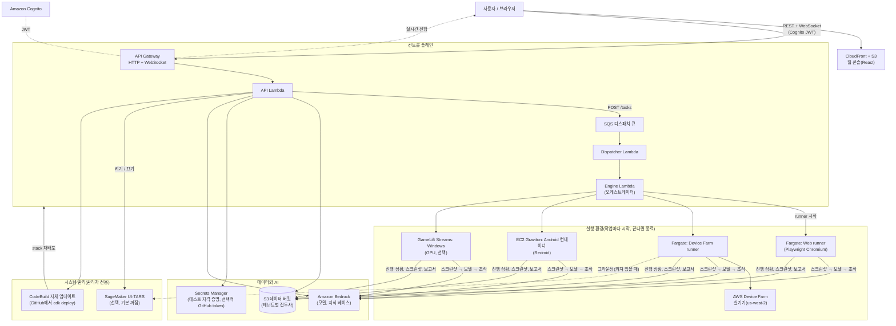

# PlayAgent Checker

**게임과 앱을 위한 AI 기반 자동 QA입니다.** 테스트 흐름을 자연어로 설명하면 AI 에이전트가 화면을 보고 대신 탭과 스와이프를 수행하며, 통과/실패를 판정하고, 스크린샷, 단계별 추적, 내비게이션 맵이 포함된 다국어 보고서를 생성합니다.

> 언어: [English](README.md) · [繁體中文](README_ZH.md) · [简体中文](README_CN.md) · [日本語](README_JP.md) · **한국어**

---

## 개요

PlayAgent Checker는 게임과 앱을 위한 AI 기반 자동 QA이며, 전부 사용자 본인의 AWS 계정에서 실행됩니다.

- 테스트 케이스를 자연어로 작성하면 AI 에이전트가 화면을 보고 실제 사용자처럼 조작(탭, 스와이프, 입력)하여 케이스를 실행합니다.
- 검사 가능한 UI 트리가 없는 캔버스 렌더링 게임(Unity, Cocos2d-x)에서도 동작합니다.
- 사용자의 AWS 계정에서 서버리스·사용량 과금: 리소스가 작업마다 시작되고 끝나면 종료되므로 유휴 비용이 거의 없습니다.
- 스크린샷, 단계별 추적, 내비게이션 맵, 실행별 비용이 포함된 다국어 보고서.
- 웹, Android/iOS 실기기, Android 컨테이너, Windows PC 게임 런타임을 사용할 수 있습니다.

## 빠른 시작

웹 브라우저만 있으면 되고, 컴퓨터에는 아무것도 설치하지 않습니다.

**시작하기 전에:** 관리자로 AWS Console에 로그인하고, 먼저 대상 리전에서 Bedrock 모델을 활성화한 뒤([AI 모델 활성화](#3단계--ai-모델-활성화amazon-bedrock) — 활성화하지 않으면 모든 실행이 실패합니다), Console 상단 바의 `>_` 아이콘으로 **CloudShell**을 엽니다.

명령 한 줄을 붙여 넣습니다.

```bash
curl -fsSL https://raw.githubusercontent.com/hoycdanny/playagent-checker/main/scripts/cloudshell-install.sh | bash
```

- 먼저 **언어 메뉴**가 표시되고(기본값은 영어, 플래그 불필요. `--lang en|zh-Hant|zh-Hans|ja|ko`도 사용 가능), 원시 로그 대신 **단계별 진행 상황**을 보여 주며, 실패하면 오류 로그를 출력합니다.
- 기본 리전은 `us-west-2`입니다. 다른 리전을 쓰려면 `--region <region>`을 붙입니다. 선택한 리전에서 Bedrock 모델이 활성화되어 있어야 하며, 기본 모델은 `us.` 교차 리전 추론 프로필을 사용하므로 미국 외 리전에서는 다른 모델 ID가 필요할 수 있습니다. Device Farm 실제 기기는 항상 `us-west-2`에서 실행됩니다.
- 관리자 계정은 **Cognito 이메일 초대**로 만들어집니다. 임시 비밀번호가 마지막에 화면에 표시되며 동시에 이메일로도 전송됩니다. 처음 로그인할 때 웹 페이지에서 새 비밀번호를 설정하라고 요청합니다.
- **같은 명령을 다시 실행하면 최신 버전으로 업데이트됩니다.**

`scripts/cloudshell-install.sh`가 하는 일:

- 이 계정/리전에서 CDK bootstrap을 한 번도 하지 않았다면 한 번 실행합니다. 관리자 권한이 필요한 단계는 이것뿐입니다.
- CodeBuild만 신뢰하는 IAM 역할 `playagent-installer`를 만들고 최소 권한 정책 [`infra/iam/playagent-deployer-policy.json`](infra/iam/playagent-deployer-policy.json)을 연결합니다. 빌드는 AdministratorAccess를 사용하지 않습니다.
- CodeBuild 프로젝트 `playagent-installer`를 만듭니다. 이 프로젝트가 공개 GitHub 리포지토리를 clone하고 같은 배포 코어(`scripts/deploy-latest.mjs`)를 실행합니다. EC2 인스턴스는 필요 없습니다.
- 진행 상황을 보여 주고, 끝나면 사이트 URL을 출력합니다.

이 정책이 허용하는 것은 이 계정의 CDK bootstrap 역할 수임, PlayAgent 스택 읽기, 러너 이미지 푸시, Cognito 관리자 생성, `/playagent/*` SSM 파라미터 쓰기뿐입니다. CloudFormation 변경은 CDK의 `cdk-hnb659fds-cfn-exec-role`을 통해 실행됩니다. 이 역할은 기본적으로 관리자 권한을 가지므로, 배포할 수 있는 사람은 CloudFormation을 통해 리소스를 만들 수 있습니다.

## 빠른 삭제

PlayAgent를 제거하려면 CloudShell에서 명령 한 줄을 실행합니다.

```bash
curl -fsSL https://raw.githubusercontent.com/hoycdanny/playagent-checker/main/scripts/cloudshell-uninstall.sh | bash
```

- 같은 **언어 메뉴**가 표시되고, 환경을 스캔하여 삭제될 항목과 유지될 항목을 나열합니다. 확인하기 전에는 아무것도 삭제되지 않으며, 계속하려면 **12자리 계정 id를 입력**해야 합니다. `--yes`는 확인 프롬프트를 건너뜁니다(수동 사용은 권장하지 않음). `--region` 기본값은 `us-west-2`입니다.
- PlayAgent 자체 리소스를 제거합니다: 6개의 `PlayAgentDev-*` 스택, 보존된 데이터 버킷 / Cognito 사용자 풀 / 러너 ECR 리포지토리, 설치 프로그램의 CodeBuild 프로젝트와 IAM 역할, 그리고 PlayAgent의 SSM 파라미터와 로그 그룹.
- CDK bootstrap(`CDKToolkit`)과 공유 `cdk-hnb659fds-*` 자산(다른 앱이 공유할 수 있음)은 유지하므로, 이후 재설치 시 bootstrap을 건너뜁니다.

수동 전체 삭제(및 문제 해결)는 [정리 및 문제 해결](#정리-및-문제-해결)을 참고하십시오.

## 기술 세부 정보

### 런타임

| 런타임 | 실행 환경 | 설치 후 사용 가능 | 제한 |
| --- | --- | --- | --- |
| **웹 브라우저** | ECS Fargate의 Headless Chromium(Playwright) | ✅ | — |
| **Android 실기기**(Device Farm) | AWS Device Farm + Appium, 컨트롤러는 Fargate | ✅ | 세션당 150분(AWS 제한). "long" 옵션은 140분마다 재연결하며 게임이 재시작됩니다 |
| **iOS 실기기**(Device Farm) | AWS Device Farm + Appium | ✅ | 설치 가능한 `.ipa` 필요. 세션당 150분 |
| **Android 컨테이너**(Redroid) | 작업당 Graviton EC2 1대(`m7g.xlarge`)에서 Redroid 실행 | ✅ | 에뮬레이터 탐지가 있는 게임은 스스로 종료됩니다(실기기 사용). 영상/오디오 검사 불가. 핀치 불가. 실행당 1–72시간 |
| **Windows PC 게임** | Amazon GameLift Streams(NVIDIA GPU, `gen6n_medium_win2022`) | ⚙️ 1회 설정 필요([선택: Windows](#선택-windows-pc-게임-gamelift-streams) 참고) | 실행당 ≤ 60분. 총 픽셀 ≤ 1920×1080 |
| iOS 시뮬레이터 / Linux | — | ❌ 미구현 | — |

게임별로 어떤 런타임을 선택할지: [docs/design/multi-platform-workers.md](docs/design/multi-platform-workers.md).

### 기본 제공 항목

아래 설치를 마치면 다음과 같이 켜진 항목, 꺼진 항목, 추가 단계가 필요한 항목이 있습니다.

| 기능 | 기본값 | 비고 |
| --- | --- | --- |
| 웹 콘솔, 로그인(Cognito), 5개 언어 | ✅ 켜짐 | 자체 가입은 비활성화되어 있으며 관리자가 사용자를 생성합니다. |
| 앱 / 테스트 케이스 / 작업 / 보고서 / 메모리 맵 | ✅ 켜짐 | AI가 자연어로부터 테스트 케이스 초안을 작성합니다(Claude Sonnet 4.5). |
| 런타임: 웹, Device Farm Android/iOS, Android 컨테이너 | ✅ 켜짐 | 각 실행은 자체 리소스를 시작하고 종료 시 중지합니다. |
| 기본 모델 | ✅ 켜짐 | 결정 **Amazon Nova Lite**, 화면 분석 **Moonshot Kimi K3**, 보조 **Amazon Nova Micro**. 작업마다 모든 seat를 변경할 수 있습니다. |
| 지식 베이스(Markdown + PDF 검색) | ✅ 켜짐 | PDF 검색은 Bedrock Knowledge Bases + S3 Vectors + Titan Embeddings V2를 사용합니다. |
| 테스트 자격 증명(Secrets Manager) | ✅ 켜짐 | 앱별. 마스킹된 값은 모델에 절대 전달되지 않습니다. |
| 비용 가드레일(예산 + fail-closed 가격) | ✅ 켜짐 | — |
| 비용 분석 페이지 — 작업 추정 비용 | ✅ 켜짐 | 작업별 토큰 × 가격. |
| 비용 분석 페이지 — 실제 AWS 청구액 | ⚙️ 계정 설정 필요 | Cost Explorer 활성화 + 태그 활성화([아래](#비용-분석-페이지-활성화)). |
| 멤버 관리 페이지(관리자) | ✅ 켜짐 | 사용자 추가, 비밀번호 재설정, 테넌트 이동, 관리자 권한 부여. |
| 시스템 관리 페이지 → **시스템 업데이트** | ✅ 켜짐 | GitHub에서 원클릭으로 업데이트합니다. 토큰이 필요 없습니다(리포지토리가 공개). 토큰은 선택 사항이며 GitHub API 속도 제한을 높이는 용도로만 사용합니다([아래](#선택-원클릭-시스템-업데이트)). |
| 시스템 관리 페이지 → **중앙 집중식 로그** | ✅ 켜짐 | 한 곳에서 모든 서비스의 CloudWatch 로그를 검색해 실패를 디버깅합니다([아래](#중앙-집중식-로그)). |
| 시스템 관리 페이지 → **UI-TARS 그라운딩 모델** | ⛔ **꺼짐** | GPU 그라운딩 모델입니다. 관리자가 페이지에서 켜고 끄며, 켜져 있는 동안에만 과금됩니다([아래](#선택-ui-tars-그라운딩-모델)). |
| Windows 런타임 | ⚙️ 선택 | Windows 머신에서 GameLift Streams를 1회 설정합니다. |

### 아키텍처



CDK 스택(모두 `us-west-2`):

| 스택 | 내용 |
| --- | --- |
| **Foundation** | S3 데이터 버킷, Cognito 사용자 풀, 테넌트 IAM 역할, Bedrock KB 서비스 역할. |
| **ControlPlane** | HTTP API + JWT 권한 부여자, API Lambda, WebSocket API. |
| **Scheduling** | SQS 디스패치 큐 + Dispatcher Lambda. |
| **Execution** | Engine Lambda, ECS 클러스터 + Fargate 작업 정의, ECR 리포지토리, VPC(NAT 게이트웨이 없음), 작업별 EC2 시작 설정. |
| **Frontend** | CloudFront + S3 정적 사이트. |
| **Updater** | 위 5개 스택을 GitHub 버전으로 재배포하는 CodeBuild 프로젝트. 설치 프로그램이 자동으로 배포합니다. |

자세한 내용: [docs/architecture.md](docs/architecture.md).

### 비용

이 프로젝트 자체 계정에서 측정한 값입니다(2026년 10월). AWS 가격은 변동되므로 추정치로 참고하십시오.

**아무것도 실행하지 않을 때(유휴):** 대략 **월 US$2–5**입니다. NAT 게이트웨이, 상시 가동 서버, 예약된 스트림 용량이 없습니다. 남는 비용은 다음과 같습니다.

- S3 스토리지(스크린샷, 보고서, 업로드한 앱. UI-TARS 가중치를 스테이징하면 약 31 GB가 추가되며 월 약 US$0.7)
- ECR 이미지(러너 이미지. 빌드한 경우 약 10 GB의 UI-TARS 서빙 이미지 추가)
- Secrets Manager(시크릿당 월 US$0.40), CloudWatch Logs, CloudFront
- Lambda, API Gateway, SQS, Cognito는 요청당 과금이며 사용량이 적으면 몇 센트 수준입니다

**테스트 실행당(실행 중에만):**

| 항목 | 가격 | 예시 |
| --- | --- | --- |
| AI 모델(Bedrock 토큰) | 토큰당 과금, 제출 시 고정되며 각 보고서에 표시 | 기본 모델로 26단계, 10회 스핀 슬롯 테스트에 입력 약 141k / 출력 14k 토큰 사용, **US$0.80 미만** |
| Device Farm 실기기 | **장치 분당 US$0.17** | 30분 ≈ US$5.10 |
| Android 컨테이너(EC2 `m7g.xlarge`) | **시간당 US$0.1632** + 디스크 | 1시간 ≈ US$0.17 |
| Fargate 러너(1 vCPU / 2 GB) | 시간당 약 US$0.05 | 웹 실행 및 Device Farm 컨트롤러 |
| Windows(GameLift Streams) | 세션 실행 중 초당 과금 | [GameLift Streams 요금](https://aws.amazon.com/gamelift/streams/pricing/) 참고 |
| 자체 업데이트 | CodeBuild 분 | 업데이트당 약 5–15분, 몇 센트 |
| Cost Explorer 쿼리(비용 분석 페이지) | 쿼리당 약 US$0.01 | — |

**유일하게 큰 선택적 비용: UI-TARS.** `ml.g6e.xlarge` GPU로, 측정값은 **하루 US$62.53(시간당 약 US$2.6)**이며 작업이 없어도 켜져 있는 동안 계속 과금됩니다. **기본값은 꺼짐**이며, 필요하지 않다면 꺼 두십시오.

실제로 저희 계정 지출의 대부분은 Bedrock 토큰과 Device Farm 분이었습니다. 둘 다 테스트하지 않을 때는 비용이 발생하지 않습니다.

### 기능(페이지별 용도)

| 페이지 | 용도 |
| --- | --- |
| **가이드** | 앱 내 안내(로그인 후 첫 화면), 5개 언어 지원. |
| **앱 관리** | 게임/앱마다 하나의 워크스페이스: 이름, 플랫폼, 장르, 아티팩트(APK/IPA/XAPK/ZIP/EXE) 또는 URL. 내부에 테스트 케이스, 작업, 보고서, 메모리 맵, 테스트 자격 증명이 있습니다. |
| **테스트 케이스**(앱 워크스페이스 내) | AI가 수행할 하나의 흐름입니다. 자연어로 초안 작성(AI → YAML), YAML 직접 작성, 또는 스프레드시트에서 가져오기가 가능합니다. 평문 비밀번호는 거부되므로 테스트 자격 증명을 사용하십시오. |
| **테스트 작업**(앱 워크스페이스 내) | 케이스를 실행합니다. **런타임**, 3개의 **모델**, 단계/예산 제한, **지식 베이스**를 선택합니다. 실시간 화면, 장치 로그(실기기 및 Android 컨테이너), 에이전트의 추론을 확인하고, 실행 중 AI에 지시를 내리거나 언제든 취소할 수 있습니다. |
| **테스트 보고서** | AI 서술, 단계 추적, 스크린샷, 녹화 재생(실기기), 내비게이션 그래프, 지출 및 토큰. |
| **메모리 맵** | 모든 실행에서 방문한 화면은 노드가, 전환은 엣지가 됩니다. 이후 실행은 더 빠르게 탐색합니다. |
| **장치 관리** | 현재 사용 가능한 Device Farm 휴대폰과, 현재 실행 중인 컨테이너, EC2 호스트, GameLift 용량. |
| **지식 베이스** | 공유 지식 베이스(게임 장르 / 시나리오): Markdown 전체 주입 및/또는 PDF 검색. |
| **비용 분석** | 앱 및 모델별 작업 추정 비용과, 서비스 / 컴포넌트별 실제 AWS 청구액(활성화 후). |
| **멤버 관리**(관리자) | 사용자 추가, 비밀번호 재설정, 비활성화/활성화, 테넌트 이동, 관리자 권한 부여 또는 해제. |
| **시스템 관리**(관리자) | GitHub에서의 **시스템 업데이트**(원클릭, 토큰 불필요; 버전 비교, 진행 상황, 이력), **UI-TARS 그라운딩 모델** 켜기/끄기 스위치, 그리고 **중앙 집중식 로그**(모든 서비스의 CloudWatch 로그 검색). |

### AI: 3개의 모델 "seat"

모델은 공급업체가 아니라 **역할(seat)**별로 구성됩니다. 각 seat는 작업마다 선택합니다.

- **Agent(결정)** — 화면과 목표를 바탕으로 다음 동작을 결정합니다. 기본값 **Amazon Nova Lite**.
- **VLM(화면 분석 / 좌표)** — "탭할 대상"을 픽셀 좌표로 변환합니다. 기본값 **Moonshot Kimi K3**. UI-TARS-1.5-7B는 관리자가 켜 둔 동안에만 여기에 표시됩니다.
- **Subagent(보조)** — 동작이 성공했는지 확인하고, 숫자를 추적하며, 완료를 검증합니다. 기본값 **Amazon Nova Micro**.

SDK나 엔드포인트를 직접 선택할 필요가 없으며, 시스템이 모델 ID로부터 도출합니다.

### 비용 가드레일

모든 작업에 단계 제한과 예산을 설정할 수 있습니다. 실행 전에 엔진은 각 seat 모델의 **가격 스냅샷을 고정**합니다(fail-closed: 가격을 알 수 없으면 실행을 거부합니다). 지출이 예산에 도달하면 실행이 중지되며, 보고서에 실제 지출과 토큰이 표시됩니다.

### 시스템 관리

**시스템 관리** 페이지(관리자 전용)에는 세 가지 도구가 있습니다.

**원클릭 자체 업데이트.** Updater 스택은 설치 프로그램이 자동으로 배포하므로, 설치 직후 바로 사용할 수 있습니다. **시스템 관리 → 시스템 업데이트**를 열고 버전을 선택한 뒤 확인합니다. 먼저 테스트를 실행한 다음 CodeBuild에서 `cdk deploy`를 실행합니다. GitHub 토큰은 필요 없습니다. 리포지토리가 공개되어 있어 업데이트가 직접 clone합니다. 토큰은 선택 사항이며 GitHub API 속도 제한을 높이는 용도로만 사용합니다. **시스템 관리**에서 설정하면 Secrets Manager(`playagent/github`)에 저장되며 다시 표시되지 않습니다. 포크를 사용합니까? `-c githubRepo=owner/name`으로 배포하십시오. 업데이트 버튼은 높은 권한으로 IAM과 리소스를 재배포하므로 관리자에게만 표시되며 모든 실행이 기록됩니다. 설계 문서: [docs/design/self-update.md](docs/design/self-update.md).

**중앙 집중식 로그.** 디버깅을 위한 서비스 횡단 로그 뷰어입니다. CloudWatch Logs Insights를 사용해 모든 서비스의 CloudWatch 로그(컨트롤 플레인 API, engine, dispatcher, WebSocket, 두 개의 Fargate 러너, 자체 업데이트 및 이미지 빌드 CodeBuild)를 한 번에 검색합니다. 서비스 필터, 기간(최근 15분 / 1시간 / 3시간 / 24시간), 키워드를 지정할 수 있으며, 결과는 최신 순으로 정렬되고 다운로드할 수 있습니다. 관리자 전용입니다. 설계 문서: [docs/design/centralized-logs.md](docs/design/centralized-logs.md).

**UI-TARS 켜기/끄기.** 관리자는 여기에서 선택적 GPU 그라운딩 모델을 켜거나 끌 수 있으며, 켜져 있는 동안에만 과금됩니다. 설정과 자세한 내용은 [수동 설치](#수동-설치)의 "선택: UI-TARS 그라운딩 모델"을 참고하십시오.

### 용어집

- **Seat** — 모델 역할(Agent / VLM / Subagent)이며, 공급업체가 아닙니다.
- **VLM** — Vision-Language Model. 스크린샷을 읽고 좌표를 찾습니다.
- **UI-TARS** — GUI 그라운딩용으로 파인튜닝된 ByteDance 비전 모델로, vLLM을 통해 SageMaker에서 서빙됩니다. 선택 사항이며 기본값은 꺼짐입니다.
- **Redroid** — ARM EC2 호스트의 컨테이너에서 실행되는 Android("Android 컨테이너" 런타임).
- **Locality** — 장치 위치: `cloud`(제공됨) 또는 `attached`(로컬 장치, 여전히 클라우드에서 제어).
- **Terminal state** — `pass` / `fail` / `error` / `cancelled` / `budget_exceeded` / `dead`.
- **Fail-closed** — 알 수 없는 가격으로 지출하는 대신 실행을 거부합니다.

---

## 수동 설치

본인 컴퓨터에서 배포하고 싶거나 일회성 선택 설정이 필요하면 아래 방법을 사용하십시오. [빠른 시작](#빠른-시작)의 CloudShell 한 줄 명령이 가장 쉬운 방법이며, 이 섹션은 그 외의 모든 경우를 다룹니다.

### Windows / macOS 권장: 원클릭 설치／업데이트

먼저 **Node.js 22, AWS CLI v2, Git, Docker Desktop**을 설치하고 AWS에 로그인한 뒤 아래의 Bedrock 모델을 활성화합니다. 리포지토리를 clone한 다음 다음 중 하나를 실행합니다.

```text
Windows: Install-Latest.cmd 더블클릭
macOS:   Install-Latest.command 더블클릭
Linux:   scripts/deploy-latest.sh 실행
```

세 런처는 같은 배포 코어를 사용하며 기본 리전은 **`us-west-2`(미국 서부, 오레곤)**입니다(`--region`으로 변경 가능).

모든 OS에서 `npm run deploy:latest -- --expected-account-id 123456789012`로 AWS 계정을 확인할 수 있습니다. 기존 PowerShell 스크립트는 호환 래퍼로 유지되며, 모든 OS가 동일한 Node.js 배포 코어를 사용합니다.

`npm run deploy:latest`로도 실행할 수 있습니다. 설치 프로그램은 **이 폴더를 있는 그대로 배포**하며 새 버전을 자동으로 가져오지 않습니다. 최신 `main`을 배포하려면 먼저 `git pull`을 실행하십시오. 버전 태그는 Git commit SHA입니다(`.git`이 없는 ZIP을 푼 경우 `local-<UTC 시각>`). 커밋되지 않은 변경이 있으면 경고를 표시하고 `<sha12>-dirty-<UTC 시각>` 태그로 함께 배포합니다. lockfile 설치, 테스트, 모든 스택과 업데이터(Updater) 배포를 수행하고, 러너 이미지는 버전 태그와 `latest`를 함께 푸시하며 ECS 작업 정의는 버전 태그에 고정됩니다. 마지막에 CloudFormation, ECR digest, ECS 이미지, CloudFront를 검증합니다. 로컬 파일을 초기화·stash·삭제하지 않습니다.

잘못된 AWS 계정에 배포하지 않도록 `npm run deploy:latest -- --expected-account-id 123456789012` 사용을 권장합니다. 첫 설치의 대화형 입력은 관리자 **Email(로그인 username)**과 화면에 표시되지 않는 비밀번호만 묻습니다. tenant 기본값은 `default`이며 고급 설정에서 변경할 때만 `--admin-tenant <tenant>`를 사용합니다.

비대화형 자동화에서는 비밀번호를 명령줄 인수에 절대 넣지 마십시오. 비밀 관리자의 출력을 stdin으로 pipe합니다.

```bash
# bash / zsh(macOS 또는 Linux)
aws secretsmanager get-secret-value --region us-west-2 --secret-id playagent/admin-password --query SecretString --output text | npm run deploy:latest -- --non-interactive --admin-email admin@example.com --admin-password-stdin
```

```powershell
# PowerShell
(aws secretsmanager get-secret-value --region us-west-2 --secret-id playagent/admin-password --query SecretString --output text) | npm run deploy:latest -- --non-interactive --admin-email admin@example.com --admin-password-stdin
```

```bat
rem 명령 프롬프트(cmd.exe)
aws secretsmanager get-secret-value --region us-west-2 --secret-id playagent/admin-password --query SecretString --output text | npm run deploy:latest -- --non-interactive --admin-email admin@example.com --admin-password-stdin
```

이 예제에는 리터럴 비밀번호가 없습니다. 기본 tenant를 변경할 때만 `--admin-tenant <tenant>`를 추가하십시오.

> 원클릭 방식에는 Docker Desktop이 필요합니다. 아래의 수동 CodeBuild 방식은 Docker가 필요하지 않습니다.
>
> **`cdk destroy` 후 재설치:** 데이터 버킷, Cognito User Pool, 러너 ECR은 `Retain`으로 보호됩니다. 설치 프로그램은 남아 있는 ECR을 감지해 재사용하므로 같은 리포지토리 이름 때문에 재설치가 막히지 않습니다. 기존 데이터 버킷/User Pool은 자동 삭제하거나 자동 인계하지 않습니다. 완전히 초기화하려면 필요한 데이터를 백업한 뒤 보존 리소스를 명시적으로 삭제하십시오.

### 수동 설치(단계별)

이 섹션은 **AWS 사용 경험이 없다고 가정**합니다. 위에서 아래로 따라 하십시오. 총 소요 시간은 약 **60–90분**이며, 대부분은 AWS 대기 시간입니다.

> 모든 것이 **`us-west-2`(미국 서부, 오레곤)**에 배포됩니다. 무엇을 변경하는지 알고 있지 않다면 모든 곳에서 이 리전을 사용하십시오.
>
> 명령은 **bash**(macOS, Linux, Git Bash, WSL) 기준으로 작성되어 있습니다. Windows PowerShell에서는 `NAME=value command` 대신 `$env:NAME="value"`로 변수를 설정하십시오.

#### 0단계 — 컴퓨터에 도구 설치

| 도구 | 용도 | 설치 |
| --- | --- | --- |
| **Node.js 22+** | 빌드 및 배포 스크립트 실행 | https://nodejs.org ("LTS" 설치 프로그램) |
| **AWS CLI v2** | AWS 계정과 통신 | https://docs.aws.amazon.com/cli/latest/userguide/getting-started-install.html |
| **Git** | 이 코드 가져오기 | https://git-scm.com/downloads |

```bash
node --version    # v22.x 이상
aws --version     # aws-cli/2.x
git --version
```

Docker는 **필요하지 않습니다**. 컨테이너 이미지는 클라우드(AWS CodeBuild)에서 빌드됩니다.

#### 1단계 — 코드 가져오기

```bash
git clone https://github.com/hoycdanny/playagent-checker.git
cd playagent-checker
npm install
```

#### 2단계 — AWS CLI를 계정에 연결

계정 소유자에게 **Access Key ID**와 **Secret Access Key**를 요청합니다(AWS Console → IAM → Users → Security credentials → Create access key). 그런 다음:

```bash
aws configure
# AWS Access Key ID     : <붙여넣기>
# AWS Secret Access Key : <붙여넣기>
# Default region name   : us-west-2
# Default output format : json

aws sts get-caller-identity   # 계정 번호가 출력되어야 합니다
```

> 자격 증명은 Lambda, S3, Cognito, API Gateway, IAM, ECS, EC2, ECR, CodeBuild, SageMaker, Bedrock, CloudFront 리소스를 생성할 수 있어야 합니다. 첫 설정에는 관리자 사용자(`AdministratorAccess`)가 가장 간단합니다.

#### 3단계 — AI 모델 활성화(Amazon Bedrock)

새 계정은 Bedrock 모델이 **꺼져** 있습니다. 한 번 활성화하지 않으면 모든 실행이 실패합니다.

1. AWS Console → **Bedrock** → 리전(오른쪽 위) **US West (Oregon) us-west-2**.
2. 왼쪽 메뉴 → **Model access** → **Enable specific models**.
3. 최소한 다음을 활성화합니다.
   - **Amazon – Nova Lite**(기본 결정 모델)
   - **Amazon – Nova Micro**(기본 보조 모델)
   - **Moonshot AI – Kimi K3**(기본 화면 분석 모델)
   - **Anthropic – Claude Sonnet 4.5**(테스트 케이스 초안 작성, 가져온 스프레드시트 읽기)
   - **Amazon – Titan Text Embeddings V2**(지식 베이스 검색)
4. **Access granted**가 될 때까지 기다립니다. 평가 목적이라면 리전의 모든 모델을 활성화해도 됩니다. 앱은 각 seat에서 사용 가능한 모델을 모두 나열합니다.

#### 4단계 — CDK 준비(계정당 1회)

```bash
cd infra
npx cdk bootstrap aws://ACCOUNT_ID/us-west-2
```

`ACCOUNT_ID`를 2단계에서 확인한 번호로 바꾸십시오.

#### 5단계 — 백엔드 배포

`infra/`에서:

```bash
AWS_REGION=us-west-2 npx cdk deploy \
  PlayAgentDev-Foundation PlayAgentDev-ControlPlane \
  PlayAgentDev-Scheduling PlayAgentDev-Execution \
  --require-approval never
```

> **선택: 비용 할당 태그.** 모든 리소스에는 `project`, `stage`, `component` 태그가 지정됩니다. `-c`로 자체 태그를 추가할 수 있습니다(실행 시 시작되는 EC2/Fargate에도 전달됩니다).
> `-c costCenter=QA-1234 -c owner=alice -c team=game-qa`(키: `costCenter`, `owner`, `team`, `env`, `costAllocation`). 모든 배포에서 동일한 플래그를 사용하십시오.

약 10–15분이 걸립니다. 그런 다음 다음 단계에 필요한 값을 출력합니다.

```bash
aws cloudformation describe-stacks --region us-west-2 --stack-name PlayAgentDev-Foundation \
  --query "Stacks[0].Outputs[].[OutputKey,OutputValue]" --output table
aws cloudformation describe-stacks --region us-west-2 --stack-name PlayAgentDev-ControlPlane \
  --query "Stacks[0].Outputs[?OutputKey=='ApiUrl'||OutputKey=='WsUrl'].[OutputKey,OutputValue]" --output table
```

다음을 기록해 두십시오.

- **Data bucket** — 출력 이름에 `DataBucket`(Ref) 포함, `playagentdev-foundation-databucket…` 형태
- **User Pool ID** — `UserPoolId` 포함, `us-west-2_XXXXXXXXX` 형태
- **User Pool Client ID** — `UserPoolClientId` 포함
- **ApiUrl** — `https://xxxx.execute-api.us-west-2.amazonaws.com`
- **WsUrl** — `wss://xxxx.execute-api.us-west-2.amazonaws.com/prod`

#### 6단계 — 러너 이미지 빌드(필수)

웹 및 Device Farm 러너와 Windows 실행을 1시간 넘게 유지하는 세션 유지 태스크는 사용자 ECR의 컨테이너 이미지에서 실행됩니다. 이미지는 CodeBuild를 통해 클라우드에서 빌드되므로 대용량 파일이 컴퓨터로 다운로드되지 않습니다.

```bash
cd ../agent/sagemaker && npm install
export PA_SM_BUCKET=PASTE_DataBucket     # 5단계에서 확인한 값 — 스크립트가 빌드 소스를 여기에 업로드합니다
export AWS_REGION=us-west-2

# a) 공유 CodeBuild 역할을 생성하고 UI-TARS 가중치 + 서빙 이미지를 스테이징합니다
#    (나중에 UI-TARS를 켤 때만 필요). 약 20–40분, AWS에서 실행됩니다.
#    GPU는 시작하지 않습니다. 스토리지 비용은 월 약 US$2입니다.
node cloudBuild.mjs

# b) 러너 이미지를 빌드하고 푸시합니다(각각 몇 분).
node cloudBuildRunner.mjs
node cloudBuildWebRunner.mjs
node cloudBuildKeepAlive.mjs
```

> `PA_SM_BUCKET`은 필수입니다. 본인의 Foundation 스택이 출력한 DataBucket으로 설정하십시오. 스크립트에는 계정별 버킷 기본값이 더 이상 없습니다.

#### 7단계 — 웹 콘솔 빌드

```bash
cd ../../web
cat > .env.production <<'EOF'
VITE_COGNITO_REGION=us-west-2
VITE_COGNITO_USER_POOL_ID=PASTE_UserPoolId
VITE_COGNITO_CLIENT_ID=PASTE_UserPoolClientId
VITE_API_URL=PASTE_ApiUrl
VITE_WS_URL=PASTE_WsUrl
EOF
npm run build
```

빌드 전에 각 `PASTE_...`를 5단계의 값으로 바꾸십시오.

#### 8단계 — 웹 콘솔 배포

```bash
cd ../infra
AWS_REGION=us-west-2 npx cdk deploy PlayAgentDev-Frontend --require-approval never
aws cloudformation describe-stacks --region us-west-2 --stack-name PlayAgentDev-Frontend \
  --query "Stacks[0].Outputs[?contains(OutputKey,'SiteUrl')].OutputValue" --output text
```

출력된 `https://xxxx.cloudfront.net` 주소를 열면 로그인 페이지가 표시됩니다.

#### 9단계 — 첫 번째(관리자) 로그인 생성

자체 가입은 의도적으로 비활성화되어 있습니다. 가장 간단한 방법은 위의 원클릭 설치 프로그램입니다. 수동 설정에서는 아래 도구를 실행합니다. 비밀번호는 화면에 표시되지 않게 입력하므로 명령이나 shell history에 남지 않습니다. tenant를 별도로 격리할 명확한 이유가 없다면 기본값 `default`를 사용하십시오.

```bash
cd ../agent/sagemaker
AWS_REGION=us-west-2 node createUser.mjs --email admin@example.com --tenant default --admin
```

자동화에서는 비밀번호를 argv에 넣지 말고 비밀 관리자에서 stdin으로 pipe하십시오.

```bash
aws secretsmanager get-secret-value --region us-west-2 --secret-id playagent/admin-password --query SecretString --output text | AWS_REGION=us-west-2 node createUser.mjs --email admin@example.com --tenant default --admin --password-stdin
```

비밀번호는 8자 이상이며 대문자, 소문자, 숫자를 포함해야 합니다.

이후 다른 사용자는 모두 **멤버 관리** 페이지에서 생성합니다.

#### 10단계 — 로그인하고 첫 테스트 실행

CloudFront URL을 열고 로그인합니다. **가이드** 페이지가 표시됩니다. 그런 다음:

1. **앱 관리** → 앱을 생성합니다(APK/IPA/XAPK 업로드, 또는 웹의 경우 URL 입력).
2. 앱 워크스페이스 → **테스트 케이스** → 흐름을 설명하면 AI가 케이스로 변환합니다.
3. **테스트 작업** → 케이스와 런타임(**웹**, **Android/iOS 실기기**, 또는 **Android 컨테이너**)을 선택 → 제출합니다. 모델 기본값은 Nova Lite / Kimi K3 / Nova Micro입니다.
4. 실시간으로 확인한 후 **보고서**를 읽습니다.

> **멤버 관리 / 시스템 관리 항목이 보이지 않습니까?** 관리자에게만 표시되며, 로그인 토큰은 로그인할 때만 그룹 변경 사항을 반영합니다. 관리자로 지정된 후 로그아웃했다가 다시 로그인하십시오.

✅ **이제 작동하는 환경이 준비되었습니다.** 아래 내용은 모두 선택 사항입니다.

---

### 선택: UI-TARS 그라운딩 모델

UI-TARS-1.5-7B는 작은 버튼에서 더 정밀할 수 있는 GUI 그라운딩 모델입니다. GPU 비용이 **켜져 있는 동안 하루 약 US$62.5**이므로 **기본값은 꺼짐**입니다. 현재는 Device Farm 실기기 런타임만 이를 사용하며, 다른 런타임은 Bedrock 비전 모델로 대체됩니다.

스위치가 작동하려면 계정에 다음이 필요합니다.

1. **6a단계**(`cloudBuild.mjs`)에서 스테이징한 가중치와 서빙 이미지.
2. **`ArtSmokerSageMakerRole`**이라는 이름의 SageMaker 실행 역할(스택이 기본적으로 기대하는 이름이며, SageMaker가 이미지를 가져오고 가중치를 읽을 수 있게 합니다).
   ```bash
   ACCOUNT=$(aws sts get-caller-identity --query Account --output text)
   BUCKET=PASTE_DataBucket
   aws iam create-role --role-name ArtSmokerSageMakerRole --assume-role-policy-document \
     '{"Version":"2012-10-17","Statement":[{"Effect":"Allow","Principal":{"Service":"sagemaker.amazonaws.com"},"Action":"sts:AssumeRole"}]}'
   aws iam put-role-policy --role-name ArtSmokerSageMakerRole --policy-name uitars --policy-document "{
     \"Version\":\"2012-10-17\",\"Statement\":[
     {\"Effect\":\"Allow\",\"Action\":\"ecr:GetAuthorizationToken\",\"Resource\":\"*\"},
     {\"Effect\":\"Allow\",\"Action\":[\"ecr:BatchGetImage\",\"ecr:GetDownloadUrlForLayer\",\"ecr:BatchCheckLayerAvailability\"],
      \"Resource\":\"arn:aws:ecr:us-west-2:${ACCOUNT}:repository/playagent-vllm-byoc\"},
     {\"Effect\":\"Allow\",\"Action\":\"s3:ListBucket\",\"Resource\":\"arn:aws:s3:::${BUCKET}\"},
     {\"Effect\":\"Allow\",\"Action\":\"s3:GetObject\",\"Resource\":\"arn:aws:s3:::${BUCKET}/sagemaker-models/ui-tars/*\"},
     {\"Effect\":\"Allow\",\"Action\":[\"logs:CreateLogGroup\",\"logs:CreateLogStream\",\"logs:PutLogEvents\",\"logs:DescribeLogStreams\",\"cloudwatch:PutMetricData\"],\"Resource\":\"*\"}]}"
   ```
   다른 역할을 사용하려면 ControlPlane을 `-c uitarsRoleArn=arn:aws:iam::…:role/…`로 배포하십시오.

그런 다음 **시스템 관리 → UI-TARS 그라운딩 모델 → 켜기**를 사용합니다. **켜짐** 상태가 되기까지 약 8–15분이 걸리며, 시작 중에도 이미 과금됩니다. 이후 작업의 VLM 메뉴에 UI-TARS가 표시됩니다. 사용이 끝나면 같은 페이지에서 **끄십시오**. 끄면 GPU 엔드포인트가 삭제되지만 모델 설정은 유지되므로, 다시 켤 때 추가 설정이 필요 없습니다. 꺼져 있는 동안에는 모델 메뉴에서 UI-TARS가 숨겨지며, 이를 요청하는 작업은 거부됩니다.

자세한 내용: [docs/design/uitars-sagemaker-grounding.md](docs/design/uitars-sagemaker-grounding.md).

### 선택: Windows PC 게임 (GameLift Streams)

**Windows 머신에서** 한 번 실행합니다(GPU 호스트용 Windows 도구를 패키징합니다).

```powershell
cd worker\windows-host\gamelift
npm install
$env:AWS_REGION="us-west-2"; node setup.mjs --capacity 2
```

GameLift Streams 애플리케이션과 **상시 가동 용량이 없는** 스트림 그룹(테스트가 실행되지 않는 동안 과금 없음)을 생성하며, 최대 2개의 동시 실행을 지원합니다. 이후 작업 제출 시 **Windows** 런타임이 표시됩니다. 첫 시작은 10–15분이 걸리며, 각 실행은 60분으로 제한됩니다. Windows 호스트 스크립트를 변경한 후에는 `setup.mjs`를 다시 실행하십시오. 자체 업데이트에는 포함되지 않습니다.

### 비용 분석 페이지 활성화

**비용 분석** 페이지는 실제 AWS 청구액(Cost Explorer 기반)을 작업 추정 비용(토큰 × 가격)과 함께 표시합니다. 추정 비용은 바로 작동합니다. 실제 청구액을 보려면 계정당 한 번:

1. **Billing and Cost Management → Cost Explorer** → 활성화합니다. 데이터는 약 24시간 후에 표시됩니다.
2. **Billing and Cost Management → Cost allocation tags** → `project`, `stage`, `component`(및 사용자 지정 태그)를 활성화합니다.
3. 하루를 기다립니다. 태그는 활성화 이후의 비용에만 적용되며, 이전 비용은 소급 적용되지 않습니다.

Cost Explorer는 `us-east-1`에만 있으며(앱이 해당 리전에서 쿼리합니다), 쿼리당 약 US$0.01이고, 약 24시간 지연됩니다. 태그 활성화에는 결제 액세스 권한이 필요합니다.

참고: Bedrock 토큰과 Device Farm 분에는 리소스 태그가 붙지 않으므로, `component`별 실제 청구액 보기에서는 별도로 표시됩니다. Device Farm 분은 세션 이름으로도 각 실행과 매칭됩니다.

## Device Farm(실제 휴대폰) 참고 사항

추가 설정이 필요 없습니다. Device Farm은 **us-west-2**에 있으며, 러너가 프로젝트를 자동으로 생성합니다. 실기기 런타임을 선택하면 현재 사용 가능한 휴대폰(모델, OS, 해상도, 메모리, CPU)이 드롭다운에 나열되며, "Auto"는 첫 번째로 사용 가능한 장치를 선택합니다. 화면이 하드 제한을 넘어 변하지 않으면(설치 멈춤, 앱 정지, reCAPTCHA 장벽) 루프 상태로 과금되는 대신 `error`로 실행이 종료됩니다.

## 테스트 자격 증명(가입/로그인 흐름)

계정과 비밀번호는 **앱 → 테스트 자격 증명**에 앱별로 보관하며, 필드마다 하나의 키–값 행을 사용합니다(예: `帳號`, `密碼`, `伺服器名稱`). 각 행은 **마스킹**(기본값. AI는 `${key}`만 보고 러너가 입력 시점에 값을 채웁니다) 또는 **표시**(AI가 목록에서 골라야 하는 민감하지 않은 값용)입니다. 케이스는 자격 증명을 참조하지 않고 평소처럼 작성하십시오.

값은 **AWS Secrets Manager**(`playagent/tenant/<tenant>/app/<appId>/credentials`)에만 저장됩니다. 마스킹된 값은 UI에 표시되지 않고, API로 반환되지 않으며, 모델로 전송되지 않고, S3, 작업 정의, 보고서, 추적에 기록되지 않습니다. 자세한 내용: [docs/design/test-credentials.md](docs/design/test-credentials.md).

---

## 정리 및 문제 해결

**가장 큰 비용부터 중지하십시오:** 시스템 관리 페이지에서 UI-TARS를 **끄고**, 장시간 실행 중인 Android 컨테이너나 Device Farm 실행이 남아 있지 않은지 확인합니다(장치 관리 페이지).

**모두 삭제하기**(데이터 버킷과 Cognito 사용자 풀은 설계상 보존됩니다. 정말로 제거하려면 직접 삭제하십시오):

```bash
cd infra
AWS_REGION=us-west-2 npx cdk destroy --all
```

다음 항목도 남습니다: 러너 ECR 리포지토리 `playagent-exploration-runner` / `playagent-web-runner` / `playagent-keepalive-runner`(CDK가 기본적으로 보존), ECR 리포지토리 `playagent-vllm-byoc`, CodeBuild 프로젝트 `playagent-uitars-build` / `playagent-runner-build` / `playagent-web-runner-build` / `playagent-keepalive-runner-build`, 역할 `PlayAgentCodeBuildUitarsRole`, SageMaker 모델/구성 `ui-tars-playagent-*`, 그리고 (설정한 경우) GameLift Streams 애플리케이션과 스트림 그룹.

| 증상 | 해결 방법 |
| --- | --- |
| 배포 실패: *"not bootstrapped"* | `us-west-2`에 대해 4단계를 실행합니다. |
| 실행이 *AccessDenied* / 모델 사용 불가 오류 | **us-west-2**에서 모델 액세스를 활성화합니다(3단계). |
| 웹 / Device Farm 실행이 시작되지 않음(이미지 없음) | 러너 이미지를 빌드합니다(6단계). |
| 로그인 페이지는 열리지만 로그인이 실패하거나 페이지가 비어 있음 | `web/.env.production`의 값이 잘못되었거나, 수정 후 웹을 다시 빌드 + 재배포하지 않았습니다(7–8단계). |
| Android 컨테이너에서 게임이 바로 스스로 종료됨 | 에뮬레이터 탐지가 있는 게임입니다. Android 실기기를 사용하십시오. |
| UI-TARS가 **Failed**로 표시됨 | 끄고(과금 중지), 카드에서 원인을 확인하고, 6a단계와 SageMaker 역할을 확인한 후 다시 켭니다. |
| 시스템 업데이트에서 토큰 권한이 부족하다고 표시됨 | 토큰에 이 리포지토리에 대한 **Contents: Read-only** 권한이 필요합니다. |
| 가입할 수 없음 | 설계상 의도된 동작입니다. 관리자가 사용자를 생성합니다(9단계 / 멤버 관리 페이지). |

---

## 리포지토리 구조

```
agent/            Execution runners
  explorationRunner.mjs    Device Farm / Android container / Windows runner (one loop, different drivers)
  webExplorationRunner.mjs Web runner (Playwright headless Chromium)
  uitarsClient.mjs         UI-TARS (SageMaker) grounding client
  sagemaker/               Cloud build scripts (runner images, UI-TARS), createUser.mjs
infra/            AWS CDK app (Foundation, ControlPlane, Scheduling, Execution, Frontend, Updater)
web/              React + Vite web console (5-locale i18n)
worker/           Platform workers, incl. windows-host/gamelift (Windows GameLift Streams setup)
docs/             Architecture, design notes, research
```

## 개발자용

```bash
npm run test:web       # 웹 단위 테스트
npm run test:worker    # 워커 단위 테스트
cd infra && npm test   # CDK + Lambda 단위 테스트
npm run build:web      # i18n 검사 + 타입 검사 + 빌드
```

[CONTRIBUTING.md](CONTRIBUTING.md) 및 [docs/architecture.md](docs/architecture.md)를 참고하십시오.

## 라이선스

리포지토리 설정을 참고하십시오. 내부 평가용으로 있는 그대로 제공됩니다.
