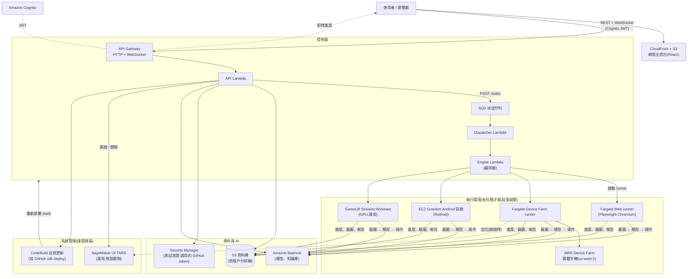

# PlayAgent Checker

**以 AI 驅動的遊戲與 App 自動化 QA。** 用自然語言描述測試流程,AI 代理會看著畫面、替你點擊與滑動、判斷通過或失敗,並產出含截圖、逐步軌跡與導覽地圖的多語系報告。

> 語言:[English](README.md) · **繁體中文** · [简体中文](README_CN.md) · [日本語](README_JP.md) · [한국어](README_KR.md)

---

## 這是什麼

PlayAgent Checker 是以 AI 驅動的遊戲與 App 自動化 QA,完全執行於你自己的 AWS 帳號中。

- 用自然語言撰寫測試案例;AI 代理會看著畫面、像真正的使用者一樣操作(點擊、滑動、輸入)來執行這些案例。
- 適用於以 canvas 繪製、沒有可檢視 UI 樹的遊戲(Unity、Cocos2d-x)。
- 在你的 AWS 帳號中無伺服器、按用量計費:資源在每個任務啟動、結束時關閉,因此閒置成本幾乎為零。
- 多語系報告,含截圖、逐步軌跡、導覽地圖,以及每次執行的花費。
- 提供 Web、Android/iOS 實機、Android 容器與 Windows PC 遊戲等執行環境。

## 快速開始

最快的方式只需要瀏覽器,不用在電腦上安裝任何東西。

**開始之前:** 以管理員身分登入 AWS Console,先在目標區域啟用 Bedrock 模型(見[開啟 AI 模型](#步驟-3開啟-ai-模型amazon-bedrock) — 沒有啟用的話每次執行都會失敗),再點 Console 上方列的 `>_` 圖示開啟 **CloudShell**。

貼上一行指令:

```bash
curl -fsSL https://raw.githubusercontent.com/hoycdanny/playagent-checker/main/scripts/cloudshell-install.sh | bash
```

- 它會先顯示**語言選單**(預設英文,不需任何旗標;仍可用 `--lang en|zh-Hant|zh-Hans|ja|ko`),以**逐步進度**取代原始日誌,若失敗則印出錯誤日誌。
- 預設區域為 `us-west-2`。要用其他區域,加上 `--region <region>`;選定的區域必須已啟用 Bedrock 模型,而且預設模型使用 `us.` 跨區域推論設定檔,非美國區域可能需要改用其他模型 ID。Device Farm 實機一律在 `us-west-2` 執行。
- 管理員帳號透過 **Cognito 的 Email 邀請**建立:臨時密碼會在結束時顯示在畫面上,同時也會寄到你的信箱。第一次登入時網頁會要求你設定新密碼。
- **再執行一次同一行指令,即可更新到最新版本。**

`scripts/cloudshell-install.sh` 會做這些事:

- 如果這個帳號/區域從沒做過 CDK bootstrap,就做一次。這是唯一需要管理員權限的步驟。
- 建立只信任 CodeBuild 的 IAM 角色 `playagent-installer`,掛上最小權限政策 [`infra/iam/playagent-deployer-policy.json`](infra/iam/playagent-deployer-policy.json)。建置過程不使用 AdministratorAccess。
- 建立 CodeBuild 專案 `playagent-installer`,由它 clone 公開的 GitHub 儲存庫並執行同一份部署核心(`scripts/deploy-latest.mjs`)。不需要 EC2 執行個體。
- 即時顯示進度,完成後印出網站網址。

這個政策只允許建置承接本帳號的 CDK bootstrap 角色、讀取 PlayAgent stack、推送兩個 runner 映像、建立 Cognito 管理員,以及寫入 `/playagent/*` SSM 參數。CloudFormation 的變更透過 CDK 的 `cdk-hnb659fds-cfn-exec-role` 執行,它預設有管理員權限,所以能部署的人仍可透過 CloudFormation 建立資源。

## 快速刪除

要移除 PlayAgent,在 CloudShell 執行一行指令:

```bash
curl -fsSL https://raw.githubusercontent.com/hoycdanny/playagent-checker/main/scripts/cloudshell-uninstall.sh | bash
```

- 它會顯示相同的**語言選單**,掃描環境,並列出哪些會刪除、哪些會保留。在你確認之前不會刪除任何東西:你必須**輸入 12 位數的帳號 id** 才能繼續。`--yes` 會略過確認提示(不建議手動使用);`--region` 預設為 `us-west-2`。
- 它會移除 PlayAgent 自己的資源:六個 `PlayAgentDev-*` 堆疊、保留的資料桶 / Cognito 使用者集區 / runner ECR 儲存庫、安裝器的 CodeBuild 專案與 IAM 角色,以及 PlayAgent 的 SSM 參數與日誌群組。
- 它會保留 CDK bootstrap(`CDKToolkit`)與共用的 `cdk-hnb659fds-*` 資產(其他應用可能共用),因此之後重裝可略過 bootstrap。

手動完整移除(與疑難排解)請見[清理與疑難排解](#清理與疑難排解)。

## 技術細節

### 執行環境

| 執行環境 | 執行方式 | 安裝後可用 | 限制 |
| --- | --- | --- | --- |
| **網頁瀏覽器** | 在 ECS Fargate 上執行無頭 Chromium(Playwright) | ✅ | — |
| **Android 實機**(Device Farm) | AWS Device Farm + Appium,控制端在 Fargate | ✅ | 每個工作階段 150 分鐘(AWS 限制);「長時間」選項每 140 分鐘重新連線,遊戲會重新啟動 |
| **iOS 實機**(Device Farm) | AWS Device Farm + Appium | ✅ | 需要可安裝的 `.ipa`;每個工作階段 150 分鐘 |
| **Android 容器**(Redroid) | 每個任務一台執行 Redroid 的 Graviton EC2(`m7g.xlarge`) | ✅ | 有防模擬器檢查的遊戲會自行關閉(請改用實機);不支援影音檢查;不支援雙指縮放;每次執行 1–72 小時 |
| **Windows PC 遊戲** | Amazon GameLift Streams(NVIDIA GPU,`gen6n_medium_win2022`) | ⚙️ 需一次性設定(見[選用:Windows](#選用windows-pc-遊戲gamelift-streams)) | 每次執行 ≤ 60 分鐘;總像素 ≤ 1920×1080 |
| iOS 模擬器 / Linux | — | ❌ 尚未實作 | — |

各類遊戲該選哪個環境:[docs/design/multi-platform-workers.md](docs/design/multi-platform-workers.md)。

### 預設提供的功能

依照下方步驟安裝後,哪些功能已開啟、哪些關閉、哪些需要多一個步驟,如下表。

| 功能 | 預設 | 說明 |
| --- | --- | --- |
| 網頁主控台、登入(Cognito)、5 種語言 | ✅ 開啟 | 已停用自助註冊,由管理員建立使用者。 |
| 應用 / 測試案例 / 任務 / 報告 / 記憶地圖 | ✅ 開啟 | AI 依自然語言草擬測試案例(Claude Sonnet 4.5)。 |
| 執行環境:Web、Device Farm Android/iOS、Android 容器 | ✅ 開啟 | 每次執行自行啟動所需資源,結束時關閉。 |
| 預設模型 | ✅ 開啟 | 決策 **Amazon Nova Lite**、畫面分析 **Moonshot Kimi K3**、輔助 **Amazon Nova Micro**。每個席位都可依任務更換。 |
| 知識庫(Markdown + PDF 檢索) | ✅ 開啟 | PDF 檢索使用 Bedrock Knowledge Bases + S3 Vectors + Titan Embeddings V2。 |
| 測試憑證(Secrets Manager) | ✅ 開啟 | 依應用分別設定;遮罩值絕不會傳給模型。 |
| 費用護欄(預算 + 價格未知即拒絕執行) | ✅ 開啟 | — |
| 費用分析頁面:任務估算 | ✅ 開啟 | 每個任務的 Token × 單價。 |
| 費用分析頁面:實際 AWS 帳單 | ⚙️ 需設定帳號 | 啟用 Cost Explorer 並啟用標籤([見下方](#啟用費用分析頁面))。 |
| 成員管理頁面(管理員) | ✅ 開啟 | 新增使用者、重設密碼、移動租戶、授予管理員權限。 |
| 系統管理頁面 → **系統更新** | ✅ 開啟 | 從 GitHub 一鍵更新。不需要 token(儲存庫為公開);token 僅為選用,只用來提高 GitHub API 速率限制([見下方](#選用一鍵系統更新))。 |
| 系統管理頁面 → **集中式日誌** | ✅ 開啟 | 在同一處搜尋所有服務的 CloudWatch 日誌以排查失敗([見下方](#集中式日誌))。 |
| 系統管理頁面 → **UI-TARS** | ⛔ **關閉** | GPU 定位模型。管理員可在頁面上開啟或關閉,只在開啟期間計費([見下方](#選用ui-tars-定位模型))。 |
| Windows 執行環境 | ⚙️ 選用 | 需從 Windows 電腦進行一次性 GameLift Streams 設定。 |

### 架構



CDK 堆疊(全部位於 `us-west-2`):

| 堆疊 | 內容 |
| --- | --- |
| **Foundation** | S3 資料儲存貯體、Cognito 使用者集區、租戶 IAM 角色、Bedrock KB 服務角色。 |
| **ControlPlane** | HTTP API + JWT 授權器、API Lambda、WebSocket API。 |
| **Scheduling** | SQS 派送佇列 + Dispatcher Lambda。 |
| **Execution** | Engine Lambda、ECS 叢集 + Fargate 任務定義、ECR 儲存庫、VPC(無 NAT 閘道)、每個任務的 EC2 啟動設定。 |
| **Frontend** | CloudFront + S3 靜態網站。 |
| **Updater** | 從 GitHub 版本重新部署上述五個堆疊的 CodeBuild 專案;由安裝器自動部署。 |

詳細說明:[docs/architecture.md](docs/architecture.md)。

### 費用

以本專案自己的帳號實測(2026 年 10 月)。AWS 價格會變動,以下數字僅供估算。

**沒有任何執行時(閒置):** 約 **每月 US$2–5**。沒有 NAT 閘道、沒有常駐伺服器,也沒有預留串流容量。剩下的費用來自:

- S3 儲存(截圖、報告、上傳的 App;若有預先放置 UI-TARS 權重,約再加 31 GB,每月約 US$0.7)
- ECR 映像(runner 映像,若有建置則加上約 10 GB 的 UI-TARS 服務映像)
- Secrets Manager(每個 secret 每月 US$0.40)、CloudWatch Logs、CloudFront
- Lambda、API Gateway、SQS、Cognito 依請求計費,低用量時只有幾分錢

**每次測試執行(僅在執行期間):**

| 項目 | 價格 | 範例 |
| --- | --- | --- |
| AI 模型(Bedrock token) | 依 token 計費,送出時鎖定價格;每份報告都會顯示 | 以預設模型執行 26 步、轉 10 次的老虎機測試,約用 141k 輸入 / 14k 輸出 token,**低於 US$0.80** |
| Device Farm 實機 | **每裝置分鐘 US$0.17** | 30 分鐘 ≈ US$5.10 |
| Android 容器(EC2 `m7g.xlarge`) | **每小時 US$0.1632** + 磁碟 | 1 小時 ≈ US$0.17 |
| Fargate runner(1 vCPU / 2 GB) | 每小時約 US$0.05 | Web 執行與 Device Farm 控制端 |
| Windows(GameLift Streams) | 工作階段執行期間依秒計費 | 見 [GameLift Streams 定價](https://aws.amazon.com/gamelift/streams/pricing/) |
| 自我更新 | CodeBuild 分鐘數 | 每次更新約 5–15 分鐘,幾美分 |
| Cost Explorer 查詢(費用分析頁面) | 每次查詢約 US$0.01 | — |

**唯一一項金額較大的選用費用:UI-TARS。** 使用 `ml.g6e.xlarge` GPU,實測 **每天 US$62.53(每小時約 US$2.6)**,只要開著就整段時間計費,即使沒有任務也一樣。它**預設關閉**,除非需要,請保持關閉。

實際上,我們帳號的支出大多是 Bedrock token 與 Device Farm 分鐘數。不測試時,這兩項都不會產生費用。

### 功能(各頁面用途)

| 頁面 | 用途 |
| --- | --- |
| **指南**(Guide) | App 內的操作導覽(登入後的首頁),提供 5 種語言。 |
| **應用管理**(Apps) | 每個遊戲/App 一個工作區:名稱、平台、類型、安裝檔(APK/IPA/XAPK/ZIP/EXE)或 URL。內含測試案例、任務、報告、記憶地圖、測試憑證。 |
| **測試案例**(Test cases,在應用工作區內) | 給 AI 的一條流程。可用自然語言草擬(AI → YAML)、手寫 YAML,或從試算表匯入。明文密碼會被拒絕,請改用測試憑證。 |
| **測試任務**(Test tasks,在應用工作區內) | 執行案例。選擇**執行環境**、三個**模型**、步數/預算上限與**知識庫**。可即時觀看畫面、裝置日誌(實機與 Android 容器)及代理的推理過程;執行中可對 AI 下指示;隨時可取消。 |
| **測試報告**(Test reports) | AI 敘述、步驟軌跡、截圖、錄影回放(實機)、導覽圖、花費與 token。 |
| **記憶地圖**(Memory map) | 所有執行中造訪過的畫面成為節點,畫面轉換成為邊;之後的執行能更快導覽。 |
| **裝置管理**(Devices) | 目前可用的 Device Farm 手機,以及正在執行的容器、EC2 主機與 GameLift 容量。 |
| **知識庫**(Knowledge) | 共用知識庫(遊戲類型/情境):Markdown 全文注入和/或 PDF 檢索。 |
| **費用分析**(Cost Analysis) | 依應用與模型的任務估算,以及依服務/元件的實際 AWS 帳單(啟用後)。 |
| **成員管理**(Members,管理員) | 新增使用者、重設密碼、停用/啟用、移動租戶、授予或移除管理員權限。 |
| **系統管理**(System admin,管理員) | 從 GitHub 進行**系統更新**(一鍵、免 token;版本比對、進度、歷史紀錄)、**UI-TARS 定位模型**開關,以及**集中式日誌**(跨所有服務搜尋 CloudWatch 日誌)。 |

### AI:三個模型「席位」

模型依**角色(席位)**區分,而不是依供應商。每個席位都可依任務選擇:

- **Agent(決策)**:依畫面與目標決定下一步動作。預設 **Amazon Nova Lite**。
- **VLM(畫面分析/座標)**:把「要點的東西」轉成像素座標。預設 **Moonshot Kimi K3**。只有在管理員開啟 UI-TARS-1.5-7B 期間,它才會出現在這裡。
- **Subagent(輔助)**:檢查動作是否生效、追蹤數值、確認是否完成。預設 **Amazon Nova Micro**。

你不需要選擇 SDK 或端點,系統會依模型 id 自動判斷。

### 費用護欄

每個任務都可設定步數上限與預算。執行前,引擎會為每個席位的模型**鎖定價格快照**(fail-closed:價格未知就拒絕執行)。花費達到預算即停止執行,報告會顯示實際花費與 token。

### 系統管理

**系統管理**頁面(僅管理員)提供三項工具。

**一鍵自我更新。** Updater 堆疊會由安裝器自動部署,因此安裝完成後即可使用。開啟**系統管理 → 系統更新**,選擇版本並確認;它會先執行測試,再於 CodeBuild 中執行 `cdk deploy`。不需要 GitHub token:儲存庫為公開,更新會直接 clone。token 為選用,只用來提高 GitHub API 速率限制;若在**系統管理**中設定,它會存放在 Secrets Manager(`playagent/github`),之後不會再顯示。使用 fork?請以 `-c githubRepo=owner/name` 部署。更新按鈕會以高權限重新部署 IAM 與資源,因此只有管理員看得到,每次執行也都會被記錄。設計說明:[docs/design/self-update.md](docs/design/self-update.md)。

**集中式日誌。** 用於除錯的跨服務日誌檢視器。它使用 CloudWatch Logs Insights,一次搜尋所有服務的 CloudWatch 日誌(控制平面 API、engine、dispatcher、WebSocket、兩個 Fargate runner、自我更新與映像建置 CodeBuild),可依服務篩選、設定時間範圍(最近 15 分鐘 / 1 小時 / 3 小時 / 24 小時)與關鍵字。結果以最新優先排序,並可下載。僅限管理員。設計說明:[docs/design/centralized-logs.md](docs/design/centralized-logs.md)。

**UI-TARS 開關。** 管理員可在此開啟或關閉選用的 GPU 定位模型,只在開啟期間計費。設定與細節請見[手動安裝](#手動安裝)中的「選用:UI-TARS 定位模型」。

### 名詞解釋

- **席位(Seat)**:模型的角色(Agent / VLM / Subagent),不是供應商。
- **VLM**:Vision-Language Model,讀取截圖並定位座標。
- **UI-TARS**:ByteDance 針對 GUI 定位微調的視覺模型,透過 vLLM 在 SageMaker 上提供服務。選用,預設關閉。
- **Redroid**:在 ARM EC2 主機的容器中執行的 Android(即「Android 容器」執行環境)。
- **Locality**:裝置所在位置:`cloud`(雲端提供)或 `attached`(你的本機裝置,仍由雲端操控)。
- **終止狀態(Terminal state)**:`pass` / `fail` / `error` / `cancelled` / `budget_exceeded` / `dead`。
- **Fail-closed**:寧可拒絕執行,也不在價格未知的情況下花錢。

---

## 手動安裝

想從自己的電腦部署,或需要某項一次性的選用設定?請使用以下路徑。[快速開始](#快速開始)中的 CloudShell 一行指令是最簡單的方式,本節涵蓋其餘所有情況。

### Windows 與 macOS 建議:一鍵安裝／更新

先安裝 **Node.js 22、AWS CLI v2、Git、Docker Desktop**,完成 `aws configure`(或 AWS SSO)並在奧勒岡啟用下方列出的 Bedrock 模型。接著 clone 儲存庫並執行:

```text
Windows:雙擊 Install-Latest.cmd
macOS:  雙擊 Install-Latest.command
Linux:  執行 scripts/deploy-latest.sh
```

這三個啟動器共用同一份部署核心,預設區域為 **`us-west-2`(美國西部,奧勒岡)**(可用 `--region` 變更)。

任何系統都可指定帳號,避免部署到錯誤 AWS account:

```bash
npm run deploy:latest -- --expected-account-id 123456789012
```

舊的 Windows `scripts/deploy-latest.ps1` 仍可使用,但只是相容包裝；Windows、macOS、Linux 都執行同一份 Node.js 部署核心。

安裝器會**原樣部署這個資料夾**,不會自行抓取新版;要部署最新的 `main`,請先 `git pull`。版本 tag 是 Git commit SHA(從沒有 `.git` 的 ZIP 解壓縮則為 `local-<UTC 時間>`);有未提交的變更時會一併部署,並顯示警告、使用 `<sha12>-dirty-<UTC 時間>` tag。它會依 lockfile 安裝套件、跑測試、CDK bootstrap、部署所有 stack 與更新器(Updater)、建置兩個 runner 映像並同時推送 `:<版本>` 與 `:latest`、讓 ECS Task Definition 鎖定版本 tag、由 stack outputs 建置前端,最後核對 CloudFormation、ECR digest、ECS image 與 CloudFront。不會 reset、stash 或清除本機檔案。

第一次安裝接近結束時,互動式安裝只會詢問管理員的 **Email(登入 username)** 與以隱藏輸入方式填寫的密碼。tenant 預設為 `default`;只有進階情境才需要用 `--admin-tenant <tenant>` 覆寫。

非互動自動化時,絕對不要把密碼放進命令列參數。請從秘密管理器將密碼透過 stdin pipe 給安裝器:

```bash
# bash / zsh(macOS 或 Linux)
aws secretsmanager get-secret-value --region us-west-2 --secret-id playagent/admin-password --query SecretString --output text | npm run deploy:latest -- --non-interactive --admin-email admin@example.com --admin-password-stdin
```

```powershell
# PowerShell
(aws secretsmanager get-secret-value --region us-west-2 --secret-id playagent/admin-password --query SecretString --output text) | npm run deploy:latest -- --non-interactive --admin-email admin@example.com --admin-password-stdin
```

```bat
rem 命令提示字元(cmd.exe)
aws secretsmanager get-secret-value --region us-west-2 --secret-id playagent/admin-password --query SecretString --output text | npm run deploy:latest -- --non-interactive --admin-email admin@example.com --admin-password-stdin
```

以上範例不含任何字面密碼。只有需要覆寫預設 tenant 時才加上 `--admin-tenant <tenant>`。

> 一鍵路徑使用 Docker Desktop 在本機建出「與指定 Git SHA 完全一致」的映像。下方手動 CodeBuild 路徑仍不需要 Docker。
>
> **`cdk destroy` 後重裝:**資料桶、Cognito User Pool 與 runner ECR 都有 `Retain` 保護。安裝器會偵測並沿用已保留的 ECR,避免同名 repository 擋住重裝；但不會偷偷刪除或接管舊資料桶/User Pool。若要真正完全清空,請先備份需要的資料,再明確刪除這些保留資源。

### 手動安裝(逐步說明)

本節假設你**沒有任何 AWS 經驗**。請從上到下依序操作。總時間約 **60–90 分鐘**,大部分是在等 AWS。

> 所有資源都部署到 **`us-west-2`(美國西部,奧勒岡)**。除非你清楚自己在改什麼,否則所有地方都使用這個區域。
>
> 指令以 **bash** 撰寫(macOS、Linux、Git Bash、WSL)。在 Windows PowerShell 上,請用 `$env:NAME="value"` 設定變數,而不是 `NAME=value command`。

#### 步驟 0:在電腦上安裝工具

| 工具 | 用途 | 安裝 |
| --- | --- | --- |
| **Node.js 22+** | 執行建置與部署腳本 | https://nodejs.org(「LTS」安裝程式) |
| **AWS CLI v2** | 與你的 AWS 帳號溝通 | https://docs.aws.amazon.com/cli/latest/userguide/getting-started-install.html |
| **Git** | 取得本程式碼 | https://git-scm.com/downloads |

```bash
node --version    # v22.x 或更新版本
aws --version     # aws-cli/2.x
git --version
```

你**不需要** Docker;容器映像會在雲端建置(AWS CodeBuild)。

#### 步驟 1:取得程式碼

```bash
git clone https://github.com/hoycdanny/playagent-checker.git
cd playagent-checker
npm install
```

#### 步驟 2:將 AWS CLI 連線到帳號

向帳號擁有者索取 **Access Key ID** 與 **Secret Access Key**(AWS Console → IAM → Users → Security credentials → Create access key)。接著:

```bash
aws configure
# AWS Access Key ID     : <貼上>
# AWS Secret Access Key : <貼上>
# Default region name   : us-west-2
# Default output format : json

aws sts get-caller-identity   # 應該會印出你的帳號號碼
```

> 這組憑證必須能建立 Lambda、S3、Cognito、API Gateway、IAM、ECS、EC2、ECR、CodeBuild、SageMaker、Bedrock 與 CloudFront 資源。首次設定時,使用管理員使用者(`AdministratorAccess`)最簡單。

#### 步驟 3:開啟 AI 模型(Amazon Bedrock)

新帳號的 Bedrock 模型預設為**關閉**。請先啟用一次,否則每次執行都會失敗。

1. AWS Console → **Bedrock** → 右上角區域選 **US West (Oregon) us-west-2**。
2. 左側選單 → **Model access** → **Enable specific models**。
3. 至少啟用:
   - **Amazon – Nova Lite**(預設決策模型)
   - **Amazon – Nova Micro**(預設輔助模型)
   - **Moonshot AI – Kimi K3**(預設畫面分析模型)
   - **Anthropic – Claude Sonnet 4.5**(草擬測試案例、讀取匯入的試算表)
   - **Amazon – Titan Text Embeddings V2**(知識庫搜尋)
4. 等待出現 **Access granted**。評估階段可以直接啟用該區域所有模型;App 會在每個席位列出所有可用的模型。

#### 步驟 4:準備 CDK(每個帳號一次)

```bash
cd infra
npx cdk bootstrap aws://ACCOUNT_ID/us-west-2
```

將 `ACCOUNT_ID` 替換為步驟 2 取得的號碼。

#### 步驟 5:部署後端

在 `infra/` 中執行:

```bash
AWS_REGION=us-west-2 npx cdk deploy \
  PlayAgentDev-Foundation PlayAgentDev-ControlPlane \
  PlayAgentDev-Scheduling PlayAgentDev-Execution \
  --require-approval never
```

> **選用的成本分配標籤。** 每個資源都會加上 `project`、`stage`、`component` 標籤。可用 `-c` 加上自訂標籤(也會套用到執行時啟動的 EC2/Fargate):
> `-c costCenter=QA-1234 -c owner=alice -c team=game-qa`(鍵:`costCenter`、`owner`、`team`、`env`、`costAllocation`)。每次部署都請使用相同的參數。

約需 10–15 分鐘。接著印出後續步驟需要的值:

```bash
aws cloudformation describe-stacks --region us-west-2 --stack-name PlayAgentDev-Foundation \
  --query "Stacks[0].Outputs[].[OutputKey,OutputValue]" --output table
aws cloudformation describe-stacks --region us-west-2 --stack-name PlayAgentDev-ControlPlane \
  --query "Stacks[0].Outputs[?OutputKey=='ApiUrl'||OutputKey=='WsUrl'].[OutputKey,OutputValue]" --output table
```

記下:

- **Data bucket**:輸出名稱包含 `DataBucket`(Ref),形如 `playagentdev-foundation-databucket…`
- **User Pool ID**:包含 `UserPoolId`,形如 `us-west-2_XXXXXXXXX`
- **User Pool Client ID**:包含 `UserPoolClientId`
- **ApiUrl**:`https://xxxx.execute-api.us-west-2.amazonaws.com`
- **WsUrl**:`wss://xxxx.execute-api.us-west-2.amazonaws.com/prod`

#### 步驟 6:建置 runner 映像(必要)

Web 與 Device Farm runner 從你 ECR 中的容器映像執行。映像透過 CodeBuild 在雲端建置,不會有大型檔案下載到你的電腦。

```bash
cd ../agent/sagemaker && npm install
export PA_SM_BUCKET=PASTE_DataBucket     # 來自步驟 5,腳本會把建置原始碼上傳到這裡
export AWS_REGION=us-west-2

# a) 建立共用的 CodeBuild 角色,並預先放置 UI-TARS 權重與服務映像
#    (只有之後要開啟 UI-TARS 才需要)。約 20–40 分鐘,在 AWS 上執行。
#    不會啟動 GPU;儲存費用約每月 US$2。
node cloudBuild.mjs

# b) 建置並推送兩個 runner 映像(各需幾分鐘)。
node cloudBuildRunner.mjs
node cloudBuildWebRunner.mjs
```

> `PA_SM_BUCKET` 為必填,請設成你自己 Foundation stack 輸出的 DataBucket；腳本不再包含任何特定帳號的儲存貯體預設值。

#### 步驟 7:建置網頁主控台

```bash
cd ../../web
cat > .env.production <<'EOF'
VITE_COGNITO_REGION=us-west-2
VITE_COGNITO_USER_POOL_ID=PASTE_UserPoolId
VITE_COGNITO_CLIENT_ID=PASTE_UserPoolClientId
VITE_API_URL=PASTE_ApiUrl
VITE_WS_URL=PASTE_WsUrl
EOF
npm run build
```

建置前,請將每個 `PASTE_...` 替換為步驟 5 取得的值。

#### 步驟 8:部署網頁主控台

```bash
cd ../infra
AWS_REGION=us-west-2 npx cdk deploy PlayAgentDev-Frontend --require-approval never
aws cloudformation describe-stacks --region us-west-2 --stack-name PlayAgentDev-Frontend \
  --query "Stacks[0].Outputs[?contains(OutputKey,'SiteUrl')].OutputValue" --output text
```

開啟印出的 `https://xxxx.cloudfront.net` 網址,應該會看到登入頁面。

#### 步驟 9:建立第一個(管理員)登入帳號

自助註冊是刻意停用的。最簡單的方式是使用上方的一鍵安裝器。手動設定時,執行下方工具;程式會以隱藏輸入詢問密碼,因此密碼不會出現在命令或 shell history。除非確實要隔離不同 tenant,否則使用預設的 `default`。

```bash
cd ../agent/sagemaker
AWS_REGION=us-west-2 node createUser.mjs --email admin@example.com --tenant default --admin
```

自動化時,請從秘密管理器將密碼 pipe 到 stdin,不要放進 argv:

```bash
aws secretsmanager get-secret-value --region us-west-2 --secret-id playagent/admin-password --query SecretString --output text | AWS_REGION=us-west-2 node createUser.mjs --email admin@example.com --tenant default --admin --password-stdin
```

密碼至少要有 8 個字元,並包含大寫、小寫與數字。

之後,其他人都從**成員管理**頁面建立。

#### 步驟 10:登入並執行第一個測試

開啟 CloudFront 網址並登入,會進入**指南**頁面。接著:

1. **應用管理** → 建立應用(上傳 APK/IPA/XAPK,或在 Web 填入 URL)。
2. 在應用工作區 → **測試案例** → 描述一條流程,AI 會將它轉成案例。
3. **測試任務** → 選擇案例與執行環境(**Web**、**Android/iOS 實機**或 **Android 容器**)→ 送出。模型預設為 Nova Lite / Kimi K3 / Nova Micro。
4. 即時觀看執行過程,然後閱讀**報告**。

> **看不到成員管理 / 系統管理項目?** 這些只對管理員顯示,而登入 token 只在登入時才會取得群組變更。被設為管理員後,請登出再重新登入。

✅ **你現在擁有一個可運作的環境。** 以下內容皆為選用。

---

### 選用:UI-TARS 定位模型

UI-TARS-1.5-7B 是 GUI 定位模型,對小按鈕的定位可能更精準。它**預設關閉**,因為其 GPU **開啟期間每天約 US$62.5**。目前只有 Device Farm 實機執行環境會使用它;其他執行環境會改用 Bedrock 視覺模型。

開關能運作之前,帳號需要:

1. 來自**步驟 6a**(`cloudBuild.mjs`)預先放置的權重與服務映像。
2. 名為 **`ArtSmokerSageMakerRole`** 的 SageMaker 執行角色(堆疊預設期望的名稱;讓 SageMaker 能拉取映像並讀取權重):
   ```bash
   ACCOUNT=$(aws sts get-caller-identity --query Account --output text)
   BUCKET=PASTE_DataBucket
   aws iam create-role --role-name ArtSmokerSageMakerRole --assume-role-policy-document \
     '{"Version":"2012-10-17","Statement":[{"Effect":"Allow","Principal":{"Service":"sagemaker.amazonaws.com"},"Action":"sts:AssumeRole"}]}'
   aws iam put-role-policy --role-name ArtSmokerSageMakerRole --policy-name uitars --policy-document "{
     \"Version\":\"2012-10-17\",\"Statement\":[
     {\"Effect\":\"Allow\",\"Action\":\"ecr:GetAuthorizationToken\",\"Resource\":\"*\"},
     {\"Effect\":\"Allow\",\"Action\":[\"ecr:BatchGetImage\",\"ecr:GetDownloadUrlForLayer\",\"ecr:BatchCheckLayerAvailability\"],
      \"Resource\":\"arn:aws:ecr:us-west-2:${ACCOUNT}:repository/playagent-vllm-byoc\"},
     {\"Effect\":\"Allow\",\"Action\":\"s3:ListBucket\",\"Resource\":\"arn:aws:s3:::${BUCKET}\"},
     {\"Effect\":\"Allow\",\"Action\":\"s3:GetObject\",\"Resource\":\"arn:aws:s3:::${BUCKET}/sagemaker-models/ui-tars/*\"},
     {\"Effect\":\"Allow\",\"Action\":[\"logs:CreateLogGroup\",\"logs:CreateLogStream\",\"logs:PutLogEvents\",\"logs:DescribeLogStreams\",\"cloudwatch:PutMetricData\"],\"Resource\":\"*\"}]}"
   ```
   若要使用其他角色,部署 ControlPlane 時加上 `-c uitarsRoleArn=arn:aws:iam::…:role/…`。

接著使用**系統管理 → UI-TARS 定位模型 → 開啟**。約需 8–15 分鐘才會變成**開啟**;啟動期間就已開始計費。之後 UI-TARS 會出現在任務的 VLM 選單中。用完後請在同一頁面將它**關閉**;這會刪除 GPU 端點但保留模型設定,因此再次開啟時不需要重新設定。關閉期間,模型選單會隱藏 UI-TARS,要求使用它的任務也會被拒絕。

更多資訊:[docs/design/uitars-sagemaker-grounding.md](docs/design/uitars-sagemaker-grounding.md)。

### 選用:Windows PC 遊戲(GameLift Streams)

請**在 Windows 電腦上**執行一次(它會為 GPU 主機打包 Windows 工具):

```powershell
cd worker\windows-host\gamelift
npm install
$env:AWS_REGION="us-west-2"; node setup.mjs --capacity 2
```

它會建立 GameLift Streams 應用程式與串流群組,**沒有常駐容量**(沒有測試執行時不會計費),最多可同時執行 2 個。之後送出任務時就會出現 **Windows** 執行環境。首次啟動需 10–15 分鐘;每次執行上限為 60 分鐘。修改 Windows 主機腳本後請重新執行 `setup.mjs`;自我更新不涵蓋這部分。

### 啟用費用分析頁面

**費用分析**頁面會把實際 AWS 帳單(來自 Cost Explorer)與任務估算(token × 單價)並列顯示。估算功能立即可用。若要看實際帳單,每個帳號需設定一次:

1. **Billing and Cost Management → Cost Explorer** → 啟用。資料約 24 小時後出現。
2. **Billing and Cost Management → Cost allocation tags** → 啟用 `project`、`stage`、`component`(以及任何自訂標籤)。
3. 等待一天。標籤只會套用到啟用後的費用,先前的費用不會回溯補上。

Cost Explorer 只在 `us-east-1` 提供(App 會在該區域查詢),每次查詢約 US$0.01,資料延遲約 24 小時。啟用標籤需要帳單存取權限。

注意:Bedrock token 與 Device Farm 分鐘數不帶資源標籤,因此在依 `component` 檢視實際帳單時,它們會分開顯示。Device Farm 分鐘數也會依工作階段名稱對應到每次執行。

## Device Farm(實體手機)說明

不需要額外設定。Device Farm 位於 **us-west-2**;runner 會自動建立專案。選擇實機執行環境時,下拉選單會列出目前可用的手機(型號、OS、解析度、記憶體、CPU);「自動」會選第一台可用的手機。若畫面停止變化超過硬性上限(安裝卡住、App 凍結、reCAPTCHA 擋住),該次執行會以 `error` 結束,而不會在迴圈中持續計費。

## 測試憑證(註冊/登入流程)

在**應用 → 測試憑證**中依應用保存帳號與密碼,每個欄位一列 key–value(例如 `帳號`、`密碼`、`伺服器名稱`)。每一列可設為**遮罩**(預設;AI 只會看到 `${key}`,由 runner 在輸入時填入實際值)或**可見**(用於 AI 必須從清單中選取的非敏感值)。撰寫案例時照常寫即可,不需要引用憑證。

這些值只存放在 **AWS Secrets Manager**(`playagent/tenant/<tenant>/app/<appId>/credentials`)。遮罩值絕不會顯示在 UI、由 API 回傳、傳送給模型,也不會寫入 S3、任務定義、報告或軌跡。詳細說明:[docs/design/test-credentials.md](docs/design/test-credentials.md)。

---

## 清理與疑難排解

**先停止最大筆的費用:** 在系統管理頁面將 UI-TARS **關閉**,並確認沒有仍在進行的長時間 Android 容器或 Device Farm 執行(裝置管理頁面)。

**移除所有資源**(資料儲存貯體與 Cognito 使用者集區依設計會保留;若真的要刪除,請手動刪除):

```bash
cd infra
AWS_REGION=us-west-2 npx cdk destroy --all
```

同樣會留下的還有:runner 的 ECR 儲存庫 `playagent-exploration-runner` / `playagent-web-runner`(CDK 預設保留)、ECR 儲存庫 `playagent-vllm-byoc`、CodeBuild 專案 `playagent-uitars-build` / `playagent-runner-build` / `playagent-web-runner-build`、角色 `PlayAgentCodeBuildUitarsRole`、SageMaker 模型/設定 `ui-tars-playagent-*`,以及(若有設定)GameLift Streams 應用程式與串流群組。

| 症狀 | 解法 |
| --- | --- |
| 部署失敗:*"not bootstrapped"* | 對 `us-west-2` 執行步驟 4。 |
| 執行出現 *AccessDenied* / 模型不可用 | 在 **us-west-2** 啟用模型存取(步驟 3)。 |
| Web / Device Farm 執行無法啟動(找不到映像) | 建置 runner 映像(步驟 6)。 |
| 登入頁面有載入但無法登入,或頁面空白 | `web/.env.production` 中的值錯誤,或修改後沒有重新建置並重新部署網頁(步驟 7–8)。 |
| 遊戲在 Android 容器上一開就自行關閉 | 該遊戲有防模擬器檢查,請改用 Android 實機。 |
| UI-TARS 顯示 **Failed** | 先關閉(停止計費),查看卡片上的原因,確認步驟 6a 與 SageMaker 角色,再重新開啟。 |
| 系統更新提示 token 權限不足 | token 需要此儲存庫的 **Contents: Read-only** 權限。 |
| 無法註冊 | 這是刻意設計;由管理員建立使用者(步驟 9 / 成員管理頁面)。 |

---

## 儲存庫結構

```
agent/            Execution runners
  explorationRunner.mjs    Device Farm / Android container / Windows runner (one loop, different drivers)
  webExplorationRunner.mjs Web runner (Playwright headless Chromium)
  uitarsClient.mjs         UI-TARS (SageMaker) grounding client
  sagemaker/               Cloud build scripts (runner images, UI-TARS), createUser.mjs
infra/            AWS CDK app (Foundation, ControlPlane, Scheduling, Execution, Frontend, Updater)
web/              React + Vite web console (5-locale i18n)
worker/           Platform workers, incl. windows-host/gamelift (Windows GameLift Streams setup)
docs/             Architecture, design notes, research
```

## 開發者資訊

```bash
npm run test:web       # 網頁單元測試
npm run test:worker    # worker 單元測試
cd infra && npm test   # CDK + Lambda 單元測試
npm run build:web      # i18n 檢查 + 型別檢查 + 建置
```

請參閱 [CONTRIBUTING.md](CONTRIBUTING.md) 與 [docs/architecture.md](docs/architecture.md)。

## 授權

請見儲存庫設定。依現狀提供,僅供內部評估使用。
