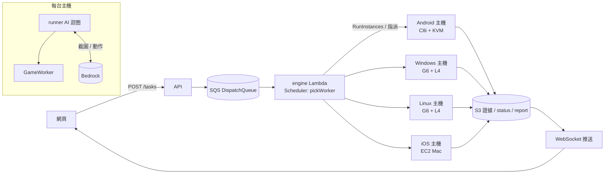

# 多平台測試 Worker(Android 模擬器 / iOS 模擬器 / Windows / Linux)

狀態:**Android(模擬器)與 Windows 已接上平台並端到端驗證**;做法與本文件原先規劃的不同(見下方「0. 最後採用的方案」),保留原規劃做為選項比較。Phase 1 的核心模型程式在 `worker/`。

## 0. 最後採用的方案(2026-10-06 實作)

要放進 aws-samples,所以只用「開源」或「AWS 服務」:

| 執行環境 | 採用 | 關鍵理由 |
|---|---|---|
| Android(模擬器) | **Graviton EC2(m7g.xlarge)+ Redroid 容器**(Apache-2.0) | Google 的 Android Emulator 原始碼開源,但 SDK binary 有授權限制,不適合直接散佈;Redroid 是容器(非 QEMU),所以 guest 架構必須等於宿主,arm64 遊戲就用 Graviton。Fargate 不行(需要 privileged 與 binder)。 |
| Windows | **Amazon GameLift Streams(Windows Server 2022 runtime,NVIDIA GPU)** | 不必自己維護 AMI、GRID 驅動、AutoLogon、DPI;GPU 與互動式桌面由服務提供。 |
| iOS | 維持 **Device Farm 真機** | EC2 Mac 最少計費 24 小時;Simulator 不能裝 `.ipa`。 |

### 選哪一個?(送出任務頁也會顯示同一份說明)

| 你要測的情境 | 選這個 | 一定要先知道的硬限制 |
|---|---|---|
| 網頁 / H5 遊戲 | Web 瀏覽器 | 只有瀏覽器內容,沒有 FPS / 溫度 / 耗電 / 音效 |
| Android,**遊戲會擋模擬器**、要真實 GMS 或行動網路 | Android(Device Farm 真機) | 單次連線 **150 分鐘**(AWS 固定上限) |
| Android 真機,但需要超過 150 分鐘 | Android(Device Farm 真機・長時) | 每 **140 分鐘換一條新連線**,換線時**遊戲會重啟**;測試腳本要能自己回到測試點 |
| Android **長時**(數小時~3 天)或要**大量平行**跑,且遊戲不擋模擬器 | Android(模擬器・Redroid 容器) | 反模擬器檢查會被擋(遊戲自己關掉);**沒有錄影與音效判斷**;不支援雙指縮放 |
| iOS | iOS(Device Farm 真機 / 長時) | 150 分鐘上限;要可安裝的 `.ipa`;錄影沒有聲音 |
| Windows PC 遊戲,**單場 1 小時內**的功能驗證 | Windows(GPU 主機・GameLift Streams) | **單次最長 60 分鐘**;解析度總像素 **≤ 1920×1080**(直式最多 1080×1920,**1080×4096 做不到**);首次啟動 10~15 分鐘 |
| Windows 長時掛機(> 1 小時) | **目前沒有** | 需要先做「保活 client」或改回自管 EC2 G6(見下方 Windows 段落) |
| iOS 模擬器 / Linux | 尚未建置 | iOS 模擬器不建議(EC2 Mac 最少計費 24 小時且不能裝 `.ipa`);Linux 優先度最低 |

一句話版本:**會擋模擬器 → 真機;要跑很久 → Redroid;PC 遊戲 → Windows,但一次只有一小時而且不能超過 1080p。**

兩者都沿用同一份 AI runner(`agent/explorationRunner.mjs`),只換「裝置那一層」:

| 驅動 | 環境變數 | 實作 | 截圖 / 輸入 |
|---|---|---|---|
| `appium` | 預設 | `appiumClient.mjs` | Device Farm 真機(WebDriver) |
| `adb` | `PA_DRIVER=adb` | `adbClient.mjs` | Redroid 容器(主機本機 adb) |
| `windows` | `PA_DRIVER=windows` | `windowsClient.mjs` → `winHost.ps1` → `WinHelper.cs` | GDI 截圖 + SendInput,與遊戲同一個桌面 session |

三種驅動都在主機本機取得截圖、直接以主機身分呼叫 Bedrock,再在本機送出動作;網頁只透過 S3 + WebSocket 看進度。

### Android(Redroid)
- engine `emulator` backend → `emulatorHost.ts` 起 EC2 → `emulator-userdata.sh`:裝 Docker + Redroid(解析度取 `job.json` 的 `display`)→ 安裝 APK → 下載 `_engine/runner/` → 跑 runner(`PA_DRIVER=adb`)→ 寫終態 → `shutdown -h` 自我終止(`InstanceInitiatedShutdownBehavior=terminate`)。
- 沒有 Device Farm 的 150 分鐘上限,最長時數由使用者在送出任務時選(1~72 小時),逾時主機自動關機。
- 限制:`adb` 沒有 `mobile:` 擴充,所以**不錄影也沒有音效判斷**(MediaProjection 錄影是 Appium 的能力);不支援 pinch。
- **有反模擬器檢查的遊戲會被擋**。實測:嘎嘎特攻(`com.mrtgd2.tw.and`)在 Redroid 上自我結束(logcat 出現 `getSerial` 被拒、`pthread_mutex_lock called on a destroyed mutex`);老子有錢(`com.sgt.apk`)可正常遊玩並完成 5 次 SPIN 任務。遇到前者要改用 Device Farm 真機。

### Windows(GameLift Streams)
- `worker/windows-host/gamelift/setup.mjs` 組出應用套件並建立 Application + Stream Group,ID 寫進 SSM;engine 的 `windows` backend(`windowsHost.ts`)用 `StartStreamSession` 開一個 **沒有人連線的 session**(`SignalRequest=NO_CLIENT_CONNECTION`),用 `RoleArn` 帶入 IAM 角色(名稱必須以 `GameLiftStreams-` 開頭)。
- 套件內容:`launcher.bat` → `host.ps1`、`innoextract.exe`(zlib)、`node/node.exe`、`im/magick.exe`(ImageMagick 可攜版,用 innoextract 從官方 static 安裝檔取出)、`runner-deps/node_modules`。
- `host.ps1`:下載 `_engine/runner/` 與遊戲 → Inno Setup 用 innoextract 解開(失敗才退回靜默安裝;`.zip` 直接解壓)→ 挑執行檔(App 識別碼優先,否則最大的 exe)→ 跑 runner → 上傳 log → 結束遊戲(應用結束 = session 結束 = 停止計費)。
- **解析度**:寬高需為偶數,**總像素上限 2,073,600(1920×1080)**,所以直式 1080×1920 可以,**1080×4096 不可能**(API 直接拒絕)。前端送出任務時可選預設或自訂,並在送出前檢核。
- **單次最長約 60 分鐘**:沒有 client 連線的 session 會在 `ConnectionTimeoutSeconds`(上限 3600 秒)到時被終止。實測一個閒置 session 在 3692 秒被以 `connectionTimeout` 終止。若要更長,需要另外跑一個「保活」用的無頭 WebRTC client(Playwright + GameLift Web SDK)定時送極小輸入,或改回自管 EC2 G6。
- 限制:單一滑鼠指標(不支援 pinch);SendInput 是合成事件,有 Raw Input / 反作弊的遊戲可能忽略;GDI 截圖對獨佔全螢幕的 DirectX 遊戲可能是黑畫面(視窗 / 無邊框視窗正常)。

## 1. 原則:沿用現有架構,只換「裝置那一層」

需求文件提出的 Orchestrator → Queue → Scheduler → Worker → AI → S3 → Report,現有平台大部分已經有了,不另起一套:

| 需求 | 現有對應 | 這次的調整 |
|---|---|---|
| Test Orchestrator | API `POST /tasks` → `job.json` | `job.json` 增加 `platform` / `display` / `durationMinutes` / `recording` / `retry`(`worker/src/domain/job.ts` 的 schema) |
| Job Queue | `scheduling-stack.ts` 的 DispatchQueue(SQS)→ dispatcher → engine | 不變 |
| Worker Scheduler | engine 依 backend 起 Fargate / EC2 | engine 改呼叫 `pickWorker()`(容量感知),沒有可用主機才起新主機 |
| Worker | Device Farm runner(Fargate)、Redroid emulator(EC2) | 新增 `GameWorker` 介面與四個實作 |
| AI Agent / VLM / Subagent | `agentTeam.mjs` + runner 迴圈(視覺 → 決策 → 執行,輔助在背景) | 迴圈改成只呼叫 `GameWorker`,不碰 Appium / adb |
| Artifact / Report | `tenants/<t>/jobs/<id>/...` + 報告引擎 | 沿用路徑;新增 `crashes/`、`metrics/`、`videos/` |

**截圖與 Bedrock 的路徑**:runner 跑在 Worker 主機本身(EC2 上的 Node 程序),截圖在本機取得後直接用主機的 IAM Role 呼叫 Bedrock,再在本機執行動作。網頁只透過 S3 + WebSocket 看進度,完全不在這條路上。現有的 Device Farm 與 Web 路徑也不經過網頁;唯一多出來的距離是 Device Farm(us-west-2)到 Fargate runner(us-east-2)。



## 2. 各平台:做法與限制

已查證的項目附出處;標「要 PoC」的,在實機驗證之前不保證。

### Android 模擬器(EC2 C8i + KVM + Android Emulator)
- C8i / M8i / R8i 這類非 metal 機型已經支援 nested virtualization,啟動時加 `CpuOptions.NestedVirtualization=enabled` 就能用 KVM([AWS 文件](https://docs.aws.amazon.com/AWSEC2/latest/UserGuide/amazon-ec2-nested-virtualization.html))。不必用貴的 metal 機型。
- C8i 沒有 GPU,Emulator 用 `swiftshader_indirect` 軟體繪圖。重 3D 遊戲的 FPS 會偏低。G6 是 AMD CPU,不在 nested virtualization 支援清單,所以「GPU 加速的模擬器」目前沒有可靠做法。
- x86_64 映像靠內建的 ARM 轉譯執行 ARM-only 遊戲,少數遊戲不相容。
- **有反模擬器檢查的遊戲會被擋**(先前 Redroid 遇到的 50019999 就是這類)。這種遊戲還是要用 Device Farm 真機。
- `screenrecord` 單段最長 180 秒且不含聲音。Worker 在裝置上連續分段錄,聲音要由主機端從 Emulator 的音訊輸出擷取(Phase 3)。
- 長時間執行(1~72 小時):EC2 沒有 150 分鐘限制。watchdog 每 30 秒呼叫 `checkHealth()`。

### iOS 模擬器(EC2 Mac + Xcode Simulator)
- EC2 Mac 跑在 Dedicated Host 上,**配置後至少要付 24 小時**,而且沒有 Spot。這是成本模型裡的 `minimumBilledHours`。
- **Simulator 不能安裝 App Store / Ad Hoc 的 `.ipa`**,只能跑用 iphonesimulator SDK 編譯的 `.app`,需要遊戲團隊另外提供 Simulator build。
- `xcrun simctl` 能截圖、錄影、裝 App、看 log,但**沒有點擊 / 滑動指令**。操作要透過 XCUITest(Appium XCUITest driver / WebDriverAgent)。
- 聲音只能從 macOS 主機端擷取,Simulator 本身不提供音訊錄製。

### Windows(EC2 G6 + Windows + NVIDIA L4)
- 需要 GRID 驅動([AWS 文件](https://docs.aws.amazon.com/AWSEC2/latest/UserGuide/nvidia-GRID-driver.html))。自製 AMI 必須先 Sysprep。
- **1080×4096 直向(要 PoC)**:規劃的做法是建立 4096×1080 的虛擬顯示模式,再旋轉成直向,讓遊戲真的以 1080×4096 渲染。能不能設定成功要在 G6 上實測。`prepareEnvironment()` 會驗證實際 framebuffer,不符就 `ENVIRONMENT_ERROR`,不會縮放充數。
- 遊戲要在互動式桌面(AutoLogon 的 console session)執行。Windows 服務所在的 Session 0 看不到畫面,也收不到輸入。
- 輸入用 SendInput。部分遊戲(Raw Input / DirectInput / 反作弊)會忽略合成事件,需要虛擬 HID 驅動。
- 錄影用 Desktop Duplication + NVENC 硬體編碼,不吃遊戲的 CPU。
- 目前 `WindowsWorker` 的流程與檢查已完成。碰 OS 的部分(`WindowsHostAgent`)還沒寫,呼叫時會丟 `PlatformNotReadyError`,不會假裝成功。

**PoC 結果(2026-10-06,g6.xlarge + Windows Server 2022 + GRID 596.86,遊戲:滿貫大亨 v1.2.12)**,腳本在 `worker/windows-host/poc/`:

| 項目 | 結果 |
|---|---|
| 靜默安裝(Inno Setup `/VERYSILENT`) | ✅ |
| GRID 驅動(AWS S3 `ec2-windows-nvidia-drivers`) | ✅ 靜默安裝,授權自動 |
| GPU 渲染 | ✅ 必須**停用 EC2 的 Microsoft Basic Display Adapter**,讓 L4 成為主要顯示器;否則 Cocos 跳「OpenGL Error」 |
| 互動式桌面 | ✅ AutoLogon + 排程工作(Interactive)在 console session 執行;Session 0 看不到畫面 |
| 截圖(GDI) | ✅ OpenGL 視窗模式截得到 |
| 點擊(合成滑鼠事件) | ✅ 點「手機登入」會開出登入視窗,點 ✕ 會關閉 |
| 遊戲連線 / 更新 | ✅ 從 us-east-2 連得到遊戲伺服器並完成熱更新,停在登入畫面(第一次啟動要等熱更新,約 2~5 分鐘) |
| 橫向解析度 | ✅ 驅動內建模式 640×480 ~ 7680×4320 都能設定(含 4096×2160) |
| 直向 1080×4096 | ❌ 驅動沒有 4096×1080 / 1080×4096 模式,而且虛擬顯示器**不支援旋轉**(所有方向都回 BAD_MODE) |
| 把遊戲視窗調成 1080×4096 | ❌ 高解析度桌面預設 300% 縮放,視窗被限制高度,Cocos 也沒有跟著重建畫面(黑畫面) |

直向機台解析度的下一步(要再 PoC):① 用 NVAPI 加自訂解析度(`NvAPI_DISP_TryCustomDisplay`)或 EDID override;② 桌面固定 100% 縮放後,用遊戲本身的啟動參數 / 設定檔指定視窗大小。兩個都不行時,1080×4096 在 G6 上無法保證,要回報 `ENVIRONMENT_ERROR`。

### Linux(EC2 G6 + Ubuntu + NVIDIA + Xorg)
- Xorg 搭配 NVIDIA 驅動與自訂 Modeline(`AllowEmptyInitialConfiguration`)可以建立 1080×4096 這類任意解析度,支援 OpenGL / Vulkan 的 GPU 渲染。不用純 Xvfb。
- 輸入用 xdotool / uinput,錄影用 ffmpeg x11grab + `h264_nvenc`,聲音用 PulseAudio null sink。
- 能做,但 Slot / Casino 很少有 Linux 版。建議等 Windows 穩定後再做。

### Device Farm 真機
維持現狀(單次連線最長 150 分鐘)。需要真實 GMS、真實網路,或遊戲會擋模擬器時,選這個。

## 3. 程式結構

```
worker/                       新的 TypeScript workspace(strict、Zod、vitest)
  src/domain/
    job.ts                    Job 設定 schema(平台 × 產物種類、解析度、時長、錄影、重試)
    display.ts                解析度清單、framebuffer 驗證
    action.ts                 AI 動作 schema(tap / doubleTap / longPress / swipe / drag / keyboard / hotkey / wait …)
    coordinates.ts            模型空間 ↔ 裝置空間轉換
    stateMachine.ts           Job / Worker 狀態機 + 對應既有 status.json
    artifact.ts               S3 路徑(沿用既有)、失敗證據
    metrics.ts                效能取樣、健康訊號
    retry.ts                  action / app / worker 三種重試預算
    cost.ts                   每場 / 每分鐘 / 共用主機 / Mac 最低計費 / Spot 差額
    log.ts                    structured JSON log
  src/worker/
    GameWorker.ts             共用介面(Orchestrator 只依賴它)
    commandRunner.ts          execFile + timeout + AbortSignal,不經 shell
    android/AndroidEmulatorWorker.ts
    windows/WindowsWorker.ts  流程完成;OS helper 介面待實作
  src/scheduler/Scheduler.ts  容量感知選機(Spot 優先、bin packing、擴容判斷)
  test/                       30 個單元測試
```

既有的 `agent/*.mjs` runner 先不動。Phase 2 會把 AI 迴圈抽出來改成只呼叫 `GameWorker`,Device Farm 也包成一個 `GameWorker`(Appium),四個平台加上真機共用同一個迴圈。

## 4. MVP 開發順序(Android + Windows)

1. ~~核心模型、狀態機、Action / Artifact / Metrics schema、Scheduler、Android Worker、Windows 骨架~~(Phase 1,完成)
2. **Android 主機 AMI**:Ubuntu + Android SDK / Emulator + AVD(API 34 x86_64),用 EC2 Image Builder(IaC)建置;engine 的 `emulator` backend 改起 C8i(nested virtualization)。
3. **AI 迴圈抽離**:runner 改用 `GameWorker`,第一個接上 `AndroidEmulatorWorker`,端到端跑通「送出 → 開機 → 安裝 → 截圖 → Bedrock → 點擊 → 證據 → 報告」。
4. **Watchdog / 錄影 / 指標**:30 秒健康檢查 → 失敗先收證據再依重試預算決定是否重開;移植 `perfMonitor.mjs` 的 FPS(SurfaceFlinger timestats)。
5. **Windows PoC(先驗證限制)**:在 G6 上確認 1080×4096 直向、SendInput 對目標遊戲有效、NVENC 錄影。驗證通過才寫 `WindowsHostAgent`。
6. **Windows AMI + engine 接上**(AutoLogon、GRID 驅動、helper 服務)。
7. Spot 中斷處理(2 分鐘通知 → 收證據 → `RETRYING`)。
8. Linux、iOS 依需求排入。

## 5. 待決定

- Windows helper 用什麼語言:建議 C#(.NET 8,直接呼叫 SendInput / DXGI,單一執行檔),Node runner 透過本機 HTTP 呼叫。
- iOS:遊戲團隊能不能提供 Simulator build?不能的話,iOS 只能留在 Device Farm 真機。
- 要先測的 Windows 遊戲是哪一款(需要 build 做 PoC)。
