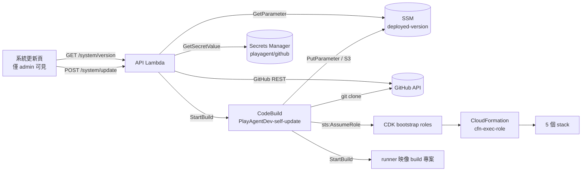

# 系統更新(管理員一鍵從 GitHub 更新)

狀態:已實作並部署。管理員在「系統更新」頁可以看到目前部署的版本、GitHub 上的最新版本、落後的 commit,按一顆按鈕就把整個平台更新到該版本。

## 1. 為什麼是這個做法

「一鍵更新」實際要動的東西不只前端:

| 要更新的東西 | 怎麼更新 |
|---|---|
| 前端靜態站(S3 + CloudFront) | `cdk deploy` 的 BucketDeployment,順便做 CloudFront 失效 |
| 4 個 Lambda(api / engine / dispatcher / ws) | `cdk deploy` |
| 兩個 runner 容器映像(ECR) | 只有 `agent/` 有變更時才重建(docker build 慢) |
| `_engine/runner/` 的 S3 資產(Redroid / Windows 主機下載的 runner) | `cdk deploy` 的 BucketDeployment |
| IAM / VPC / ECS / Cognito 等資源 | `cdk deploy`(CloudFormation) |

所以更新 = 跑一次 `cdk deploy`。能跑 `cdk deploy` 的執行環境要有 Node、倉庫原始碼與 AWS 憑證,因此用 CodeBuild 承載,API 只負責驗證與觸發。

## 2. 組成

- `infra/lib/updater-stack.ts` —— CodeBuild 專案與它的角色。**獨立 stack**,且不在自己的部署清單裡:更新時不會改到正在執行更新的資源。改了這支要人工 `cdk deploy PlayAgentDev-Updater`。
- `infra/lambda/api/systemUpdate.ts` —— 純邏輯(版本解析、落後比對、觸發前檢查),用 ports 介面注入 AWS,所以能單元測試(`infra/test/system-update.test.ts`,20 個測試)。
- `infra/lambda/api/systemUpdatePorts.ts` —— 真實的 AWS 實作。
- `web/src/pages/SystemUpdatePage.tsx` —— 管理頁。

buildspec 刻意**寫在 CDK 裡而不是放進倉庫**:更新器要能部署任意版本,如果流程腳本在倉庫內,回滾到舊版本就會跑到舊的流程腳本(或根本還沒有那個檔案)。

## 3. 更新流程

1. 用 Secrets Manager 的 token clone 倉庫,checkout 指定版本
2. `npm ci`
3. 跑測試當閘門 —— **不過就不部署**
4. `npm run build:web`
5. `cdk deploy` 五個 stack(Foundation / Execution / Scheduling / ControlPlane / Frontend)
6. 只有 `agent/` 相對上一版有變更時,才重建兩個 runner 映像
7. 無論成敗都寫一筆歷史到 `s3://<data-bucket>/_system/update-history.json`(最近 50 筆);**只有成功才更新** SSM 的 `deployed-version`

## 4. 版本來源

優先序:GitHub **latest release** → 最新 **tag** → 預設分支最新 **commit**。本專案目前沒有 release 也沒有 tag,所以會顯示 `main` 的最新 commit,頁面上標為「分支最新 commit」。開始打 tag 之後會自動改用 tag,不需要改程式。

一鍵安裝器(`scripts/deploy-latest.mjs`)從 git checkout 部署時會把真正的 commit 寫進 `deployed-version` 的 `sha`;從 ZIP(沒有 `.git`)部署時不寫 `sha`,所以頁面會顯示「還沒有更新紀錄」,直到第一次從頁面更新為止。

## 5. 安全邊界

**必須先理解的事:這顆按鈕最終會以 AdministratorAccess 改動整個 AWS 帳號。** 能部署 CloudFormation 就能改 IAM,這一點無法用技術消除,只能限制誰按得到、留下紀錄、縮小其他環節的權限。

已經做的:

- **只有 admin**:`requireAdmin` 檢查 JWT 的 `cognito:groups` 含 `admins`。前端隱藏導覽只是方便,真正的門在後端。
- **更新器角色自己沒有部署權**:它只能 `sts:AssumeRole` 到 `cdk-hnb659fds-{deploy,file-publishing,image-publishing,lookup}`,高權限留在 CloudFormation 的 `cfn-exec-role`。已驗證該角色沒有掛任何受管政策,也沒有 `cloudformation:*` / `iam:Create*` / `lambda:*`。
- **版本字串不進 shell**:`ref` 只接受 `^[A-Za-z0-9][A-Za-z0-9._/-]{0,99}$` 且不含 `..`,並且必須真的存在於該倉庫才會被當成 CodeBuild 環境變數傳下去。`main; rm -rf /` 這類字串在呼叫 GitHub 之前就被擋掉。
- **token 不外流**:存在 Secrets Manager,永不回傳瀏覽器;buildspec 把它寫進 `~/.git-credentials`(0600)後立刻刪除,不放在指令列,所以不會出現在 CodeBuild log。
- **二次確認**:要在輸入框打出目標版本字串才能按下「確認更新」。
- **互斥**:同時只允許一個更新進行。
- **有任務在跑時先擋一次**:要再確認才會繼續(這個數字只算 Fargate task 與帶 `playagent:jobId` 的 EC2,是下限不是精確值)。
- **審計**:每次更新記錄誰、何時、哪個版本、結果、buildId。
- **IAM 精確 scope**:API 的 codebuild 權限只到那一個專案、logs 只到那一個固定 log group、SSM 只到那一個參數、Secrets 只到 `playagent/github-*`、S3 只到 `_system/*`。

要再嚴一級的選項(尚未做):把更新器放到另一個 AWS 帳號,或改成 CodePipeline 加人工核准關卡。

## 6. 已知限制

- **單次最長 90 分鐘**(CodeBuild timeout)。正常一次約 10~15 分鐘;需要重建 runner 映像時會多幾分鐘。
- **測試閘門目前只跑 web 與 worker**。`npm run test:infra` 有兩個與本功能無關的既有失敗(`app-credentials`、`emulatorCoordTransform`,後者是測試檔 import 舊的 `emulatorRunner.mjs` 導致 parse error),放進閘門會讓每次更新都被擋下。修好那兩個之後應該把它加回來。
- **不包含兩樣東西**:更新器自己(`PlayAgentDev-Updater`),以及 Windows 主機的 GameLift 應用套件(`worker/windows-host/gamelift/setup.mjs`,需要建 S3 桶與 GameLift 應用,權限過大)。這兩個維持人工部署。
- **回滾方式是「更新到舊版本」**:在輸入框打舊的 tag 或 commit sha 即可。單一 stack 部署失敗時 CloudFormation 會自行回滾,但如果前面的 stack 成功、後面的失敗,已成功的不會被還原 —— 這時要手動更新回上一版。
- **更新期間 API 會有數秒鐘的新舊版本混用**(Lambda 版本切換是逐一的),CloudFront 失效約 1~3 分鐘。對執行中的測試沒有影響,因為 runner 跑在自己的主機上。
- **GitHub API 速率限制**:用 token 時每小時 5000 次,管理頁每次開啟約 3 次呼叫,實務上碰不到。

## 7. 設定方式

1. 建一組 GitHub **fine-grained** personal access token,只勾選這個倉庫的 `Contents: Read-only` 與 `Metadata: Read-only`。
2. 在「系統更新」頁的 token 欄位貼上並儲存(寫進 Secrets Manager `playagent/github`)。
3. 按「重新檢查」,就會看到 GitHub 上的最新版本。
4. 第一次更新會把 `deployed-version` 登記起來;在那之前頁面會顯示「還沒有更新紀錄」。

倉庫位置可用 CDK context 覆寫:`cdk deploy -c githubRepo=owner/name`。
